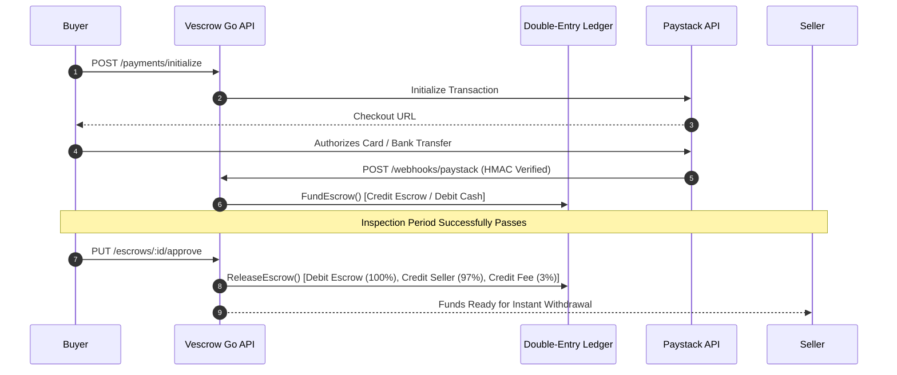

# Vescrow — Financial Escrow, Double-Entry Ledger & Compliance Engine (`/QSD`)

[](#overview)
[%20%7C%20PostgreSQL%2015%20%7C%20Redis%207%20%7C%20Next.js-navy.svg)](#technology-stack--data-architecture)
[](#regulatory-compliance)

This domain houses the complete production architecture, financial math invariants, database schemas, API specifications, and regulatory frameworks for **Vescrow**, a licensed financial escrow and digital payments platform designed for high-trust commercial transactions.

---

## Overview

Vescrow is architected around a domain-driven **Modular Monolith** in Go (Fiber), backed by an immutable double-entry ledger that guarantees mathematical conservation of funds across all user accounts, escrow balances, and platform revenue pools.

```
QSD/
├── README.md                                    # Master platform documentation & index (this file)
│
├── architecture.md                              # Go Modular Monolith system architecture & worker loops
├── double-entry-ledger-explained.md             # Immutable ledger mathematical invariants (debits = credits)
├── database-schema.md                           # PostgreSQL 15 schema, foreign keys, indexes & audit tables
├── api-specification.md                         # Complete REST API specifications & request/response DTOs
├── security-architecture.md                     # 7-layer defense system (JWT RS256, AES-256-GCM, HMAC)
├── nigerian-compliance.md                       # Central Bank of Nigeria (CBN) AML/CFT & KYC requirements
├── state-machine-and-transaction-flow.md        # Deterministic escrow state transitions & outbox events
├── deployment-guide.md                          # Docker containerization, CI/CD & production DevOps
│
├── backend-implementation-tasks.md              # Phase-by-phase backend implementation roadmap (112 tasks)
├── frontend-implementation-plan.md              # Next.js 14 frontend architecture & Zustand store models
├── admin-portal-implementation-plan.md          # Backoffice admin dashboard & dispute arbitration portal
├── escrow-chat-activity-log-plan.md             # Real-time WebSocket chat & immutable audit timeline
│
├── swagger.json / swagger.yaml / docs.go        # OpenAPI / Swagger specification and Go bindings
│
├── security/                                    # Operational Security & Runbooks
│   ├── README.md                                # Security index, SLAs & defensive layers
│   ├── runbooks.md                              # Incident response runbooks (Ledger imbalance, outages)
│   ├── key-rotation.md                          # Zero-downtime key rotation (RS256, AES-256, DB credentials)
│   ├── soc2-checklist.md                        # SOC 2 Type II trust services criteria & audit evidence
│   └── pen-test-scope.md                        # Penetration testing boundaries & rules of engagement
│
├── test/                                        # QA Acceptance & Verification Test Guides
│   ├── README.md                                # Testing overview & sequence diagrams
│   ├── end-to-end-application-test-guide.md     # Full buyer-seller-admin lifecycle testing
│   ├── new-workflow-backend-manual-test.md      # Direct disbursement model verification
│   ├── payment-manual-test-guide.md             # Paystack webhook simulation & HMAC signature checks
│   ├── wallet-swagger-test-guide.md             # Swagger UI testing for ledger & deposit endpoints
│   ├── phase5-escrow-manual-test.md             # Escrow creation, inspection and approval QA
│   └── phase8-dispute-manual-test.md            # Dispute handling, arbiter intervention & payout split QA
│
├── v2/                                          # Version 2 Architecture Simplification
│   ├── README.md                                # V2 overview, fund-on-create & state machine diffs
│   ├── 00-architecture-overview.md              # V2 system architecture & file impact matrix
│   ├── 01-phase1-escrow-flow-redesign.md        # Fund-on-create escrow lifecycle redesign
│   ├── 02-phase2-rating-penalty.md              # Buyer inspection timeout rating penalty engine
│   ├── 03-phase3-wallet-to-ledger.md            # Frontend rename of "Wallet" to "Ledger"
│   ├── 04-phase4-escrow-guidelines.md           # Regulatory guidelines & consent acceptance
│   ├── 05-phase5-theme-removal-sidebar-cleanup.md # UI simplification & navigation cleanup
│   └── 06-implementation-plan.md                # V2 implementation tasks & phase dependencies
│
└── v3/                                          # Version 3 AI Mediation & Multi-Sig Dispute Resolution
    ├── README.md                                # V3 overview, carrier integrations & multi-sig
    ├── 00-architecture.md                       # Master V3 dispute resolution architecture
    ├── 00-decision-review.md                    # Architectural Decision Records (ADRs)
    ├── 01-phase1-bounded-enforcement.md         # Immutable dispute locking & Ed25519 proof verifier
    ├── 02-phase2-intake-and-privacy-first-ledger.md # Merkle tree fingerprints & blind masking
    ├── 03-phase3-system-assistance-and-evidence-auth.md # Logistics carrier APIs (DHL, GIG)
    ├── 04-phase4-ai-assisted-mediation-sandbox.md # Mediation state machine & Pareto settlement offers
    ├── 05-phase5-escalation-and-human-arbitration.md # Arbiter blind workspace & WebCrypto signing
    ├── 06-phase6-automated-settlement-and-hardening.md # Settlement execution workers & test harness
    └── 07-implementation-plan.md                # V3 master execution roadmap
```

---

## Master Document Matrix

| Category | Document | Scope / Core Focus |
| :--- | :--- | :--- |
| **System Architecture** | [architecture.md](./architecture.md) | Go Fiber Modular Monolith, domain boundaries, worker loops, outbox pattern |
| **Financial Engineering** | [double-entry-ledger-explained.md](./double-entry-ledger-explained.md) | Mathematical invariant: $\sum \text{Debits} = \sum \text{Credits}$, chart of accounts |
| **Data Architecture** | [database-schema.md](./database-schema.md) | 25+ PostgreSQL tables, foreign key constraints, composite indexing, audit logs |
| **API Specification** | [api-specification.md](./api-specification.md) | Complete endpoints for Auth, Escrow, Ledger, Payouts, Webhooks, Disputes |
| **Security Design** | [security-architecture.md](./security-architecture.md) | 7-layer defense system (JWT RS256, Argon2id, AES-256-GCM, HMAC signatures) |
| **Regulatory** | [nigerian-compliance.md](./nigerian-compliance.md) | Central Bank of Nigeria AML/CFT, Tiered KYC (BVN/NIN), PEP screening |
| **Flow Logic** | [state-machine-and-transaction-flow.md](./state-machine-and-transaction-flow.md) | Deterministic escrow state transitions & transactional outbox event lifecycle |
| **DevOps & Infra** | [deployment-guide.md](./deployment-guide.md) | Docker multi-stage builds, environment configs, monitoring & CI/CD pipeline |
| **Backend Roadmap** | [backend-implementation-tasks.md](./backend-implementation-tasks.md) | 112 development tasks across 19 phases with validation criteria |
| **Frontend Roadmap** | [frontend-implementation-plan.md](./frontend-implementation-plan.md) | Next.js 14 App Router, Zustand cookie stores, component architecture |
| **Admin Roadmap** | [admin-portal-implementation-plan.md](./admin-portal-implementation-plan.md) | Backoffice admin portal, manual KYC review, ledger balance inspection |
| **Activity Audit** | [escrow-chat-activity-log-plan.md](./escrow-chat-activity-log-plan.md) | WebSocket chat, immutable audit timeline, attachment handling |
| **OpenAPI Contract** | [swagger.json](./swagger.json) / [swagger.yaml](./swagger.yaml) | Standard OpenAPI 3.0 specifications for frontend and partner integration |
| **Security Subsystem** | [security/README.md](./security/README.md) | Key rotation, SOC 2 Type II checklist, penetration testing scope, runbooks |
| **QA Subsystem** | [test/README.md](./test/README.md) | Manual test guides, Swagger verification, Paystack payment simulations |
| **Version 2 Overhaul** | [v2/README.md](./v2/README.md) | Architecture simplification, fund-on-create, wallet-to-ledger migration |
| **Version 3 Overhaul** | [v3/README.md](./v3/README.md) | AI mediation sandbox, carrier evidence verification, Ed25519 multi-sig arbitration |

---

## Double-Entry Ledger Principles

Every financial movement in Vescrow is backed by a balanced journal entry:

$$\sum_{i=1}^n \text{Debit}_i = \sum_{j=1}^m \text{Credit}_j$$


