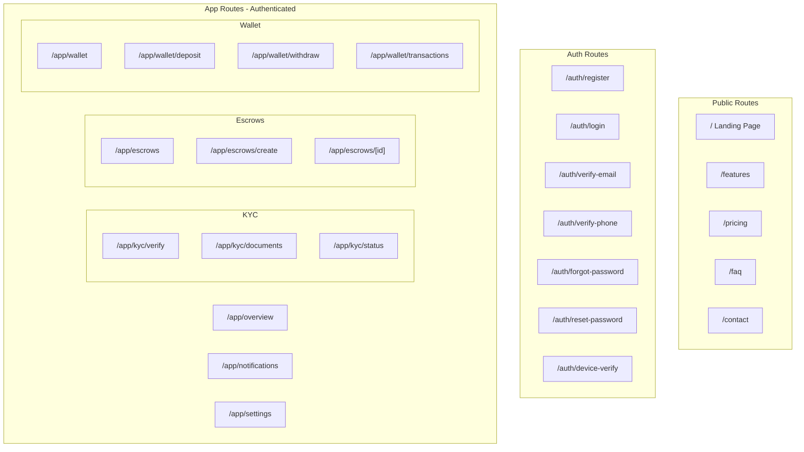

# Vescrow Frontend — Implementation Plan

**Task ID**: `VESC-FE-2026-001`  
**Created**: 2026-08-16  
**Status**: Draft — Awaiting Approval  
**Framework**: Next.js 14+ (App Router)  
**State Management**: Zustand (cookie-persisted, no localStorage)  
**Backend**: Mock data layer (no real API calls)

---

## User Review Required

> [!IMPORTANT]
> This plan creates a **frontend-only prototype** with mock data. No real backend calls. All state is managed via Zustand stores persisted to cookies. Please confirm this is the intended scope before execution begins.

> [!WARNING]
> The plan is structured in 8 phases with ~39 individual tasks. Estimated total effort is significant. If you'd like a reduced MVP scope (e.g., only public + auth + dashboard + escrow list/detail), please indicate.

## Open Questions

1. **Authentication mock behavior**: Should the OTP verification screens actually accept any 6-digit code and proceed, or should they validate against a hardcoded value (e.g., `123456`)?
2. **Currency display**: Should amounts always display in Naira with kobo precision (e.g., ₦3,500.00) or should we round to whole Naira?
3. **Dark mode**: The Finorio template supports dark mode. Should Vescrow support both light and dark modes, or light-only to match the mobile app's white/light-gray aesthetic?
4. **Notifications**: Should the notification system be functional (with mock data list) or just a bell icon with a badge count?

---

## Architecture Overview



---

## Phase 1: Project Foundation

### VESC-FE-101 — Next.js Project Scaffolding

**Files**: Root project configuration  
**Description**: Initialize Next.js 14+ project with App Router, TypeScript, ESLint, and required dependencies.

**Dependencies to install**:
- `zustand` — State management
- `js-cookie` — Cookie read/write (Zustand persistence)
- `lucide-react` — Icon library (consistent line icons)
- `clsx` — Conditional className utility
- `date-fns` — Date formatting
- `react-hot-toast` — Toast notifications
- `framer-motion` — Animations and transitions

**Validation**:
- [ ] `npm run dev` starts without errors
- [ ] TypeScript compilation passes
- [ ] App Router directory structure exists under `/app`

---

### VESC-FE-102 — Project Directory Structure

**Description**: Set up the canonical folder structure.

```
src/
├── app/
│   ├── (public)/           # Public marketing pages
│   │   ├── page.tsx        # Landing
│   │   ├── features/
│   │   ├── pricing/
│   │   ├── faq/
│   │   └── contact/
│   ├── auth/               # Auth flow pages
│   │   ├── login/
│   │   ├── register/
│   │   ├── verify-email/
│   │   ├── verify-phone/
│   │   ├── forgot-password/
│   │   └── reset-password/
│   ├── app/                # Authenticated app
│   │   ├── layout.tsx      # App shell (sidebar + topbar)
│   │   ├── overview/
│   │   ├── kyc/
│   │   ├── escrows/
│   │   ├── wallet/
│   │   ├── notifications/
│   │   └── settings/
│   ├── layout.tsx          # Root layout
│   └── globals.css         # Global styles + design tokens
├── components/
│   ├── ui/                 # Primitives (Button, Input, Card, Modal, Badge)
│   ├── layout/             # PublicNavbar, AppSidebar, AppTopbar, Footer
│   ├── landing/            # Hero, Features, Pricing, CTA sections
│   ├── auth/               # OTPInput, AuthCard
│   ├── escrow/             # EscrowCard, Timeline, MilestoneTracker, CreateForm
│   ├── wallet/             # BalanceCard, TransactionRow, WithdrawForm
│   ├── kyc/                # BVNForm, DocumentUpload, TierBadge
│   └── shared/             # EmptyState, LoadingSkeleton, StatusBadge
├── lib/
│   ├── mock/               # Mock data and services
│   │   ├── users.ts
│   │   ├── escrows.ts
│   │   ├── wallet.ts
│   │   ├── kyc.ts
│   │   ├── disputes.ts
│   │   └── notifications.ts
│   ├── utils.ts            # formatCurrency, formatDate, cn()
│   ├── constants.ts        # Status enums, colors, routes
│   └── types.ts            # TypeScript interfaces from API spec
├── stores/
│   ├── auth-store.ts       # User session, tokens
│   ├── escrow-store.ts     # Escrow CRUD state
│   ├── wallet-store.ts     # Wallet balance, transactions
│   ├── kyc-store.ts        # KYC verification state
│   └── notification-store.ts
└── hooks/
    ├── use-auth.ts
    └── use-cookie-store.ts # Custom Zustand persist middleware for cookies
```

**Validation**:
- [ ] All directories exist
- [ ] No TypeScript path alias errors

---

### VESC-FE-103 — TypeScript Type Definitions

#### [NEW] [types.ts](file:///Users/oluwatobiloba/Desktop/qsd/vescrow_frontend/src/lib/types.ts)

**Description**: Define all TypeScript interfaces matching the backend API spec.

Key types:
- `User` — id, name, email, phone, role, kyc_status, kyc_tier, email_verified, phone_verified
- `Escrow` — All 13 status values, milestones, buyer/seller refs, amounts in kobo
- `EscrowMilestone` — sequence_order, status, amount_kobo
- `Wallet` — balance_kobo, currency, is_frozen, wallet_type
- `LedgerEntry` — entry_type (debit/credit), category, amount_kobo, balance_after_kobo, reference
- `Withdrawal` — bank_code, account_number, status, amount_kobo
- `Dispute` — reason, status (open/seller_responded/under_review/resolved), resolution types
- `DisputeEvidence`, `DisputeComment`
- `KYCDocument` — document_type, status, verified_at
- `Notification` — type, title, body, read, created_at
- `ApiResponse<T>`, `PaginatedResponse<T>`, `Meta`

**Validation**:
- [ ] All types compile without errors
- [ ] Types match API spec field names exactly

---

### VESC-FE-104 — Zustand Stores with Cookie Persistence

#### [NEW] [use-cookie-store.ts](file:///Users/oluwatobiloba/Desktop/qsd/vescrow_frontend/src/hooks/use-cookie-store.ts)

Custom Zustand persistence middleware that reads/writes to `js-cookie` instead of localStorage.

#### [NEW] Auth Store — [auth-store.ts](file:///Users/oluwatobiloba/Desktop/qsd/vescrow_frontend/src/stores/auth-store.ts)

State: `user`, `accessToken`, `isAuthenticated`, `isLoading`  
Actions: `login()`, `register()`, `logout()`, `verifyEmail()`, `verifyPhone()`, `updateProfile()`

#### [NEW] Escrow Store — [escrow-store.ts](file:///Users/oluwatobiloba/Desktop/qsd/vescrow_frontend/src/stores/escrow-store.ts)

State: `escrows[]`, `currentEscrow`, `filters`, `pagination`  
Actions: `createEscrow()`, `submitTerms()`, `acceptTerms()`, `rejectTerms()`, `fundEscrow()`, `markDelivered()`, `approveDelivery()`, `openDispute()`

#### [NEW] Wallet Store — [wallet-store.ts](file:///Users/oluwatobiloba/Desktop/qsd/vescrow_frontend/src/stores/wallet-store.ts)

State: `wallet`, `transactions[]`, `withdrawals[]`  
Actions: `getBalance()`, `getTransactions()`, `withdraw()`, `verifyAccount()`

#### [NEW] KYC Store — [kyc-store.ts](file:///Users/oluwatobiloba/Desktop/qsd/vescrow_frontend/src/stores/kyc-store.ts)

State: `kycStatus`, `kycTier`, `documents[]`, `bvnLinked`, `ninLinked`  
Actions: `verifyBVN()`, `verifyNIN()`, `submitDocument()`, `getStatus()`

#### [NEW] Notification Store — [notification-store.ts](file:///Users/oluwatobiloba/Desktop/qsd/vescrow_frontend/src/stores/notification-store.ts)

State: `notifications[]`, `unreadCount`  
Actions: `markRead()`, `markAllRead()`

**Validation**:
- [ ] All stores persist to cookies on state change
- [ ] Cookie data survives page refresh
- [ ] Stores initialize correctly from empty cookies (first visit)

---

### VESC-FE-105 — Mock Data Layer

#### [NEW] [mock/](file:///Users/oluwatobiloba/Desktop/qsd/vescrow_frontend/src/lib/mock/)

Rich seed data simulating realistic Nigerian escrow transactions:

- **Users**: 3 mock users (Oluwaseun Adebayo — buyer, Tech Merchants Ltd — seller, Admin)
- **Escrows**: 8 escrows across different statuses (draft, pending_acceptance, funded, delivered, completed, disputed, refunded, expired)
- **Milestones**: 2-3 per escrow with varied statuses
- **Wallet**: N339,500.00 seller balance, transaction history with 10+ ledger entries
- **KYC**: Tier 1 verified user, with BVN linked, pending document
- **Disputes**: 1 active dispute with evidence + comments
- **Notifications**: 12 mock notifications
- **Messages**: 5 in-escrow chat messages

Mock service functions simulate API delays (300-800ms) and return typed `ApiResponse<T>` objects.

**Validation**:
- [ ] All mock data matches TypeScript types
- [ ] Mock services return realistic data shapes matching API spec
- [ ] Amounts are in kobo (integers), not naira floats

---

## Phase 2: Design System

### VESC-FE-201 — Global CSS and Design Tokens

#### [MODIFY] [globals.css](file:///Users/oluwatobiloba/Desktop/qsd/vescrow_frontend/src/app/globals.css)

Comprehensive CSS custom properties:

**Color palette** (Finorio-inspired + Vescrow mobile):
- **Primary**: Deep Navy `#0A1428` with lighter variants
- **Success**: Emerald Green `#10B981`
- **Warning**: Amber `#F59E0B`
- **Danger**: Red `#EF4444`
- **Neutrals**: White `#FFFFFF`, Light Gray `#F5F5F5`, borders `#E5E7EB`
- **Gradients**: Primary gradient, hero gradient, glass card gradient
- **Typography**: Inter font, bold headers, regular body, small muted secondary
- **Shadows**: 4-level shadow scale (sm, md, lg, xl) + glass shadow
- **Spacing**: Consistent radius scale (sm/md/lg/xl/full)

**Validation**:
- [ ] All CSS variables render correctly
- [ ] Inter font loads from Google Fonts
- [ ] No FOUC (flash of unstyled content)

---

### VESC-FE-202 — UI Primitives

#### [NEW] Components in `src/components/ui/`:

| Component | File | Description |
|-----------|------|-------------|
| `Button` | `button.tsx` | Primary, secondary, outline, danger, ghost variants. Loading state. Sizes: sm, md, lg |
| `Input` | `input.tsx` | Text, email, password, phone with label, error state, helper text, icons |
| `Card` | `card.tsx` | Elevated card with optional header/footer. Glass variant |
| `Badge` | `badge.tsx` | Status badge for all 13 escrow statuses + KYC tiers |
| `Modal` | `modal.tsx` | Accessible dialog with backdrop, close, focus trap |
| `Select` | `select.tsx` | Custom dropdown |
| `Tabs` | `tabs.tsx` | Horizontal tabs with animated indicator |
| `Avatar` | `avatar.tsx` | User avatar with fallback initials |
| `Skeleton` | `skeleton.tsx` | Loading placeholder with shimmer |
| `Toast` | `toast.tsx` | Wrapper around react-hot-toast |
| `EmptyState` | `empty-state.tsx` | Illustration + message + CTA |
| `DataTable` | `data-table.tsx` | Sortable, filterable table with pagination |
| `OTPInput` | `otp-input.tsx` | 6-digit OTP input with auto-focus |
| `FileUpload` | `file-upload.tsx` | Drag and drop with preview |
| `ProgressBar` | `progress-bar.tsx` | Animated progress |
| `Dropdown` | `dropdown.tsx` | Contextual menu |
| `Tooltip` | `tooltip.tsx` | Hover tooltip |

**Validation**:
- [ ] All components render without errors
- [ ] Loading/disabled/error states work
- [ ] Keyboard accessible (Tab, Enter, Escape)

---

## Phase 3: Public Pages

### VESC-FE-301 — Public Layout and Navbar

#### [NEW] [PublicNavbar](file:///Users/oluwatobiloba/Desktop/qsd/vescrow_frontend/src/components/layout/public-navbar.tsx)

Sticky navbar with glassmorphism scroll effect, mobile hamburger drawer, Vescrow logo, nav links, Login + Get Started buttons.

#### [NEW] [Footer](file:///Users/oluwatobiloba/Desktop/qsd/vescrow_frontend/src/components/layout/footer.tsx)

4-column footer: Product, Company, Legal, Connect. Social links, newsletter signup, copyright.

**Validation**:
- [ ] Navbar responsive (mobile hamburger at < 768px)
- [ ] Scroll behavior (transparent to solid)
- [ ] All nav links point to correct routes

---

### VESC-FE-302 — Landing Page

Premium landing page sections:

1. **Hero**: Bold headline, subtext, dual CTA buttons, floating transaction cards
2. **Trust Bar**: Partner logos
3. **How It Works**: 4-step animated flow (Create, Fund, Deliver, Release)
4. **Features Grid**: 6 feature cards with icons
5. **Stats Section**: Animated counters (N2.5B+ Secured, 15K+ Transactions, 99.9% Resolution)
6. **Testimonials**: Carousel
7. **CTA Banner**: Gradient signup prompt
8. **Footer**

**Validation**:
- [ ] No layout shift above the fold
- [ ] Smooth animations (60fps)
- [ ] Responsive at 375px, 768px, 1024px, 1440px
- [ ] All CTAs link to `/auth/register`

---

### VESC-FE-303 — Features Page

Full-page feature breakdown with deep-dives on each capability.

### VESC-FE-304 — Pricing Page

Three pricing tiers (Starter/Business/Enterprise) with comparison table and FAQ.

### VESC-FE-305 — FAQ Page

Accordion-style FAQ with categories: General, Payments, Security, Disputes.

### VESC-FE-306 — Contact Page

Contact form + company info.

**Phase 3 Validation**:
- [ ] All 5 public pages render
- [ ] Navigation between pages works
- [ ] SEO meta tags on all pages
- [ ] Responsive verified

---

## Phase 4: Auth Pages

### VESC-FE-401 — Auth Layout

Split screen: form left, illustration right (desktop). Full-width form (mobile).

### VESC-FE-402 — Register Page

Fields: Full name, Email, Phone (+234), Password, Confirm Password. Real-time validation, password strength.

### VESC-FE-403 — Login Page

Fields: Email, Password, Remember me. Forgot password link.

### VESC-FE-404 — Verify Email (OTP)

6-digit OTP, resend timer (60s), email masking.

### VESC-FE-405 — Verify Phone (OTP)

Same as email but for phone.

### VESC-FE-406 — Forgot Password

Email input with success illustration.

### VESC-FE-407 — Reset Password

New password + confirm with strength indicator.

**Phase 4 Validation**:
- [ ] Auth forms validate inputs
- [ ] OTP auto-advances between digits
- [ ] Auth state persists in cookies
- [ ] Redirect to `/app/overview` after login
- [ ] Route guard redirects unauthenticated users

---

## Phase 5: App Shell

### VESC-FE-501 — App Layout (Sidebar + Topbar)

#### [NEW] [AppSidebar](file:///Users/oluwatobiloba/Desktop/qsd/vescrow_frontend/src/components/layout/app-sidebar.tsx)

Collapsible sidebar: logo, nav items (Overview, Escrows, Wallet, KYC, Notifications, Settings), active indicator, user info with KYC badge, mobile drawer.

#### [NEW] [AppTopbar](file:///Users/oluwatobiloba/Desktop/qsd/vescrow_frontend/src/components/layout/app-topbar.tsx)

Dynamic page title, search, notification bell with badge, user dropdown.

Route guard middleware to protect `/app/*` routes.

**Validation**:
- [ ] Sidebar collapse/expand smooth
- [ ] Active route indicated
- [ ] Mobile drawer works
- [ ] Route guard functional

---

### VESC-FE-502 — Overview Dashboard

Cards: Total Escrows, Active Escrows, Wallet Balance, Pending Actions.  
Recent Escrows table, Quick Actions, Activity Timeline, Mini transaction chart.

**Validation**:
- [ ] Dashboard loads with mock data
- [ ] Amounts formatted correctly (kobo to naira)
- [ ] Quick actions navigate correctly
- [ ] Responsive grid

---

## Phase 6: Core Features

### VESC-FE-601 — Escrow List Page

Tab filters (All/Buyer/Seller), status filter, search, escrow cards with status badges, pagination, empty state.

### VESC-FE-602 — Create Escrow Page

4-step form: Details, Milestones, Terms, Confirm. Live fee calculation (3%). Milestone sum validation.

### VESC-FE-603 — Escrow Detail Page

Tabbed view: Details, Milestones, Funding, Delivery, Messages, Dispute.  
Context-aware action buttons based on status + user role.  
Vertical status timeline with timestamps.

### VESC-FE-604 — Wallet Balance Page

Large balance card, quick actions, recent transactions.

### VESC-FE-605 — Wallet Transactions (Ledger)

Full transaction history, credit/debit filters, category filters, pagination.

### VESC-FE-606 — Withdraw Page

Amount input, bank selector (Nigerian banks), NUBAN account verification, limits validation, OTP step.

### VESC-FE-607 — KYC Verify Page

BVN/NIN tab toggle, 11-digit input, verify button, success/error states.

### VESC-FE-608 — KYC Documents Page

Document type selector, file upload, selfie upload, submitted documents list.

### VESC-FE-609 — KYC Status Page

Current tier badge, tier comparison, linked status, upgrade CTAs.

**Phase 6 Validation**:
- [ ] Escrow filters work
- [ ] Create form validates milestone sum = total
- [ ] Detail page shows correct actions per status
- [ ] Wallet kobo-to-naira conversion correct
- [ ] Withdrawal validates limits
- [ ] KYC forms update store

---

## Phase 7: Supporting Features

### VESC-FE-701 — Notifications Page

Notification list with types, unread indicator, mark as read, click to navigate.

### VESC-FE-702 — Profile and Settings Page

Tabs: Profile (edit name, view masked data), Security (change password, 2FA toggle), Preferences (notification toggles), Account (logout, info).

### VESC-FE-703 — Dispute Flow

Dispute tab in escrow detail: reason/description, evidence gallery, upload form, comment thread with role badges, resolution display.

**Phase 7 Validation**:
- [ ] Notifications render and mark-as-read works
- [ ] Profile edit updates store with toast
- [ ] Dispute tab shows evidence and comments

---

## Phase 8: Polish and QA

### VESC-FE-801 — Animations and Micro-interactions

Page transitions, card hover, button press, sidebar animation, status badge pulse, skeleton loading, toast animations, counter animations, progress bar animations.

### VESC-FE-802 — Responsive Design Audit

Test all pages at: 375px, 390px, 768px, 1024px, 1280px, 1440px, 1920px.

### VESC-FE-803 — SEO and Accessibility

Title/meta on all pages, semantic HTML, ARIA labels, keyboard navigation, color contrast, unique IDs.

### VESC-FE-804 — Error States and Edge Cases

Network error simulation, empty states, 404 page, loading states, form error handling.

### VESC-FE-805 — Final Build and Smoke Test

`npm run build` passes. Full user journey walkthrough. All 30+ pages render. No console errors.

**Phase 8 Validation**:
- [ ] Build succeeds
- [ ] Full journey works end-to-end
- [ ] All pages responsive
- [ ] No console errors

---

## Verification Plan

### Automated Tests
```bash
npm run build     # Build passes
npm run lint      # Linting passes
npx tsc --noEmit  # Type checking passes
```

### Manual Verification
- Complete user journey walkthrough (register to wallet withdrawal)
- Responsive design check at all breakpoints
- Cookie persistence check (refresh = state survives)
- Route guard check (unauthenticated access redirects)
- All status badge colors match design spec

---

## Summary

| Phase | Tasks | Key Deliverables |
|-------|-------|-----------------|
| 1. Foundation | 5 | Next.js scaffold, types, stores, mock data |
| 2. Design System | 2 | CSS tokens, 17 UI components |
| 3. Public Pages | 6 | Landing, Features, Pricing, FAQ, Contact + layout |
| 4. Auth Pages | 7 | Register, Login, OTP, Forgot/Reset password |
| 5. App Shell | 2 | Sidebar, Topbar, Dashboard |
| 6. Core Features | 9 | Escrows (list/create/detail), Wallet (balance/ledger/withdraw), KYC (verify/docs/status) |
| 7. Supporting | 3 | Notifications, Profile/Settings, Dispute flow |
| 8. Polish | 5 | Animations, responsive, SEO, error states, final test |
| **Total** | **39** | **30+ pages, 17+ components, 5 stores, full mock data** |
