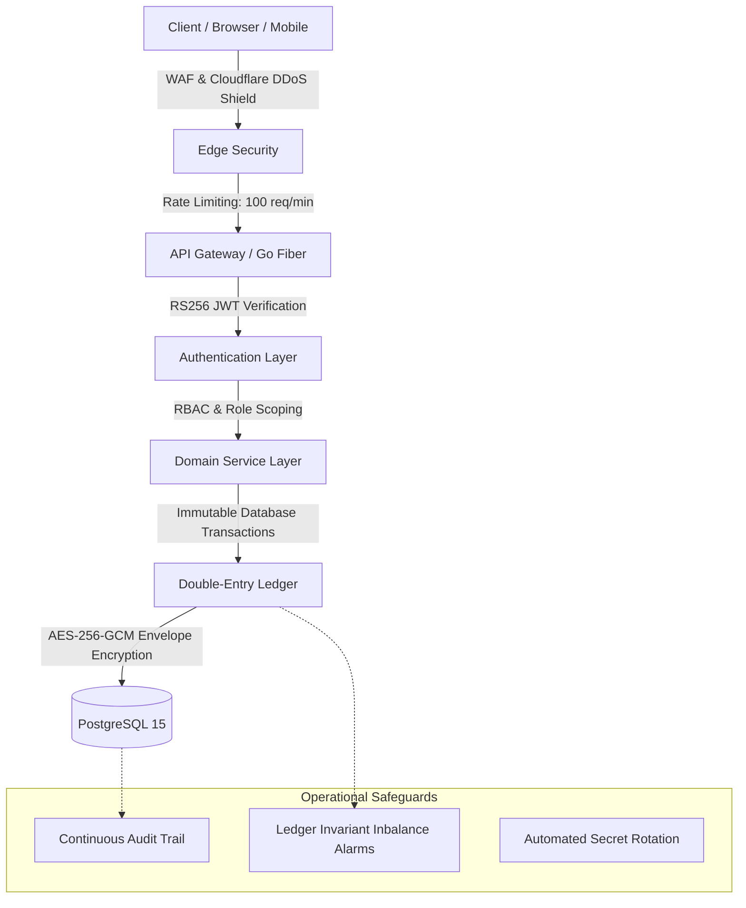

# Vescrow Security & Operational Runbooks (`/QSD/security`)

[](#overview)
[](#document-index)
[](#incident-response-runbooks)

This directory houses operational security procedures, cryptographic key lifecycle management policies, penetration testing parameters, and emergency incident response runbooks for the Vescrow platform.

---

## Overview

Financial escrow and double-entry ledger platforms require strict operational security controls to prevent unauthorized withdrawals, key compromise, or balance discrepancies. The documents in this directory define the defensive baselines and emergency operational protocols used by the engineering team.

```
security/
├── README.md             # This document index and security overview
├── runbooks.md           # Operational incident response runbooks
├── key-rotation.md       # Cryptographic key rotation procedures (RS256, AES-256-GCM)
├── soc2-checklist.md     # SOC 2 Type II controls and evidence checklist
└── pen-test-scope.md     # Penetration testing rules of engagement & asset scope
```

---

## Document Index

| Document | Category | Scope / Key Focus | Operational SLA |
| :--- | :--- | :--- | :--- |
| [runbooks.md](./runbooks.md) | **Incident Response** | Triage and mitigation runbooks for Ledger Imbalance, Webhook Failures, Breached Admin Credentials, and DDoS attacks | Severity 1: < 15 min |
| [key-rotation.md](./key-rotation.md) | **Cryptographic Ops** | Zero-downtime key rotation for RS256 JWT keypairs, AES-256-GCM ledger payload keys, and database secrets | Bi-annual / On-demand |
| [soc2-checklist.md](./soc2-checklist.md) | **Audit Readiness** | SOC 2 Type II Trust Services Criteria (Security, Availability, Confidentiality, Processing Integrity) | Continuous Audit |
| [pen-test-scope.md](./pen-test-scope.md) | **Offensive Security** | Authorized targets, testing methodologies, API fuzzing limits, and emergency abort contacts | Annual / Major Release |

---

## Defense-in-Depth Architecture



---

## Incident Response Priorities

1. **Protect Ledger Invariance**: Immediate circuit breaker halts disbursements if $\sum \text{Debits} \ne \sum \text{Credits}$.
2. **Contain Compromise**: Rotate keys using [key-rotation.md](./key-rotation.md) and revoke active tokens using Redis blocklists.
3. **Execute Runbook**: Follow step-by-step procedures in [runbooks.md](./runbooks.md) and record root-cause analysis (RCA).
