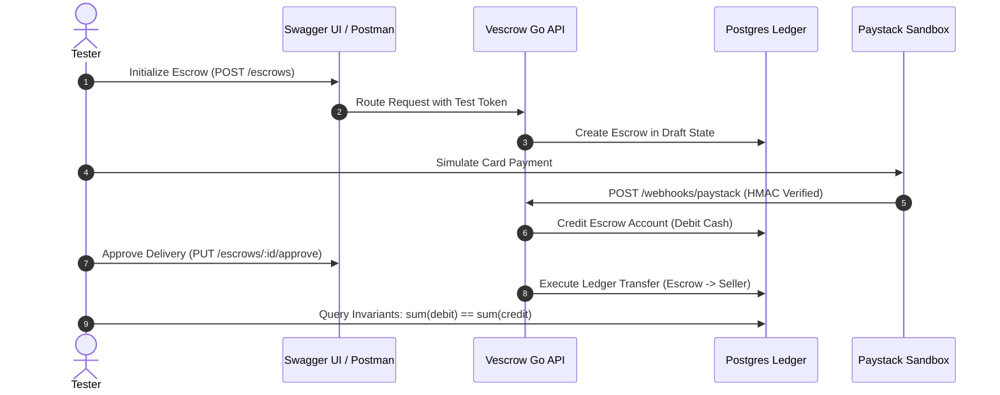

# Vescrow QA & Verification Test Guides (`/QSD/test`)

[](#overview)
[](#document-index)
[](#test-execution-flow)

This directory contains manual test guides, Swagger verification walkthroughs, payment simulation procedures, and end-to-end QA acceptance scripts for the Vescrow platform.

---

## Overview

Because financial escrow systems handle real funds and legal contracts, manual and automated verification must cover all edge cases—such as payment webhook dropouts, race conditions during release, and dispute settlement splits. These guides provide repeatable step-by-step test instructions.

```
test/
├── README.md                               # This document index and testing framework
├── end-to-end-application-test-guide.md    # Full buyer-seller-admin lifecycle testing
├── new-workflow-backend-manual-test.md     # Backend verification for direct disbursement model
├── payment-manual-test-guide.md            # Paystack payment and HMAC webhook simulation
├── wallet-swagger-test-guide.md            # Swagger API testing guide for wallet & ledger endpoints
├── phase5-escrow-manual-test.md            # Escrow milestones, inspection and approval QA
└── phase8-dispute-manual-test.md           # Dispute handling, arbiter intervention & payout split QA
```

---

## Document Index

| Guide | Scope | Target Subsystem | Key Verification |
| :--- | :--- | :--- | :--- |
| [end-to-end-application-test-guide.md](./end-to-end-application-test-guide.md) | **E2E Acceptance** | Web App + Go API + DB | Complete transaction lifecycle from sign-up to final bank withdrawal |
| [new-workflow-backend-manual-test.md](./new-workflow-backend-manual-test.md) | **Backend Verification** | Go Fiber API | Direct escrow disbursement model without intermediate wallet hops |
| [payment-manual-test-guide.md](./payment-manual-test-guide.md) | **Payments QA** | Paystack Webhooks | HMAC-SHA512 verification, duplicate webhook idempotency, failed charges |
| [wallet-swagger-test-guide.md](./wallet-swagger-test-guide.md) | **Swagger API QA** | OpenAPI / Swagger UI | Ledger query endpoints, deposit initialization, and balance endpoints |
| [phase5-escrow-manual-test.md](./phase5-escrow-manual-test.md) | **Escrow Lifecycle** | Escrow State Machine | Fund-on-create, inspection timer countdown, buyer release authorization |
| [phase8-dispute-manual-test.md](./phase8-dispute-manual-test.md) | **Disputes QA** | Dispute Mediation Engine | Lock-on-dispute, evidence submission, partial refund split execution |

---

## Test Execution Flow


