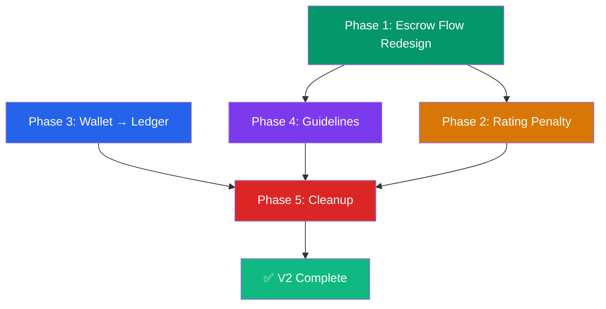

# Vescrow V2 — Master Implementation Plan

> **Version**: 2.0  
> **Created**: October 2026  
> **Scope**: Escrow flow redesign, trust penalties, wallet→ledger rename, guidelines system, theme removal, sidebar cleanup

---

## Document Index

| # | Document | Scope |
|---|---|---|
| 00 | [Architecture Overview](file:///Users/oluwatobiloba/Desktop/qsd/vescrow/docsplan/v2/00-architecture-overview.md) | System-wide architectural changes, state machine diagrams, file impact matrix |
| 01 | [Phase 1 — Escrow Flow Redesign](file:///Users/oluwatobiloba/Desktop/qsd/vescrow/docsplan/v2/01-phase1-escrow-flow-redesign.md) | Fund-on-create, remove confirm delivery, merge verify+approve, completed lock |
| 02 | [Phase 2 — Rating Penalty](file:///Users/oluwatobiloba/Desktop/qsd/vescrow/docsplan/v2/02-phase2-rating-penalty.md) | Trust score penalty for buyer non-verification timeout |
| 03 | [Phase 3 — Wallet → Ledger](file:///Users/oluwatobiloba/Desktop/qsd/vescrow/docsplan/v2/03-phase3-wallet-to-ledger.md) | Systematic rename of all user-facing "Wallet" to "Ledger" |
| 04 | [Phase 4 — Escrow Guidelines](file:///Users/oluwatobiloba/Desktop/qsd/vescrow/docsplan/v2/04-phase4-escrow-guidelines.md) | Guidelines content, agreement flow, persistent access points |
| 05 | [Phase 5 — Theme Removal & Sidebar Cleanup](file:///Users/oluwatobiloba/Desktop/qsd/vescrow/docsplan/v2/05-phase5-theme-removal-sidebar-cleanup.md) | Delete 100 themes, remove KYC/Notifications/Settings from sidebar only (pages stay accessible via navbar) |

---

## Phase Execution Order & Dependencies



- **Phase 1** (Escrow Flow) must come first — it changes the core state machine
- **Phase 2** (Rating) depends on Phase 1's verify+release merge
- **Phase 3** (Wallet→Ledger) is independent and can run in parallel with Phase 1-2
- **Phase 4** (Guidelines) can run in parallel with Phase 3, but depends on Phase 1 for sidebar changes
- **Phase 5** (Cleanup) runs last — removes dead code after all features are in place

---

## Task Summary

| Phase | Tasks | Backend | Frontend | Estimated Effort |
|---|---|---|---|---|
| **Phase 1** | 7 tasks | 4 tasks (state machine, service, handler, dto) | 3 tasks (create page, detail page, store) | **High** |
| **Phase 2** | 4 tasks | 3 tasks (enum, worker, reminders) | 1 task (verify modal warning) | **Medium** |
| **Phase 3** | 4 tasks | 0 tasks | 4 tasks (sidebar, pages, escrow refs, constants) | **Low** |
| **Phase 4** | 4 tasks | 0 tasks | 4 tasks (component, create flow, accept flow, access points) | **Medium** |
| **Phase 5** | 5 tasks | 0 tasks | 5 tasks (themes, sidebar KYC removal, sidebar notif removal, sidebar settings removal, sweep) | **Low-Medium** |
| **Total** | **24 tasks** | **7 tasks** | **17 tasks** | |

---

## Files to DELETE (Complete List)

| File | Reason | Size |
|---|---|---|
| `src/lib/themes.ts` | 100-theme system removed | 53KB |
| `src/components/shared/theme-switcher.tsx` | Theme switcher removed | ~8KB |

> **Note**: KYC pages, Notifications page, and Settings page are **NOT deleted**. They are only removed from the sidebar/mobile-nav to reduce redundancy — they remain accessible via the navbar/topbar.

---

## Files to CREATE (Complete List)

| File | Purpose | Phase |
|---|---|---|
| `src/components/shared/escrow-guidelines.tsx` | Guidelines content component | Phase 4 |
| `src/components/shared/escrow-guidelines-modal.tsx` | Guidelines modal with agreement | Phase 4 |
| `src/app/app/guidelines/page.tsx` | Dedicated guidelines page | Phase 4 |

---

## Files to MODIFY (Complete List)

### Backend (Go)

| File | Changes | Phase |
|---|---|---|
| `internal/escrow/state_machine.go` | Remove `delivered_awaiting_verification` transitions | Phase 1 |
| `internal/escrow/enum.go` | Deprecation comments | Phase 1 |
| `internal/escrow/service.go` | Remove ConfirmDelivery, merge verify+release, update CreateEscrow | Phase 1 |
| `internal/escrow/handler.go` | Remove ConfirmDelivery handler | Phase 1 |
| `internal/escrow/routes.go` | Remove confirm-delivery route | Phase 1 |
| `internal/escrow/dto.go` | Add payment_url, remove ConfirmDeliveryDTO | Phase 1 |
| `internal/escrow/worker.go` | Add trust penalty on auto-release, update reminder messages | Phase 2 |
| `internal/trust/enum.go` | Add EventBuyerVerificationTimeout | Phase 2 |
| `internal/trust/service.go` | Add delta for new event type | Phase 2 |

### Frontend (TypeScript/React)

| File | Changes | Phase |
|---|---|---|
| `src/lib/types.ts` | Update CreateEscrowResult, remove ConfirmDeliveryRequest | Phase 1 |
| `src/lib/constants.ts` | Update routes, remove KYC/Settings/Notif routes, add Guidelines | Phase 1, 5 |
| `src/stores/escrow-store.ts` | Remove confirmDelivery, update createEscrow for payment_url | Phase 1 |
| `src/lib/api/escrows.ts` | Remove confirmDelivery API call | Phase 1 |
| `src/app/app/escrows/create/page.tsx` | Fund-on-create redirect, guidelines gate | Phase 1, 4 |
| `src/app/app/escrows/[id]/page.tsx` | Remove confirm modal, merge verify+approve, completed summary, guidelines link | Phase 1, 4 |
| `src/components/layout/app-sidebar.tsx` | Remove KYC/Notif/Settings, rename Wallet→Ledger, add Guidelines | Phase 3, 4, 5 |
| `src/components/layout/mobile-bottom-nav.tsx` | Remove KYC/Notif/Settings from "More", rename Wallet→Ledger | Phase 3, 5 |
| `src/app/app/wallet/page.tsx` | Rename "Wallet" → "Ledger" | Phase 3 |
| `src/app/app/wallet/transactions/` | Rename labels | Phase 3 |
| `src/app/app/wallet/deposit/` | Rename labels | Phase 3 |
| `src/app/app/wallet/withdraw/` | Rename labels | Phase 3 |
| `src/components/escrow/escrow-invite-view.tsx` | Add guidelines gate | Phase 4 |
| `src/components/layout/footer.tsx` | Add guidelines link | Phase 4 |

---

## Revised Sidebar Navigation (V2 Final)

### Desktop Sidebar (V2)
```
┌─────────────────────────┐
│  🛡  VESCROW             │
├─────────────────────────┤
│  [+ Create New Escrow]   │
├─────────────────────────┤
│  📊 Overview             │
│  ⚖️  Escrow Deals        │
│  📎 Share Listings       │
│  📖 Ledger               │
│  📋 Escrow Guidelines    │
├─────────────────────────┤
│  👤 User    [Logout]     │
└─────────────────────────┘
```

### Mobile Bottom Nav (V2)
```
┌────┬────┬────┬────┐
│Home│Escs│Ldgr│More│
└────┴────┴────┴────┘

"More" drawer:
├── Listings
├── Escrow Guidelines
├── Log out
```

---

## Revised Escrow Lifecycle (V2 Final)

```
┌──────────────┐      ┌───────────────────┐
│ Buyer creates │      │ Payment gateway   │
│   + pays      ├─────►│ (Paystack)        │
└──────┬───────┘      └───────┬───────────┘
       │                      │ payment confirmed
       │                      ▼
       │              ┌───────────────────┐
       └─────────────►│ pending_acceptance │
                      │ (funded)           │
                      └───────┬───────────┘
                              │ seller accepts
                              ▼
                      ┌───────────────────┐
                      │    funded          │
                      └───────┬───────────┘
                              │ seller submits evidence
                              ▼
                      ┌───────────────────┐
                      │ preparing_shipment │
                      └───────┬───────────┘
                              │ seller ships
                              ▼
                      ┌───────────────────┐
                      │     shipped        │
                      └──────┬──────┬─────┘
                             │      │
                    verify + │      │ dispute
                    release  │      │
                             ▼      ▼
                      ┌──────────┐ ┌────────┐
                      │completed │ │disputed│
                      └──────────┘ └────────┘
                                        │
                              ┌─────────┼──────────┐
                              ▼         ▼          ▼
                        ┌─────────┐ ┌────────┐ ┌────────────┐
                        │completed│ │refunded│ │partial_rel.│
                        └─────────┘ └────────┘ └────────────┘
```

**Auto-release**: If buyer doesn't verify within inspection period, worker auto-releases funds to seller AND records `-10` trust penalty on buyer.

---

## Risk Mitigation

| Risk | Mitigation |
|---|---|
| Existing escrows in `delivered_awaiting_verification` | Keep enum value, add backward-compat transition in state machine |
| Paystack payment fails during create | Show error, allow retry from escrow detail page |
| Seller rejects funded escrow | Trigger automatic refund to buyer |
| Trust penalty too harsh/lenient | -10 is configurable; monitor and adjust |
| Users bypass guidelines | Store agreement state server-side (future enhancement) |
| Bundle size after theme removal | Verify ~53KB reduction in next build |
