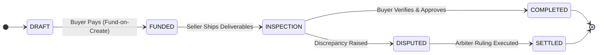

# Vescrow V2 — Architecture Simplification & Core Redesign (`/QSD/v2`)

[](#overview)
[](#core-enhancements)
[](#phase-index)

This directory details the **Vescrow Version 2 (V2)** architectural overhaul. V2 streamlined transaction state transitions, eliminated intermediate wallet friction, and unified ledger naming across the frontend and backend.

---

## Overview

The V2 release re-architected Vescrow to address usability friction identified during the V1 pilot:
- **Fund-on-Create Model**: Buyers fund transactions immediately upon creation, eliminating dangling unfunded escrow agreements.
- **Direct Ledger Transparency**: Replacing confusing "virtual wallet" abstractions with transparent, verifiable double-entry "ledger accounts".
- **Automated Buyer Rating Invariants**: Incentivizing buyers to complete inspection periods through automated trust penalties.

```
v2/
├── README.md                                          # This architectural overview & document index
├── 00-architecture-overview.md                        # Master V2 architecture, state machines & diffs
├── 01-phase1-escrow-flow-redesign.md                  # Fund-on-create, approve/verify flow simplification
├── 02-phase2-rating-penalty.md                        # Trust score penalty for buyer non-verification timeout
├── 03-phase3-wallet-to-ledger.md                      # Systematic rename of "Wallet" to "Ledger"
├── 04-phase4-escrow-guidelines.md                     # Escrow legal guidelines & terms acceptance
├── 05-phase5-theme-removal-sidebar-cleanup.md         # UI theme simplification and navigation cleanup
└── 06-implementation-plan.md                          # Master phase execution roadmap and exit gates
```

---

## Phase Index

| Phase | Specification | Focus / Key Deliverables |
| :--- | :--- | :--- |
| **Overview** | [00-architecture-overview.md](./00-architecture-overview.md) | Architectural diffs, state machine state-table, backend/frontend file impact matrix |
| **Phase 1** | [01-phase1-escrow-flow-redesign.md](./01-phase1-escrow-flow-redesign.md) | Fund-on-create escrow lifecycle, eliminate `confirm_delivery`, single-click approval |
| **Phase 2** | [02-phase2-rating-penalty.md](./02-phase2-rating-penalty.md) | Buyer inspection timeout trust penalty engine and automated notification triggers |
| **Phase 3** | [03-phase3-wallet-to-ledger.md](./03-phase3-wallet-to-ledger.md) | Systematic UI/UX rename from "Wallet" to "Ledger", terminology normalization |
| **Phase 4** | [04-phase4-escrow-guidelines.md](./04-phase4-escrow-guidelines.md) | Regulatory escrow guidelines modal, consent checkboxes, persistent guidelines tab |
| **Phase 5** | [05-phase5-theme-removal-sidebar-cleanup.md](./05-phase5-theme-removal-sidebar-cleanup.md) | Removing theme engine bloat, modernizing sidebar navigation |
| **Roadmap** | [06-implementation-plan.md](./06-implementation-plan.md) | Master phased implementation plan with task IDs and dependency graphs |

---

## V2 State Machine Comparison


