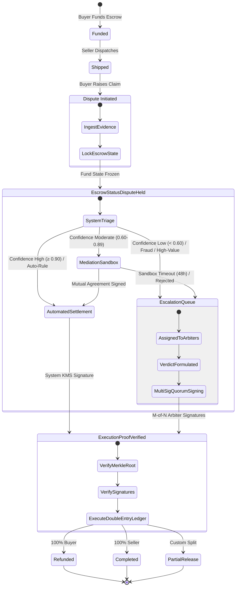

# Vescrow V3 — Dispute Resolution Engine: Human & System Hybrid Architecture

> **Document ID**: `VESC-ARCH-V3-001`  
> **Status**: Approved System Architecture  
> **Target Scope**: Digital Escrow Dispute Resolution Engine combining automated AI triage and bounded cryptographic human arbitration  
> **Affected Subsystems**: `vescrow_backend` (Go/Fiber), `vescrow_frontend` (Next.js Disputant Portal), `vescrow_admin` (Next.js Arbiter Portal)

---

## 1. Executive Summary & Core Philosophy

In a high-trust digital escrow platform operating in high-friction markets (Nigeria and pan-African trade), dispute resolution is the primary pillar of platform viability. Pure human arbitration cannot scale to thousands of daily e-commerce and freelance transactions due to high operational costs, arbitrary human variance, and slow resolution times. Conversely, purely automated or smart-contract-only dispute systems fail when dealing with subjective quality criteria, complex real-world delivery failures, and sophisticated fraud patterns.

The **Vescrow V3 Hybrid Dispute Resolution Engine** resolves this dichotomy by implementing a **bifurcated Human-and-System Architecture**:
1. **High-Volume, Low-Complexity Offload**: Clear-cut cases (e.g., carrier-verified package return, seller non-shipment, mutually agreed partial refunds) are handled autonomously by the **System Assistance Layer** and settled via the **Automated Settlement Engine**.
2. **High-Value, High-Ambiguity Safeguard**: Subjective claims, edge cases, suspected fraud, and contested legal determinations are escalated via the **Escalation Router** to vetted human neutrals on the **Human Arbitration Layer**.
3. **Bounded Enforcement & Trustless Execution**: Neither the AI engine nor any single human administrator possesses unilateral authority to move funds. Financial movement is strictly gated by the **Bounded Enforcement Layer**, requiring cryptographic execution proofs signed by an automated system key or an M-of-N multi-sig quorum of bonded human arbiters.
4. **Institutional Safeguards**: Data privacy is protected via an off-chain **Privacy-First Ledger Pattern**, while algorithmic fairness is enforced through a strict **Anti-Bias Demographics Sanitization Pipeline**.

---

## 2. System Architecture & Layered Decomposition

```
┌──────────────────────────────────────────────────────────────────────────────────────────────────┐
│                                   USER INTERACTION LAYER                                         │
│  - Structured Dispute Intake Wizard (Category-specific claim schemas)                           │
│  - Cryptographic Evidence Uploader (Client-side SHA-256 fingerprinting & EXIF extraction)       │
│  - AI-Assisted Mediation Sandbox (Interactive counter-offer & settlement negotiation room)      │
└────────────────────────────────────────────────┬─────────────────────────────────────────────────┘
                                                 │ HTTPS / REST / WebSockets
┌────────────────────────────────────────────────▼─────────────────────────────────────────────────┐
│                           SYSTEM ASSISTANCE LAYER (Off-Chain Engine)                             │
│  ┌──────────────────────────────┐ ┌──────────────────────────────┐ ┌───────────────────────────┐  │
│  │ Anti-Bias Demographics Mask  │ │ Legal Triage & Classify      │ │ Evidence Authenticator    │  │
│  │ Blind Tokenization Pipeline  │ │ Confidence Scoring Engine    │ │ Carrier, Git, Media Hash  │  │
│  └──────────────────────────────┘ └──────────────────────────────┘ └───────────────────────────┘  │
│  ┌─────────────────────────────────────────────────────────────────────────────────────────────┐  │
│  │ AI-Assisted Negotiation Engine (Pareto-Optimal Compromise Generator)                        │  │
│  └─────────────────────────────────────────────────────────────────────────────────────────────┘  │
└───────────────────────┬──────────────────────────────────────────────────┬───────────────────────┘
                        │ Low Risk / High Confidence                       │ Ambiguity / High Value
                        │ (Score ≥ 0.90 or Mutual Pact)                    │ (Score < 0.90 or Fraud)
┌───────────────────────▼──────────────────────┐   ┌───────────────────────▼───────────────────────┐
│         AUTOMATED SETTLEMENT ENGINE          │   │                  ESCALATION ROUTER            │
│  - Rule & Policy Matrix Evaluation           │   │  - Multi-Dimensional Risk Matrix             │
│  - Strict SLA Timeout Default Judgment       │   │  - Arbiter Queue Dispatcher (Tier 1/2/3)      │
│  - System KMS Execution Proof Generator      │   │  - Cryptographic Workspace Provisioner        │
└───────────────────────┬──────────────────────┘   └───────────────────────┬───────────────────────┘
                        │                                                  │
                        │                                  ┌───────────────▼───────────────────────┐
                        │                                  │        HUMAN ARBITRATION LAYER        │
                        │                                  │  - Blind Case Dossier & Explanations  │
                        │                                  │  - Contextual Evidence Review Panel   │
                        │                                  │  - WebCrypto M-of-N Multi-Sig Signer  │
                        │                                  └───────────────┬───────────────────────┘
                        │                                                  │
                        │ System Proof                                     │ M-of-N Arbiter Quorum
                        │ (Single-Sig System KMS)                          │ (e.g. 2-of-3 Ed25519 Keys)
┌───────────────────────▼──────────────────────────────────────────────────▼───────────────────────┐
│                                 BOUNDED ENFORCEMENT LAYER                                        │
│  - State Locking Engine: Immediate Escrow Freeze to "Held" (`EscrowStatusDisputeHeld`)          │
│  - Execution Proof Verification Gate: Cryptographic Sig Verification + Merkle Root Check         │
│  - Dual-Entry Ledger Settlement Engine: Non-reversible atomic fund disbursement/refund         │
│  - Immutable Audit & Proof Log: Salted State Hashes committed to immutable ledger                │
└──────────────────────────────────────────────────────────────────────────────────────────────────┘
```

---

## 3. Deep-Dive: Architectural Layers

### 3.1 Layer 1: User Interaction Layer

The User Interaction Layer operates within `vescrow_frontend` (accessible to buyers and sellers) and provides guided, low-anxiety interfaces for dispute management.

1. **Structured Dispute Intake Wizard**:
   - Rather than an unstructured text box, the intake flow enforces category-specific structured questionnaires:
     - **Non-Delivery (`item_not_received`)**: Carrier name, tracking ID, expected delivery date, delivery address confirmation.
     - **Defective / Damaged Asset (`damaged_item` / `not_as_described`)**: Packaging photos, unboxing video hash, specific defects checklist, serial/IMEI verification.
     - **Milestone / Service Failure (`service_not_delivered` / `missing_components`)**: Milestone deliverable URL, GitHub repository link, staging URL, acceptance criteria checklist.
   - Enforces pre-submission checklists to reduce frivolous filings.
2. **Cryptographic Evidence Normalizer**:
   - All uploaded files (images, PDFs, MP4s, invoices) undergo browser-side SHA-256 fingerprinting before upload.
   - Normalizes MIME types, extracts EXIF metadata (timestamp, geolocation if permitted), and uploads directly to private encrypted object storage (`storage.StorageService`).
   - Generates an **Evidence Manifest** containing content hashes, file sizes, and client timestamps.
3. **Interactive Mediation Sandbox**:
   - A dedicated real-time negotiation space within the escrow page.
   - Displays system-recommended settlement pathways (e.g. 100% refund, 30% discount for minor flaw, replacement agreement).
   - Enables asynchronous counter-proposals with strict 48-hour turn-based countdown timers.

---

### 3.2 Layer 2: System Assistance Layer (Off-Chain Backend)

The System Assistance Layer is an event-driven Go service package (`internal/dispute/engine/`) that analyzes incoming claims, verifies evidence, and computes settlement viability.

#### A. Anti-Bias Demographics Sanitization Pipeline
To prevent algorithmic and human cognitive bias, the engine runs an automated PII stripping and tokenization filter:
- Strips disputants' names, phone numbers, email addresses, delivery addresses, bank account numbers, and avatar photos.
- Replaces identities with blind role tokens: `Disputant A (Buyer)` and `Disputant B (Seller)`.
- Replaces locations with normalized regional zones (e.g. `Zone Lagos-Mainland`, `Inter-State Transit Corridor`) strictly for logistics calculation.
- Strips personal insults and toxic rhetoric from narrative descriptions using NLP sentiment filters, preserving only factual assertions.

#### B. Legal Triage & Classification Engine
- Validates the dispute category against the escrow's initial contract parameters (e.g. whether the escrow was a physical product, digital asset, or service milestone).
- Computes the **Structural Confidence Score ($C_s \in [0.00, 1.00]$)** using four weighted vectors:
  $$C_s = w_1 \cdot V_{\text{logistics}} + w_2 \cdot V_{\text{history}} + w_3 \cdot V_{\text{evidence}} + w_4 \cdot V_{\text{consistency}}$$
  Where:
  - $V_{\text{logistics}}$: Automated carrier tracking status (0.0 = unconfirmed/contradictory, 1.0 = carrier API confirms delivery or lost parcel).
  - $V_{\text{history}}$: Disputant historical trust scores and dispute loss ratio ($S_{\text{trust}} \in [0, 100]$ mapped to $[0, 1]$).
  - $V_{\text{evidence}}$: Verification quality of submitted files (presence of valid waybill, unboxing video, serial match).
  - $V_{\text{consistency}}$: Cross-referencing timestamps between shipment, estimated delivery, and dispute opening.
- Threshold Decision Logic:
  - $C_s \ge 0.90$ with zero fraud flags $\rightarrow$ Eligible for Automated Settlement.
  - $0.60 \le C_s < 0.90$ $\rightarrow$ Route to Assisted Mediation Sandbox (48h window).
  - $C_s < 0.60$ or Fraud Flag Triggered $\rightarrow$ Instant Escalation to Human Arbitration.

#### C. Evidence Authentication Agent
An asynchronous worker pool (`internal/dispute/agent/`) that interfaces with external verification sources:
1. **Logistics Carrier Connectors**:
   - Webhook & polling adapters for regional carriers: GIG Logistics, DHL, FedEx, Terminal Africa, Topship.
   - Fetches official carrier tracking history, signed recipient names, and delivery coordinates.
2. **Digital Deliverable & Code Verifier**:
   - For software/freelance escrows: GitHub/GitLab integration verifying repository commit hashes, PR merge status, and deployment webhooks.
3. **Media Authenticity & Duplicate Detector**:
   - Compares image SHA-256 and perceptual hashes (pHash) against historical platform uploads to detect recycled stock photos or proof forgery.

#### D. AI-Assisted Negotiation Engine
- If the case is eligible for mediation, the engine computes a **Pareto-Optimal Settlement Offer**:
  - Example: Buyer claims item is slightly damaged (repairable); engine calculates average repair allowance or depreciation ($20\% - 30\%$) based on category benchmarks.
  - Generates structured offer cards in the dispute room:
    - *Option 1*: Full return of item for a 100% refund (funds released upon carrier pickup confirmation).
    - *Option 2*: Buyer keeps item with a 25% partial refund; seller receives 75%.
- If both parties cryptographically sign the same option within 48 hours, the dispute transitions to `DisputeStatusMediationResolved` and triggers immediate automated settlement.

---

### 3.3 Layer 3: Automated Settlement Engine (Low Risk / Clear Terms)

The Automated Settlement Engine executes settlements **without human intervention** under strictly bounded conditions:
1. **Settlement Triggers**:
   - **Mutual Agreement**: Both parties accept an AI mediation proposal or direct mutual split.
   - **Carrier Objective Truth**: Carrier API confirms package was returned to seller and delivered $\rightarrow$ Auto-Refund to Buyer ($100\%$).
   - **Carrier Delivery Confirmation**: Carrier API confirms package delivered to buyer's verified address with recipient signature, and buyer's claim of "Item Not Received" contradicts official carrier API $\rightarrow$ Auto-Release to Seller ($100\%$).
   - **SLA Default Judgment**: Seller fails to respond to an open dispute within 72 hours, or Buyer fails to provide requested evidence within 48 hours $\rightarrow$ Default resolution in favor of the active party.
2. **Execution Safeguards**:
   - Value Ceiling: Transactions above a configurable ceiling (e.g., $\ge \text{₦}1,000,000$ or $\$1,500$) are **never** fully auto-settled without at least 1 human supervisor review, regardless of confidence score.
   - Velocity Checks: Accounts with $> 2$ disputes in a 30-day window are blocked from automated settlement.
   - System Signing: The engine generates an `ExecutionProof` signed by the backend's dedicated System Settlement KMS Key (Ed25519).

---

### 3.4 Layer 4: Escalation Router (High Risk / Edge Cases)

When an escrow cannot be resolved automatically, the Escalation Router (`internal/dispute/escalation/`) performs deterministic handoff to the human queue:
1. **Escalation Triggers**:
   - Structural Confidence Score $C_s < 0.90$.
   - Dispute category involves subjective quality (e.g. "Logo design does not feel creative", "Fabric quality feels inferior").
   - Failure of 48-hour Mediation Sandbox (parties rejected compromise or countdown expired).
   - Transaction amount exceeds Automated Settlement Value Ceiling.
   - Anomaly/Fraud Detection: Duplicate image hashes, VPN/IP mismatch, blacklisted KYC device fingerprints, or high account churn.
2. **Tiered Routing Matrix**:
   - **Tier 1 (Standard Disputes)**: Value $< \text{₦}250,000$, standard product discrepancy. Dispatched to general arbiter pool (1 human sign-off needed).
   - **Tier 2 (High-Value / Technical Disputes)**: Value between $\text{₦}250,000$ and $\text{₦}2,000,000$, service contract milestones, software code review. Dispatched to specialized senior arbiters (2-of-3 multi-sig quorum required).
   - **Tier 3 (Fraud & Critical Legal)**: Value $> \text{₦}2,000,000$, suspected counterfeit rings, chargeback threats, legal notice served. Dispatched to Legal & Risk Review Board (requires 2-of-3 keys including Platform Compliance Lead).
3. **Encrypted Workspace Creation**:
   - Opens an isolated, end-to-end audit workspace for arbiters.
   - Generates a compiled case dossier and locks disputant direct messaging to avoid harassment.

---

### 3.5 Layer 5: Human Arbitration Layer (In-The-Loop Fail-Safe)

The Human Arbitration Layer is implemented within `vescrow_admin` (`src/app/(portal)/disputes/[id]`) and serves vetted professional arbiters.

```
┌──────────────────────────────────────────────────────────────────────────────────┐
│                             ARBITER CASE DOSSIER                                 │
├─────────────────────────┬────────────────────────────────┬───────────────────────┤
│ CASE METRICS            │ AI TRIAGE SUMMARY              │ TIMELINE & DISCREPANCY│
│ - ID: DSP-88219         │ - Triage Cat: defective_asset  │ - T+0: Shipped        │
│ - Amount: ₦450,000      │ - Confidence: 0.68 (Moderate)  │ - T+2: Delivered      │
│ - Tier: Tier 2 (2-of-3) │ - Fraud Risk: Low (0.08)       │ - T+3: Dispute opened │
│ - SLA: 18h remaining    │ - Suggested: 70/30 Buyer Split │ - Discrepancy: Weight │
├─────────────────────────┴────────────────────────────────┴───────────────────────┤
│ BLIND EVIDENCE COMPARISON (Anti-Bias Mode Enabled)                               │
│ [Disputant A (Buyer) Claims & Photos]   │ [Disputant B (Seller) Waybill & Video] │
│ - Claimed cracked screen on unboxing   │ - Shows intact screen at packaging    │
│ - Evidence SHA256: 8f4b... (Verified)   │ - Weight delta: 450g vs 320g logged   │
├──────────────────────────────────────────────────────────────────────────────────┤
│ ARBITER VERDICT & MULTI-SIG CO-SIGNING PANEL                                     │
│ Ruling Type: [ ] Full Refund   [ ] Full Release   [*] Custom Split               │
│ Distribution: Buyer: ₦315,000 (70%)  |  Seller: ₦135,000 (30%)                   │
│ Rationale: Package weight mismatch confirms internal component damage in transit.│
│ Signatures Collected: [1 / 2 required] (Arbiter #1 signed 14:10 UTC)             │
│ [ Cryptographically Sign & Authorize (Hardware/WebCrypto Key) ]                  │
└──────────────────────────────────────────────────────────────────────────────────┘
```

1. **Contextual Evaluation Panel**:
   - Arbiters view evidence side-by-side with anti-bias tokenization turned on by default (can toggle off only with super-admin approval and audited justification).
   - Integrated media viewer with zoom, EXIF validation, and frame-by-frame video scrub.
2. **Case Dossier & Explainability Report**:
   - The system automatically serves the arbiter a synthesized timeline of events, verified carrier logs, and the specific rationale behind why the AI confidence score fell below threshold.
   - Highlights discrepancies (e.g. shipment weight logged at carrier depot was 1.2kg, but buyer return weighs 0.3kg).
3. **Ruling Boundaries & Constraints Validator**:
   - The admin UI prevents invalid inputs:
     - Total allocated kobo must exactly equal the escrow held amount.
     - Split amounts cannot be negative.
     - Payout accounts must match the verified wallets established at escrow initialization.
4. **WebCrypto Multi-Sig Signing Mechanism**:
   - Arbiters do not click a simple "Resolve" button. Instead, their browser holds an Ed25519 or ECDSA P-256 private key secured in WebCrypto / Hardware token (e.g. YubiKey / WebAuthn).
   - Submitting a verdict generates a canonical verdict payload hash and signs it with the arbiter's private key.
   - Once the requisite M-of-N signatures are gathered, the system packages them into an `ExecutionProof` and submits it to the Bounded Enforcement Layer.

---

### 3.6 Layer 6: Bounded Enforcement Layer (Smart Contract / Multi-Sig Rails)

The Bounded Enforcement Layer guarantees financial integrity. No funds move unless strict state machine and cryptographic verification conditions are satisfied.



1. **Escrow State Locking (`EscrowStatusDisputeHeld`)**:
   - The millisecond a dispute intake is validated, the escrow state transitions to `dispute_held`.
   - In this state:
     - All user-initiated releases, approvals, cancellations, and withdrawal requests are rejected with `HTTP 409 Conflict: Escrow is locked under active dispute`.
     - Inspection expiration workers are paused; no automatic auto-release can fire.
     - Funds remain safely segregated in the system escrow wallet account.
2. **Cryptographic Multi-Sig Resolution Architecture**:
   - **Canonical Settlement Intent**:
     ```json
     {
       "intent_id": "018e6e5a-7b3c-7000-8000-112233445566",
       "dispute_id": "9a3f2b84-44c1-4b72-a74d-9cf91e1d0092",
       "escrow_id": "e8a1d7f3-21c9-4b68-b7e2-45e6d8a9f1b4",
       "resolution_type": "partial_split",
       "buyer_amount_kobo": 31500000,
       "seller_amount_kobo": 13500000,
       "currency": "NGN",
       "evidence_merkle_root": "e3b0c44298fc1c149afbf4c8996fb92427ae41e4649b934ca495991b7852b855",
       "timestamp": 1792348800,
       "nonce": 42
     }
     ```
   - **Signature Verification Rule**:
     - For Automated Path: Requires 1 signature matching `SYSTEM_SETTLEMENT_PUBKEY`.
     - For Tier 1 Escalated: Requires 1 signature matching an active, verified arbiter key.
     - For Tier 2 Escalated: Requires 2 distinct valid signatures from arbiters registered in `arbiter_signing_keys` table.
     - For Tier 3 Escalated: Requires 2-of-3 signatures including Platform Compliance Officer.
3. **Dual-Entry Ledger Settlement Engine**:
   - Once the cryptographic execution proof is verified by `internal/dispute/enforcement/verifier.go`, the engine invokes the double-entry bookkeeping ledger (`internal/wallet/service.go`):
     - Debits the system escrow wallet by `AmountKobo`.
     - Credits Buyer's ledger account by `BuyerAmountKobo`.
     - Credits Seller's ledger account by `SellerAmountKobo - OutgoingFeeKobo`.
     - Credits Platform Fee account by `OutgoingFeeKobo` (if applicable).
   - Zero-sum invariant enforced: $\sum \text{Credits} = \sum \text{Debits} = \text{AmountKobo}$.

---

## 4. Essential Technical Safeguards

### 4.1 Privacy-First Ledger Pattern

To comply with global and African data protection regulations (NDPR, GDPR), personal identifiable data must never be recorded on public ledgers or immutable logs:
- **Off-Chain Isolation**:
  - Chat logs, dispute comments, buyer/seller narrative explanations, and raw image/video uploads remain strictly off-chain in encrypted PostgreSQL databases and customer-isolated S3/GCS buckets with AES-256 encryption.
- **On-Chain / Ledger Commitments**:
  - The immutable dispute ledger stores strictly:
    1. `EscrowID` and `DisputeID` (UUIDv4).
    2. `EvidenceMerkleRoot`: Merkle tree root constructed from the SHA-256 hashes of all authenticated evidence files and timestamps.
    3. `ExecutionProof`: The signed canonical JSON payload containing resolution amounts and cryptographic signatures.
    4. `StateTransitionHash`: Hash chaining the previous escrow status to `dispute_held` and finally to resolved status (`refunded`, `completed`, `partial_release`).
- If evidence or dispute records must be audited in court or regulatory reviews, parties produce the raw files, compute the SHA-256 hashes, rebuild the Merkle tree, and verify the resulting root against the immutable ledger entry.

### 4.2 System Bias Defenses

Automated triage models and human reviewers can inadvertently introduce bias based on socio-economic, regional, or linguistic markers. Vescrow V3 institutes systemic defenses:
1. **Blind Feature Masking**:
   - The Triage & Classification Engine input schema is strictly constrained:
     - Allowed: Item category, price in kobo, milestone acceptance criteria, carrier tracking codes, timestamp differentials, historical dispute loss count (as a normalized integer), delivery confirmation flags.
     - Forbidden: Names, phone numbers, state/city names (abstracted to transit distance km), IP addresses, bank names, customer service conversation history before dispute.
2. **Arbiter Blind Review Mode**:
   - When human arbiters inspect a case, all disputant usernames and avatars are replaced with neutral identifiers (`Buyer #882`, `Seller #882`).
   - Phone numbers and email addresses are masked (`+234 803 *** **12`).
   - Arbiters can request unmasking only when fraud identification demands phone number/KYC cross-checking. Any unmasking event requires logging a reason and generates an immutable audit alert (`audit.log`).
3. **Automated Algorithmic Fairness Audits**:
   - Weekly batch jobs test the classification model across simulated disputes with identical parameters to ensure zero variance in confidence scoring across geographic regions.

---

## 5. End-to-End 6-Step Operational Flow

| Step | Phase | System Component | Human Component | SLA / Timeout |
|:---|:---|:---|:---|:---|
| **1. Intake** | Trigger | Ingests claims via structured wizard; generates evidence SHA-256 hashes; transitions escrow to `dispute_held`. | Disputant raises dispute; uploads proof; counterparty notified. | Buyer has inspection window (24-72h); Seller has 72h to respond. |
| **2. Triage** | Assessment | PII stripping; parses carrier API / repo logs; computes Structural Confidence Score ($C_s$) and risk tier. | None (Fully automated). | Immediate (< 10 seconds). |
| **3. Mediation** | Assisted | Deploys AI Mediation Sandbox; generates compromise proposals (partial refund, return); tracks counter-offers. | Parties review proposals; accept or submit counter-offer; or request live arbitration. | 48-hour turn-based countdown timer. |
| **4. Escalation** | Handoff | Evaluates failure of mediation / low $C_s$; compiles Case Dossier; assigns ticket to Tier 1/2/3 arbiter pool. | Arbiter claims ticket from queue; reviews discrepancy dossier in blind mode. | Tier 1: 24h SLA;<br>Tier 2: 12h SLA;<br>Tier 3: 6h SLA. |
| **5. Verdict** | Ruling | Validates split math ($\sum = \text{Total}$); enforces value caps; verifies arbiter authorization status. | Arbiter(s) formulate verdict; sign canonical payload hash with WebCrypto/Ed25519 keys (M-of-N). | Arbiter review window. |
| **6. Payout** | Settlement | Verifies multi-sig execution proof; executes double-entry ledger transfers; updates trust scores. | None (Fully automated ledger execution). | Immediate upon proof validation (< 2 seconds). |

---

## 6. Database Schema Extensions (PostgreSQL / GORM)

The engine builds upon the existing `vescrow_backend` schema (`internal/dispute/model.go`) with new relational tables:

```sql
-- 1. Enhanced Dispute Core
ALTER TABLE disputes 
  ADD COLUMN IF NOT EXISTS confidence_score NUMERIC(5,4) DEFAULT 0.0000,
  ADD COLUMN IF NOT EXISTS triage_category VARCHAR(50),
  ADD COLUMN IF NOT EXISTS risk_tier VARCHAR(20) DEFAULT 'tier_1',
  ADD COLUMN IF NOT EXISTS mediation_status VARCHAR(30) DEFAULT 'not_started',
  ADD COLUMN IF NOT EXISTS evidence_merkle_root VARCHAR(64),
  ADD COLUMN IF NOT EXISTS execution_proof_id UUID,
  ADD COLUMN IF NOT EXISTS auto_resolved BOOLEAN DEFAULT FALSE,
  ADD COLUMN IF NOT EXISTS sla_deadline TIMESTAMPTZ,
  ADD COLUMN IF NOT EXISTS escalated_at TIMESTAMPTZ;

-- 2. Enhanced Evidence with Content Addressing & Integrity
ALTER TABLE dispute_evidences
  ADD COLUMN IF NOT EXISTS sha256_hash VARCHAR(64) NOT NULL DEFAULT '',
  ADD COLUMN IF NOT EXISTS mime_type VARCHAR(100),
  ADD COLUMN IF NOT EXISTS file_size_bytes BIGINT DEFAULT 0,
  ADD COLUMN IF NOT EXISTS verification_status VARCHAR(30) DEFAULT 'unverified',
  ADD COLUMN IF NOT EXISTS verification_notes TEXT,
  ADD COLUMN IF NOT EXISTS metadata_json JSONB;

-- 3. Mediation Sandbox Proposals Table
CREATE TABLE IF NOT EXISTS dispute_mediation_proposals (
    id UUID PRIMARY KEY DEFAULT gen_random_uuid(),
    dispute_id UUID NOT NULL REFERENCES disputes(id) ON DELETE CASCADE,
    proposed_by_role VARCHAR(20) NOT NULL, -- 'system', 'buyer', 'seller'
    proposed_by_id UUID REFERENCES users(id),
    buyer_amount_kobo BIGINT NOT NULL,
    seller_amount_kobo BIGINT NOT NULL,
    terms_description TEXT NOT NULL,
    status VARCHAR(20) NOT NULL DEFAULT 'pending', -- 'pending', 'accepted', 'rejected', 'expired'
    buyer_accepted BOOLEAN DEFAULT FALSE,
    seller_accepted BOOLEAN DEFAULT FALSE,
    expires_at TIMESTAMPTZ NOT NULL,
    created_at TIMESTAMPTZ NOT NULL DEFAULT NOW()
);

-- 4. Arbiter Cryptographic Signing Keys
CREATE TABLE IF NOT EXISTS arbiter_signing_keys (
    id UUID PRIMARY KEY DEFAULT gen_random_uuid(),
    user_id UUID NOT NULL REFERENCES users(id) ON DELETE CASCADE,
    public_key_pem TEXT NOT NULL,
    key_algorithm VARCHAR(20) NOT NULL DEFAULT 'Ed25519', -- 'Ed25519', 'ECDSA_P256'
    key_fingerprint VARCHAR(64) NOT NULL UNIQUE,
    risk_tier_authorized VARCHAR(20) NOT NULL DEFAULT 'tier_1', -- 'tier_1', 'tier_2', 'tier_3'
    is_active BOOLEAN NOT NULL DEFAULT TRUE,
    created_at TIMESTAMPTZ NOT NULL DEFAULT NOW(),
    revoked_at TIMESTAMPTZ
);

-- 5. Multi-Sig Cryptographic Execution Proofs
CREATE TABLE IF NOT EXISTS dispute_execution_proofs (
    id UUID PRIMARY KEY DEFAULT gen_random_uuid(),
    dispute_id UUID NOT NULL REFERENCES disputes(id) ON DELETE RESTRICT,
    escrow_id UUID NOT NULL REFERENCES escrows(id) ON DELETE RESTRICT,
    intent_hash VARCHAR(64) NOT NULL UNIQUE, -- SHA-256 of canonical settlement intent
    canonical_intent JSONB NOT NULL,
    proof_type VARCHAR(30) NOT NULL, -- 'system_automated', 'human_multisig'
    required_signatures INT NOT NULL DEFAULT 1,
    signatures_collected INT NOT NULL DEFAULT 0,
    signatures JSONB NOT NULL DEFAULT '[]'::jsonb, -- Array of { arbiter_id, public_key_fingerprint, signature_hex, signed_at }
    is_fully_executed BOOLEAN NOT NULL DEFAULT FALSE,
    executed_at TIMESTAMPTZ,
    ledger_tx_id UUID,
    created_at TIMESTAMPTZ NOT NULL DEFAULT NOW()
);

-- 6. External Verification Logs (Carrier / API / Git)
CREATE TABLE IF NOT EXISTS dispute_external_verifications (
    id UUID PRIMARY KEY DEFAULT gen_random_uuid(),
    dispute_id UUID NOT NULL REFERENCES disputes(id) ON DELETE CASCADE,
    source_type VARCHAR(30) NOT NULL, -- 'carrier_gig', 'carrier_dhl', 'github_commit', 'image_phash'
    external_identifier VARCHAR(255) NOT NULL, -- tracking number, commit SHA
    raw_response JSONB NOT NULL,
    is_verified BOOLEAN NOT NULL DEFAULT FALSE,
    confidence_delta NUMERIC(5,4) NOT NULL DEFAULT 0.0000,
    created_at TIMESTAMPTZ NOT NULL DEFAULT NOW()
);

-- Indices for performance
CREATE INDEX IF NOT EXISTS idx_disputes_risk_tier ON disputes(risk_tier);
CREATE INDEX IF NOT EXISTS idx_disputes_sla_deadline ON disputes(sla_deadline);
CREATE INDEX IF NOT EXISTS idx_mediation_dispute_id ON dispute_mediation_proposals(dispute_id);
CREATE INDEX IF NOT EXISTS idx_proofs_intent_hash ON dispute_execution_proofs(intent_hash);
```

---

## 7. API Contracts & Communication Specs

### 7.1 Disputant & Mediation Endpoints (`vescrow_frontend` $\rightarrow$ `vescrow_backend`)

```http
### 1. Open Structured Dispute with Evidence Hashes
POST /api/v1/disputes
Authorization: Bearer <buyer_jwt>
Content-Type: application/json

{
  "escrow_id": "e8a1d7f3-21c9-4b68-b7e2-45e6d8a9f1b4",
  "category": "damaged_item",
  "reason": "Display cracked during transit",
  "description": "Upon opening the package delivered by GIG Logistics...",
  "tracking_number": "GIG-LG-98214-NG",
  "carrier_code": "gig_logistics",
  "evidences": [
    {
      "file_url": "/uploads/disputes/ev_8812.jpg",
      "file_type": "image",
      "sha256_hash": "e3b0c44298fc1c149afbf4c8996fb92427ae41e4649b934ca495991b7852b855",
      "file_size_bytes": 2451920,
      "description": "Photo of cracked packaging seal and damaged LCD"
    }
  ]
}

### 2. Get Mediation Room State & Suggested Offers
GET /api/v1/disputes/:id/mediation
Authorization: Bearer <user_jwt>

Response 200 OK:
{
  "dispute_id": "9a3f2b84-44c1-4b72-a74d-9cf91e1d0092",
  "status": "in_mediation",
  "expires_at": "2026-10-20T14:30:00Z",
  "suggested_proposals": [
    {
      "id": "prop-01",
      "buyer_amount_kobo": 15000000,
      "seller_amount_kobo": 35000000,
      "terms_description": "Partial refund of ₦150,000 for screen replacement. Seller retains ₦350,000.",
      "type": "recommended"
    }
  ],
  "active_proposals": [...]
}

### 3. Accept / Reject Mediation Proposal
POST /api/v1/disputes/:id/mediation/proposals/:proposalId/respond
Authorization: Bearer <user_jwt>
Content-Type: application/json

{
  "action": "accept" // "accept" | "reject" | "counter"
}
```

### 7.2 Arbiter & Multi-Sig Endpoints (`vescrow_admin` $\rightarrow$ `vescrow_backend`)

```http
### 1. Get Arbiter Case Dossier (Blind Anti-Bias Mode)
GET /api/v1/admin/disputes/:id/dossier
Authorization: Bearer <arbiter_jwt>

Response 200 OK:
{
  "dispute_id": "9a3f2b84-44c1-4b72-a74d-9cf91e1d0092",
  "escrow_id": "e8a1d7f3-21c9-4b68-b7e2-45e6d8a9f1b4",
  "amount_kobo": 50000000,
  "confidence_score": 0.64,
  "risk_tier": "tier_2",
  "required_signatures": 2,
  "blind_tokens": {
    "buyer": "Disputant Alpha",
    "seller": "Disputant Beta"
  },
  "discrepancies": [
    "Weight logged at dispatch was 1,200g, while buyer claims empty box weighing 120g.",
    "Waybill signature does not match buyer registered initials."
  ],
  "timeline": [...],
  "external_verifications": [...]
}

### 2. Propose Arbiter Verdict (Initiates Multi-Sig Execution Proof)
POST /api/v1/admin/disputes/:id/verdict/propose
Authorization: Bearer <arbiter_jwt>
Content-Type: application/json

{
  "resolution": "partial_split",
  "buyer_amount_kobo": 35000000,
  "seller_amount_kobo": 15000000,
  "notes": "Evidence shows carrier transit damage. Partial release covers salvage value.",
  "arbiter_signature": {
    "public_key_fingerprint": "ed25519:a8f9...31c",
    "signature_hex": "4f82bc91...12ef"
  }
}

### 3. Co-Sign Arbiter Verdict (Fulfills M-of-N Quorum)
POST /api/v1/admin/disputes/:id/verdict/co-sign
Authorization: Bearer <second_arbiter_jwt>
Content-Type: application/json

{
  "proof_id": "018e6e5a-7b3c-7000-8000-112233445566",
  "arbiter_signature": {
    "public_key_fingerprint": "ed25519:b7e3...99d",
    "signature_hex": "19ac83fe...77ab"
  }
}
```

---

## 8. Failure Modes, Edge Cases & Resilience

| Failure Scenario | Threat / Risk | Mitigation Strategy |
|:---|:---|:---|
| **Carrier API Offline / Latency** | Triage engine blocked while validating logistics tracking. | System gracefully downgrades $V_{\text{logistics}}$ weight to neutral ($0.5$), extends triage SLA by 4h, and retries with exponential backoff. If carrier remains unresponsive, escalates to human review. |
| **Tampered / Collusive Arbiter** | Rogue arbiter attempts unauthorized release or biased ruling. | M-of-N multi-sig quorum prevents single arbiter fraud. Blind mode hides counterparty identity. All arbiter verdicts are logged with cryptographic signatures and undergo periodic peer review. |
| **Evidence Forgery (AI / Photoshop)** | User submits fabricated invoice or synthetic image of defect. | Content-addressable SHA-256 deduplication, perceptual hashing against platform corpus, and mandatory EXIF timestamp validation against escrow milestone history. |
| **Disputant Hijack / Non-Responsiveness** | Party abandons dispute or refuses to respond in mediation. | Strict state machine countdowns: failure to respond within 48h to mediation triggers automatic escalation; failure to respond to official arbiter request within 72h triggers default judgment. |
| **Double Payout Race Condition** | Automated settlement and arbiter multi-sig fire simultaneously. | Atomic PostgreSQL row-level locks on the `dispute_execution_proofs` table (`SELECT ... FOR UPDATE`) and DB unique constraint on `intent_hash`. |

---

## 9. Summary & Next Steps

This architecture delivers a defensible, highly scalable, and legally sound dispute resolution system for Vescrow. By combining **algorithmic triage**, **objective carrier evidence extraction**, **assisted mediation**, and **bounded cryptographic enforcement**, Vescrow drastically reduces operational overhead while protecting transaction integrity.

Proceed to:
- [00-decision-review.md](./00-decision-review.md) for detailed Architectural Decision Records (ADRs).
- [07-implementation-plan.md](./07-implementation-plan.md) for master execution phases and task dependencies.
