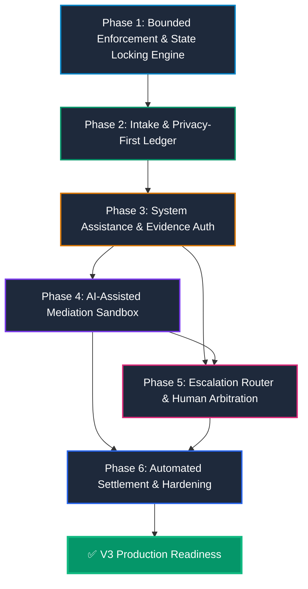

# Vescrow V3 — Master Implementation Plan: Dispute Resolution Engine

> **Version**: 3.0  
> **Status**: Ready for Execution  
> **Target Scope**: End-to-end implementation of the Human and System Hybrid Dispute Resolution Engine  
> **Target Workspaces**: `vescrow_backend`, `vescrow_frontend`, `vescrow_admin`

---

## 1. Executive Roadmap & Document Index

The Vescrow V3 Master Implementation Plan translates the system architecture into six strictly phased, testable engineering work packages. Each phase is self-contained with explicit prerequisite gates, file impact matrices, task-by-task execution steps, and verifiable validation criteria.

### Document Index

| Phase | Document | Scope & Core Deliverables | Target Subsystems | Estimated Effort |
|:---|:---|:---|:---|:---|
| **Phase 1** | [01-phase1-bounded-enforcement.md](file:///Users/oluwatobiloba/Desktop/qsd/vescrow/docsplan/v3/01-phase1-bounded-enforcement.md) | Schema migrations, immutable `dispute_held` state locking, Ed25519 cryptographic execution proof verifier, multi-sig key registry, double-entry ledger integration. | `vescrow_backend` | **High** |
| **Phase 2** | [02-phase2-intake-and-privacy-first-ledger.md](file:///Users/oluwatobiloba/Desktop/qsd/vescrow/docsplan/v3/02-phase2-intake-and-privacy-first-ledger.md) | Structured intake wizard, client-side SHA-256 fingerprinting, binary Merkle tree commitment engine, anti-bias demographic masking & blind tokenization pipeline. | `vescrow_backend`, `vescrow_frontend` | **High** |
| **Phase 3** | [03-phase3-system-assistance-and-evidence-auth.md](file:///Users/oluwatobiloba/Desktop/qsd/vescrow/docsplan/v3/03-phase3-system-assistance-and-evidence-auth.md) | Logistics carrier API connectors (GIG, DHL, FedEx, Topship), GitHub/code deliverable verifier, legal classification engine, Structural Confidence Scoring ($C_s$). | `vescrow_backend` | **High** |
| **Phase 4** | [04-phase4-ai-assisted-mediation-sandbox.md](file:///Users/oluwatobiloba/Desktop/qsd/vescrow/docsplan/v3/04-phase4-ai-assisted-mediation-sandbox.md) | Bounded mediation state machine, Pareto-optimal settlement offer generator, interactive negotiation room in user frontend, mutual consent auto-settlement. | `vescrow_backend`, `vescrow_frontend` | **Medium-High** |
| **Phase 5** | [05-phase5-escalation-and-human-arbitration.md](file:///Users/oluwatobiloba/Desktop/qsd/vescrow/docsplan/v3/05-phase5-escalation-and-human-arbitration.md) | Escalation router & SLA tiering, automated case dossier & discrepancy generator, blind evaluation arbiter workspace, WebCrypto M-of-N multi-sig signing panel. | `vescrow_backend`, `vescrow_admin` | **High** |
| **Phase 6** | [06-phase6-automated-settlement-and-hardening.md](file:///Users/oluwatobiloba/Desktop/qsd/vescrow/docsplan/v3/06-phase6-automated-settlement-and-hardening.md) | Autonomous settlement execution worker, SLA default judgment processor, end-to-end integration test harness, algorithmic bias auditing, disaster recovery tests. | `vescrow_backend`, `vescrow_frontend`, `vescrow_admin` | **Medium** |

---

## 2. Phase Execution Order & Dependency Graph

### Dependency Rules
1. **Phase 1 is the Absolute Foundation**: The cryptographic execution proof verifier, the `dispute_held` state lock, and the updated double-entry wallet service must be active before any automated or human settlement pathway can safely disburse funds.
2. **Phase 2 Feeds Phase 3**: The structured evidence manifest and sanitization pipeline from Phase 2 provide the standardized, clean data inputs that the classification and confidence scoring engines in Phase 3 require.
3. **Phases 4 & 5 Branch Simultaneously**: Once Phase 3 computes the Structural Confidence Score ($C_s$), low/moderate ambiguity cases branch into the Mediation Sandbox (Phase 4), while high-risk/complex cases branch directly into the Escalation Router and Arbiter Workspace (Phase 5).
4. **Phase 6 Validates the Complete Topology**: Phase 6 links all pathways into an automated end-to-end regression and algorithmic fairness harness.

---

## 3. High-Level Task & Effort Summary

| Phase | Total Tasks | Backend Tasks (Go) | Frontend Tasks (React/TS) | Admin Tasks (React/TS) | Estimated Duration |
|:---|:---:|:---:|:---:|:---:|:---:|
| **Phase 1: Bounded Enforcement** | 5 | 5 | 0 | 0 | 4 Days |
| **Phase 2: Intake & Privacy Ledger** | 6 | 3 | 3 | 0 | 5 Days |
| **Phase 3: System Assistance & Auth** | 5 | 5 | 0 | 0 | 5 Days |
| **Phase 4: Mediation Sandbox** | 5 | 2 | 3 | 0 | 4 Days |
| **Phase 5: Escalation & Arbitration** | 6 | 3 | 0 | 3 | 6 Days |
| **Phase 6: Automated Settlement & Hardening**| 5 | 3 | 1 | 1 | 4 Days |
| **TOTAL** | **32 Tasks** | **21 Tasks** | **7 Tasks** | **4 Tasks** | **28 Work Days** |

---

## 4. Comprehensive File Impact Matrix

### 4.1 Backend Files (`vescrow_backend`)

| Action | Path | Description | Phase |
|:---|:---|:---|:---:|
| **CREATE** | `internal/dispute/enforcement/verifier.go` | Canonical intent hashing and Ed25519/ECDSA signature verification. | Phase 1 |
| **CREATE** | `internal/dispute/enforcement/model.go` | Data models for execution proofs, signing keys, and canonical intents. | Phase 1 |
| **CREATE** | `internal/dispute/bias/sanitizer.go` | Anti-bias PII stripping, blind role tokenization, and linguistic filter. | Phase 2 |
| **CREATE** | `internal/dispute/merkle/tree.go` | Binary Merkle tree implementation for evidence commitments. | Phase 2 |
| **CREATE** | `internal/dispute/logistics/carrier.go` | Interface and factory for logistics carrier API adapters. | Phase 3 |
| **CREATE** | `internal/dispute/logistics/gig.go` | Adapter for GIG Logistics tracking API. | Phase 3 |
| **CREATE** | `internal/dispute/logistics/dhl.go` | Adapter for DHL Express tracking API. | Phase 3 |
| **CREATE** | `internal/dispute/triage/classifier.go` | Rule-based and parameter matching classification engine. | Phase 3 |
| **CREATE** | `internal/dispute/triage/confidence.go` | Structural Confidence Score ($C_s$) calculator. | Phase 3 |
| **CREATE** | `internal/dispute/mediation/service.go` | Mediation proposal generation, round-based timer, and accept/counter logic. | Phase 4 |
| **CREATE** | `internal/dispute/mediation/handler.go` | REST controllers for user mediation proposals and counter-offers. | Phase 4 |
| **CREATE** | `internal/dispute/escalation/router.go` | Risk tier assessment and arbiter ticket dispatching engine. | Phase 5 |
| **CREATE** | `internal/dispute/dossier/generator.go` | Automated summary report, timeline builder, and discrepancy extractor. | Phase 5 |
| **CREATE** | `internal/dispute/settlement/worker.go` | Background worker executing automated settlements and SLA default judgments. | Phase 6 |
| **MODIFY** | `internal/escrow/enum.go` | Add `EscrowStatusDisputeHeld`. | Phase 1 |
| **MODIFY** | `internal/escrow/state_machine.go` | Enforce lock transitions to `EscrowStatusDisputeHeld` and block actions. | Phase 1 |
| **MODIFY** | `internal/dispute/enum.go` | Add statuses for mediation, escalation, and proof verification. | Phase 1 |
| **MODIFY** | `internal/dispute/model.go` | Add fields for confidence, risk tier, Merkle root, proof ID. | Phase 1 |
| **MODIFY** | `internal/dispute/service.go` | Refactor `OpenDispute`, integrate state lock, and rewire resolution to verifier. | Phase 1, 2 |
| **MODIFY** | `internal/dispute/handler.go` | Support structured intake payload, evidence hashes, and dossier retrieval. | Phase 2, 5 |
| **MODIFY** | `internal/wallet/service.go` | Require validated `ExecutionProof` before executing ledger transfers. | Phase 1 |
| **MODIFY** | `internal/escrow/worker.go` | Ensure auto-release cron skips escrows in `dispute_held`. | Phase 1 |

### 4.2 User Frontend Files (`vescrow_frontend`)

| Action | Path | Description | Phase |
|:---|:---|:---|:---:|
| **CREATE** | `src/components/dispute/dispute-intake-wizard.tsx` | Multi-step category-specific claim questionnaire. | Phase 2 |
| **CREATE** | `src/components/dispute/evidence-uploader.tsx` | Browser-side SHA-256 calculation and manifest assembler. | Phase 2 |
| **CREATE** | `src/components/dispute/mediation-room.tsx` | Interactive mediation sandbox with proposal cards and countdown timer. | Phase 4 |
| **CREATE** | `src/components/dispute/proposal-card.tsx` | Visual component displaying split ratio and compromise terms. | Phase 4 |
| **CREATE** | `src/lib/crypto/hasher.ts` | WebCrypto utility for calculating SHA-256 file hashes in browser. | Phase 2 |
| **MODIFY** | `src/app/app/escrows/[id]/page.tsx` | Embed intake wizard, display `dispute_held` banner, wire mediation room. | Phase 2, 4 |
| **MODIFY** | `src/lib/types.ts` | Add TypeScript interfaces for proposals, execution proofs, and intake DTOs. | Phase 2, 4 |
| **MODIFY** | `src/lib/api/disputes.ts` | Add client methods for structured intake, mediation, and proposal actions. | Phase 2, 4 |

### 4.3 Admin Portal Files (`vescrow_admin`)

| Action | Path | Description | Phase |
|:---|:---|:---|:---:|
| **CREATE** | `src/components/dispute/case-dossier-card.tsx` | Executive summary of facts, AI confidence breakdown, and timeline. | Phase 5 |
| **CREATE** | `src/components/dispute/discrepancy-feed.tsx` | Visual comparison between disputants' claims and verified carrier data. | Phase 5 |
| **CREATE** | `src/components/dispute/multisig-signing-panel.tsx` | WebCrypto key manager and Ed25519 verdict co-signing interface. | Phase 5 |
| **CREATE** | `src/lib/crypto/webcrypto-signer.ts` | Client-side key generation, storage, and Ed25519 signing utilities. | Phase 5 |
| **MODIFY** | `src/app/(portal)/disputes/[id]/page.tsx` | Replace manual form with Dossier view, Blind mode toggle, and Multi-sig. | Phase 5 |
| **MODIFY** | `src/lib/api/admin.ts` | Add endpoints for dossier fetching, verdict proposition, and co-signing. | Phase 5 |

---

## 5. Cross-Cutting Validation & Compliance Gates

Every phase must satisfy both **Task-Level Unit Verifications** and an overarching **Phase Quality Gate** before the next phase is unlocked:

1. **Gate 1 (Enforcement Integrity)**: Zero funds can be disbursed without a cryptographically verified `ExecutionProof` matching registered public keys.
2. **Gate 2 (Zero-PII Leakage)**: The triage engine and public ledger commits must pass automated regex audits proving total absence of names, phone numbers, and physical addresses.
3. **Gate 3 (Carrier Mock Simulation)**: Logistics connectors must achieve 100% deterministic handling of normal, lost, and delayed tracking responses across mock test cases.
4. **Gate 4 (Mediation Determinism)**: The mediation state machine must reject invalid split sums ($\ne 100\%$) and automatically escalate upon 48-hour SLA timeout.
5. **Gate 5 (Multi-Sig Consensus)**: An escalated transaction must be physically impossible to resolve with fewer than $M$-of-$N$ valid signatures.
6. **Gate 6 (End-to-End SLA & Zero-Sum Audit)**: 100 simulated disputes run through the entire pipeline must maintain exact ledger double-entry balance ($\Delta = 0 \text{ kobo}$) with zero race conditions.
