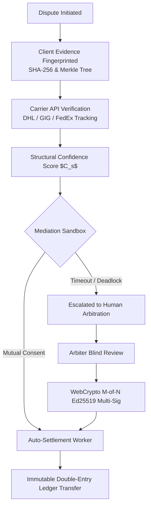

# Vescrow V3 — Dispute Resolution & Cryptographic Arbitration (`/QSD/v3`)

[](#overview)
[](#cryptographic-enforcement)
[](#document-index)

This directory details the **Vescrow Version 3 (V3)** architectural blueprint. V3 introduces an AI-assisted, carrier-integrated, cryptographically enforceable dispute resolution and arbitration engine.

---

## Overview

Traditional financial dispute resolution relies on slow, expensive human intervention. V3 delivers a high-throughput, legally defensible framework that combines:
1. **Automated Objective Evidence Ingestion**: Real-time webhook integration with logistics carriers (DHL, FedEx, GIG Logistics, Topship) and code repositories (GitHub API).
2. **AI-Assisted Mediation Sandbox**: Pareto-optimal settlement offer suggestions calculated using objective evidence confidence scores ($C_s$).
3. **Cryptographic Multi-Sig Settlement**: Bounded Ed25519 execution proofs and $M\text{-of-}N$ arbiter signatures that trigger immutable double-entry ledger transfers without human manual database manipulation.

```
v3/
├── README.md                                          # This architectural index & overview
├── 00-architecture.md                                 # Master V3 dispute resolution architecture
├── 00-decision-review.md                              # Architectural Decision Records (ADRs)
├── 01-phase1-bounded-enforcement.md                   # State locking, Ed25519 proof verifier & multi-sig
├── 02-phase2-intake-and-privacy-first-ledger.md       # Merkle tree evidence fingerprints & blind masking
├── 03-phase3-system-assistance-and-evidence-auth.md   # Carrier connectors (DHL, GIG) & confidence scoring
├── 04-phase4-ai-assisted-mediation-sandbox.md         # Mediation state machine & Pareto settlement offers
├── 05-phase5-escalation-and-human-arbitration.md      # Human arbiter workspace & WebCrypto signing panel
├── 06-phase6-automated-settlement-and-hardening.md   # Execution workers, default judgment & test harness
└── 07-implementation-plan.md                          # Master phase execution roadmap and dependencies
```

---

## Document Index

| Phase / Doc | Category | Scope / Core Deliverables |
| :--- | :--- | :--- |
| [00-architecture.md](./00-architecture.md) | **System Architecture** | Master system design, state machines, carrier connectors, trust boundaries |
| [00-decision-review.md](./00-decision-review.md) | **ADR Catalog** | Architectural Decision Records on cryptographic algorithms, storage, arbitration |
| [01-phase1-bounded-enforcement.md](./01-phase1-bounded-enforcement.md) | **Core Engine** | Schema migrations, immutable `dispute_held` state locking, Ed25519 proof verifier |
| [02-phase2-intake-and-privacy-first-ledger.md](./02-phase2-intake-and-privacy-first-ledger.md) | **Evidence Engine** | Client-side SHA-256 fingerprinting, binary Merkle tree commitment, blind masking |
| [03-phase3-system-assistance-and-evidence-auth.md](./03-phase3-system-assistance-and-evidence-auth.md) | **Connectors** | Logistics carrier APIs (GIG, DHL, FedEx, Topship), Structural Confidence Scoring ($C_s$) |
| [04-phase4-ai-assisted-mediation-sandbox.md](./04-phase4-ai-assisted-mediation-sandbox.md) | **AI Mediation** | Mediation state machine, Pareto-optimal offer generator, interactive negotiation room |
| [05-phase5-escalation-and-human-arbitration.md](./05-phase5-escalation-and-human-arbitration.md) | **Human Arbiter** | Arbiter dossier generator, blind evaluation workspace, WebCrypto $M$-of-$N$ panel |
| [06-phase6-automated-settlement-and-hardening.md](./06-phase6-automated-settlement-and-hardening.md) | **Settlement & QA** | Autonomous settlement worker, SLA default judgment, algorithmic bias audit |
| [07-implementation-plan.md](./07-implementation-plan.md) | **Roadmap** | Multi-phase development roadmap, exit gates, and task dependencies |

---

## Dispute Lifecycle Architecture


