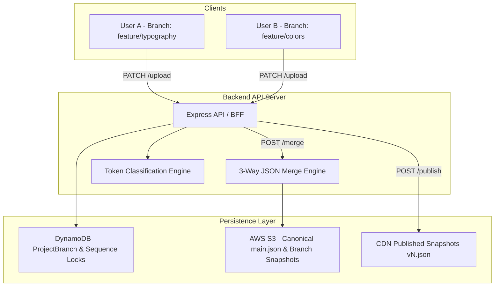
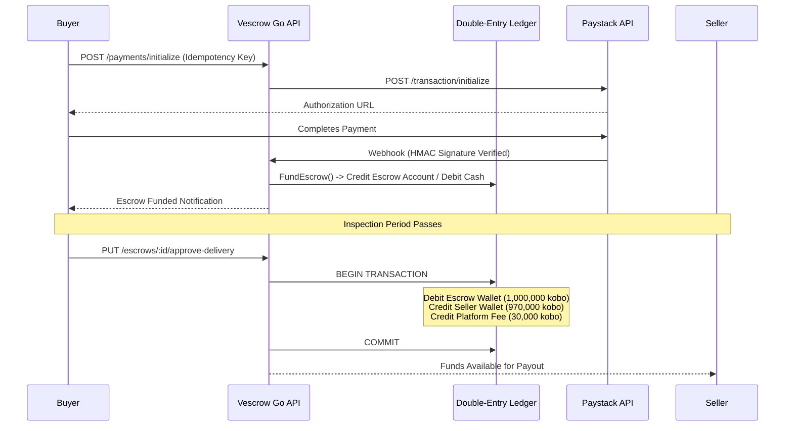

# Engineering Systems Architecture & Career Works Portfolio (`docsplan`)

[](#executive-overview)
[](#technology-stack--domain-breakdown)
[](#3-sbts--enterprise-security--regulatory-governance)
[](#architectural-taxonomy--naming-standards)

Welcome to my **Engineering Systems Architecture & Professional Career Works** repository. This workspace aggregates production-grade system blueprints, immutable financial ledger specifications, distributed state management engines, security audit matrices, and statutory regulatory compliance platforms that I have designed, architected, and delivered across organizations in my engineering career.

---

## Executive Overview

This repository captures complex multi-tier software architectures, database schemas, cryptographic flow designs, and automated compliance engines across **three primary domain initiatives**:

```
docsplan/
├── charisol/      # Strata: Multi-User VCS, Design System Tokens & Prototype Engine
├── QSD/           # Vescrow: Go Modular Monolith, Double-Entry Ledger & Multi-Sig Dispute Engine
└── SBTS/          # Enterprise Governance: CBN CSAT Rules Engine, ISO 27001 & ElectionsSentinel360
```

---

## Architecture Repository Structure

```
docsplan/
├── README.md                                             # Portfolio Master Index & Architectural Overview (this file)
│
├── charisol/                                             # Strata: Collaborative Design System & Prototype Engines
│   ├── README.md                                         # Domain master README & architecture overview
│   ├── vcs-branching-architecture.md                     # Collaborative Branching & Multi-User VCS (DynamoDB, S3)
│   ├── vcs-collaboration-implementation-plan.md         # Implementation roadmap for multi-user collaboration
│   ├── token-classification-architecture.md              # Deterministic Brand/Semantic/Scoped token pyramid
│   ├── token-classification-implementation.md            # Backend-authoritative classification engine tasks
│   ├── collaboration-gap-analysis.md                     # Multi-user conflict resolution & sequence lock audit
│   ├── strata-live-prototype-handoff-plan.md             # Strata live prototype developer handoff & roadmap
│   ├── figma-plugin-architecture.md                      # Manifest V3 Figma plugin architecture & event bridge
│   ├── figma-community-rejection-findings.md             # Figma community review triage & compliance fixes
│   ├── figma-community-resubmit-plan.md                  # Action plan for Figma store approval
│   ├── plugin-infrastructure-config.md                   # AWS CDK / Serverless infrastructure for plugin
│   ├── plugin-shared-schema-contract.md                  # Shared schema contracts between plugin and BFF
│   ├── plugin-file-change-manifest.md                    # File modification manifest for plugin integration
│   ├── font-integration-manual-ui-test-guide.md          # Dynamic font loader validation & fallback testing
│   ├── manual-ui-test-guide.md                           # End-to-end component rendering & token verification
│   ├── ai-brief-merge-bug-analysis.md                    # RCA: AI brief merge race conditions & hydration
│   ├── brand-context-engine-preview-mismatch-analysis.md # Canvas vs runtime preview mismatch resolution
│   ├── public-asset-publish-bug-analysis.md              # Asset publication race conditions & CDN caching
│   ├── sync-publish-save-analysis.md                     # Tri-state sync, publish, and save state machine
│   ├── connected-app/                                    # Downstream Application Telemetry Subsystem (README)
│   ├── figma-asset-export/                               # Automated Figma Vector & Asset Export Pipeline (README)
│   ├── prototype-builder/                                # Interactive Prototype Construction Engine (README)
│   ├── prototype-generation-engine/                      # AST Compiler & Code Synthesis Pipeline (README)
│   ├── review-feedback-architecture/                     # Foundational Architecture Blueprints (README)
│   ├── review-feedback-plan/                             # Phase-by-Phase Feedback Resolution Roadmap (README)
│   ├── v2/                                               # Snapshot Ingestion Engine V2 (README)
│   └── v2-ui-upgrade/                                    # Next.js 14 App Router UI Modernization (README)
│
├── QSD/                                                  # Vescrow: Financial Escrow & Double-Entry Ledger
│   ├── README.md                                         # Domain master README & system architecture
│   ├── architecture.md                                   # Go Modular Monolith system architecture & worker loops
│   ├── double-entry-ledger-explained.md                  # Immutable ledger math invariants (debits = credits)
│   ├── database-schema.md                                # PostgreSQL 15 schema, foreign keys, indexes & audit logs
│   ├── api-specification.md                              # Complete REST API specifications & request/response DTOs
│   ├── security-architecture.md                          # 7-layer defense system (JWT RS256, AES-256-GCM, HMAC)
│   ├── nigerian-compliance.md                            # Central Bank of Nigeria (CBN) AML/CFT & KYC requirements
│   ├── state-machine-and-transaction-flow.md             # Escrow state transitions & transactional outbox lifecycle
│   ├── deployment-guide.md                               # Docker containerization, CI/CD & production DevOps
│   ├── backend-implementation-tasks.md                   # Backend implementation task breakdown (112 tasks)
│   ├── frontend-implementation-plan.md                   # Next.js 14 frontend architecture & Zustand store models
│   ├── admin-portal-implementation-plan.md               # Backoffice admin portal & KYC inspection roadmap
│   ├── escrow-chat-activity-log-plan.md                  # WebSocket chat & immutable audit timeline
│   ├── swagger.json / swagger.yaml / docs.go             # OpenAPI 3.0 specification & Go client bindings
│   ├── security/                                         # Operational Security, Runbooks & Key Rotation (README)
│   ├── test/                                             # QA Acceptance & Verification Test Guides (README)
│   ├── v2/                                               # V2 Architecture: Fund-on-Create & Direct Ledger (README)
│   └── v3/                                               # V3 Architecture: AI Mediation & Multi-Sig (README)
│
└── SBTS/                                                 # Enterprise Governance, Security & OSINT Intelligence
    ├── README.md                                         # Domain master README & regulatory frameworks
    ├── cbn-csat/                                         # Central Bank of Nigeria CSAT Rules Engine (README)
    │   ├── cbn-csat-implementation-plan.md               # 102 Inherent Risk attributes & 504 Maturity statements
    │   └── cbn-csat-backend-migration-tasks.md           # NestJS & Prisma multi-tenant backend migration
    ├── iso27001/                                         # ISO/IEC 27001:2022 ISMS Compliance Platform (README)
    │   ├── iso27001-portal-redesign-tasks.md             # Annex A 30/70 scoring engine & SoA ownership workflows
    │   ├── iso27001-mock-removal-implementation.md       # Production hardening: replacing stubs with live APIs
    │   └── iso27001-phase5-qa-acceptance.md              # Control A.5.1 acceptance test script & evidence
    ├── elections-sentinel/                               # ElectionsSentinel360 (ES360) Platform (README)
    │   ├── 01-requirements-and-core-entities.md          # Statutory foundation (Electoral Act 2026), ERD & RBAC
    │   ├── 02-architecture-and-data-flow.md              # High-throughput ingestion, geospatial index & stream
    │   ├── 03-implementation-plan.md                     # Phased milestone delivery & situation room UI
    │   ├── 04-security-architecture-review.md            # STRIDE threat modeling & anti-tamper controls
    │   ├── 05-security-signoff-and-pentest-readiness.md  # Vulnerability remediation & pentest sign-off
    │   └── elections-sentinel360-live-data-sources-and-osint-strategy.pdf # OSINT intelligence collection
    └── audit-reports/                                    # Penetration Testing & Endpoint Security Audits (README)
        └── backend-endpoints-audit-report.pdf            # REST API endpoints security audit report
```

---

## Master Document Index

### 1. Charisol — Collaborative VCS & Design Infrastructure (`/charisol`)

Design system infrastructure engineered for Git-like multi-user collaboration, automated token classification engines, and real-time state synchronization.

> Master Domain Guide: [charisol/README.md](./charisol/README.md)

| Document | Category | Scope / Key Focus |
| :--- | :--- | :--- |
| [vcs-branching-architecture.md](./charisol/vcs-branching-architecture.md) | **System Architecture** | Collaborative Branching & Multi-User VCS (DynamoDB, S3 3-way JSON merge engine, sequence locks) |
| [vcs-collaboration-implementation-plan.md](./charisol/vcs-collaboration-implementation-plan.md) | **Execution Roadmap** | Phased backend infrastructure, API endpoints, and frontend integration for branch collaboration |
| [token-classification-architecture.md](./charisol/token-classification-architecture.md) | **Core Engine** | Deterministic token classification pyramid (Brand / Semantic / Scoped tokens & rule evaluator) |
| [token-classification-implementation.md](./charisol/token-classification-implementation.md) | **Backend Tasks** | Backend-authoritative classification engine, layer migration routes, and DTCG exports |
| [collaboration-gap-analysis.md](./charisol/collaboration-gap-analysis.md) | **Analysis** | Multi-user conflict resolution, optimistic locking gaps, and state sync strategy |
| [strata-live-prototype-handoff-plan.md](./charisol/strata-live-prototype-handoff-plan.md) | **Implementation** | Strata live prototype execution roadmap, developer handoff, and AST compilation |
| [figma-plugin-architecture.md](./charisol/figma-plugin-architecture.md) | **Figma Integration** | Manifest V3 Figma plugin architecture, variable sync, and cross-origin security |
| [figma-community-rejection-findings.md](./charisol/figma-community-rejection-findings.md) | **Figma Store** | Community review audit findings and remediation items |
| [figma-community-resubmit-plan.md](./charisol/figma-community-resubmit-plan.md) | **Figma Store** | Step-by-step resubmission plan for Figma Community directory listing |
| [plugin-infrastructure-config.md](./charisol/plugin-infrastructure-config.md) | **DevOps / Infra** | AWS CDK Serverless configuration, API Gateway HTTP endpoints, and IAM policies |
| [plugin-shared-schema-contract.md](./charisol/plugin-shared-schema-contract.md) | **API Contracts** | Shared TypeScript data contracts between Figma plugin client and BFF backend |
| [plugin-file-change-manifest.md](./charisol/plugin-file-change-manifest.md) | **Manifest** | Code change manifest for plugin repository integration |
| [font-integration-manual-ui-test-guide.md](./charisol/font-integration-manual-ui-test-guide.md) | **QA / Testing** | Dynamic font loader verification and fallback guidelines |
| [manual-ui-test-guide.md](./charisol/manual-ui-test-guide.md) | **QA / Testing** | End-to-end component rendering and design token verification |
| [ai-brief-merge-bug-analysis.md](./charisol/ai-brief-merge-bug-analysis.md) | **Debugging / RCA** | Deep-dive bug analysis on AI brief merging, branch initialization, and state hydration |
| [brand-context-engine-preview-mismatch-analysis.md](./charisol/brand-context-engine-preview-mismatch-analysis.md) | **Debugging / RCA** | Canvas vs runtime theme preview mismatch resolution |
| [public-asset-publish-bug-analysis.md](./charisol/public-asset-publish-bug-analysis.md) | **Debugging / RCA** | Asset publication race conditions and CDN snapshot persistence |
| [sync-publish-save-analysis.md](./charisol/sync-publish-save-analysis.md) | **State Machine** | Tri-state sync, publish, and save workflow integrity |
| [connected-app/README.md](./charisol/connected-app/README.md) | **Telemetry** | Downstream application heartbeat tracking, token consumption metrics & API |
| [figma-asset-export/README.md](./charisol/figma-asset-export/README.md) | **Asset Pipeline** | High-fidelity asset extraction, SVG cleanup, S3 CDN deployment |
| [prototype-builder/README.md](./charisol/prototype-builder/README.md) | **Prototype UI** | Component tree authoring, visual layout builder, API contracts |
| [prototype-generation-engine/README.md](./charisol/prototype-generation-engine/README.md) | **Code Generator** | Deterministic React code generator, AST template compilation |
| [review-feedback-architecture/README.md](./charisol/review-feedback-architecture/README.md) | **Architecture** | Blueprints for BCE V2, Figma import, and branch publishing |
| [review-feedback-plan/README.md](./charisol/review-feedback-plan/README.md) | **Roadmap** | 5-phase execution plan resolving all review feedback (RV-100 to RV-505) |
| [v2/README.md](./charisol/v2/README.md) | **Snapshot Engine** | High-performance snapshot ingestion v2 and update test suites |
| [v2-ui-upgrade/README.md](./charisol/v2-ui-upgrade/README.md) | **UI Modernization** | Next.js 14 App Router migration and zero-latency preview rendering |

---

### 2. QSD — Vescrow Escrow & Financial Systems (`/QSD`)

Production financial platform architectural specification providing escrow, double-entry bookkeeping, Paystack payment webhooks, and regulatory compliance for the Nigerian financial market:

> Master Domain Guide: [QSD/README.md](./QSD/README.md)

| Document | Category | Scope / Key Focus |
| :--- | :--- | :--- |
| [architecture.md](./QSD/architecture.md) | **System Architecture** | Modular Monolith Go application architecture, domain dependencies, and worker loops |
| [double-entry-ledger-explained.md](./QSD/double-entry-ledger-explained.md) | **Financial Design** | Immutable double-entry ledger math (debits = credits), balance invariants, and transaction safety |
| [database-schema.md](./QSD/database-schema.md) | **Data Architecture** | PostgreSQL schema (25+ tables), foreign keys, composite indexing, and audit logging |
| [api-specification.md](./QSD/api-specification.md) | **API Design** | Endpoints for Escrow lifecycle, Wallet funding, Payouts, Disputes, and Admin operations |
| [security-architecture.md](./QSD/security-architecture.md) | **Security** | 7-layer defense system (JWT RS256, Argon2id, AES-256-GCM, Rate limiting, HMAC webhooks) |
| [nigerian-compliance.md](./QSD/nigerian-compliance.md) | **Regulatory** | CBN AML/CFT compliance, BVN/NIN verification flows, transaction limits, and PEP screening |
| [state-machine-and-transaction-flow.md](./QSD/state-machine-and-transaction-flow.md) | **Flow Logic** | Escrow state machine (Draft -> Funded -> Inspection -> Released / Disputed) |
| [deployment-guide.md](./QSD/deployment-guide.md) | **DevOps** | Containerization, environment setup, and CI/CD production deployment |
| [backend-implementation-tasks.md](./QSD/backend-implementation-tasks.md) | **Backend Tasks** | 112 development tasks across 19 phases for Go Modular Monolith |
| [frontend-implementation-plan.md](./QSD/frontend-implementation-plan.md) | **Frontend Plan** | Next.js 14 App Router frontend architecture, Zustand cookie stores, component hierarchy |
| [admin-portal-implementation-plan.md](./QSD/admin-portal-implementation-plan.md) | **Admin Roadmap** | Backoffice administration portal, KYC verification queues, transaction inspection |
| [escrow-chat-activity-log-plan.md](./QSD/escrow-chat-activity-log-plan.md) | **Activity Audit** | WebSocket chat, immutable audit timeline, attachment handling |
| [swagger.json](./QSD/swagger.json) / [swagger.yaml](./QSD/swagger.yaml) | **OpenAPI Specs** | Complete API contracts for frontend and client integrations |
| [security/README.md](./QSD/security/README.md) | **Security Ops** | Operational runbooks, zero-downtime key rotation, SOC 2 Type II controls, pentest scope |
| [test/README.md](./QSD/test/README.md) | **QA & Testing** | Manual test guides, Swagger verification, Paystack payment simulations, dispute tests |
| [v2/README.md](./QSD/v2/README.md) | **V2 Redesign** | Fund-on-create escrow lifecycle, wallet-to-ledger terminology normalization |
| [v3/README.md](./QSD/v3/README.md) | **V3 Dispute Engine** | AI mediation sandbox, logistics carrier API connectors, Ed25519 multi-sig arbitration |

---

### 3. SBTS — Enterprise Security & Regulatory Governance (`/SBTS`)

Security assessment systems, regulatory compliance engines, and OSINT intelligence frameworks architected for enterprise governance:

> Master Domain Guide: [SBTS/README.md](./SBTS/README.md)

| Subsystem | Document | Category | Scope / Key Focus |
| :--- | :--- | :--- | :--- |
| **CBN CSAT** | [cbn-csat/README.md](./SBTS/cbn-csat/README.md) | **Overview** | Inherent risk bands, 100% maturity gates, multi-tenant isolation |
| **CBN CSAT** | [cbn-csat/cbn-csat-implementation-plan.md](./SBTS/cbn-csat/cbn-csat-implementation-plan.md) | **Compliance Engine** | CBN Cybersecurity Self-Assessment Tool rules engine (FFIEC CAT, 504 statements, risk bands) |
| **CBN CSAT** | [cbn-csat/cbn-csat-backend-migration-tasks.md](./SBTS/cbn-csat/cbn-csat-backend-migration-tasks.md) | **Backend Roadmap** | NestJS & Prisma migration roadmap for the CBN CSAT scoring module |
| **ISO 27001** | [iso27001/README.md](./SBTS/iso27001/README.md) | **Overview** | Annex A controls, 30/70 scoring model, Statement of Applicability |
| **ISO 27001** | [iso27001/iso27001-portal-redesign-tasks.md](./SBTS/iso27001/iso27001-portal-redesign-tasks.md) | **Security Portal** | Annex A scoring engine, SoA ownership workflows, Clause 4–10 linking |
| **ISO 27001** | [iso27001/iso27001-mock-removal-implementation.md](./SBTS/iso27001/iso27001-mock-removal-implementation.md) | **Hardening** | Replacing mock data with live ISMS controls, audit evidence, and verification logic |
| **ISO 27001** | [iso27001/iso27001-phase5-qa-acceptance.md](./SBTS/iso27001/iso27001-phase5-qa-acceptance.md) | **QA Validation** | Control A.5.1 test script and mathematical scoring validation |
| **ES360** | [elections-sentinel/README.md](./SBTS/elections-sentinel/README.md) | **Overview** | Situation room design, statutory over-voting fraud detection |
| **ES360** | [elections-sentinel/01-requirements-and-core-entities.md](./SBTS/elections-sentinel/01-requirements-and-core-entities.md) | **Requirements** | Functional requirements and core domain entities for enterprise security governance |
| **ES360** | [elections-sentinel/02-architecture-and-data-flow.md](./SBTS/elections-sentinel/02-architecture-and-data-flow.md) | **Architecture** | High-level data flows, entity relationships, and security controls |
| **ES360** | [elections-sentinel/03-implementation-plan.md](./SBTS/elections-sentinel/03-implementation-plan.md) | **Plan** | Multi-phase development roadmap and acceptance milestones |
| **ES360** | [elections-sentinel/04-security-architecture-review.md](./SBTS/elections-sentinel/04-security-architecture-review.md) | **Security Review** | Threat modeling, attack surfaces, and defensive countermeasures |
| **ES360** | [elections-sentinel/05-security-signoff-and-pentest-readiness.md](./SBTS/elections-sentinel/05-security-signoff-and-pentest-readiness.md) | **Pentest Sign-off** | Pentest preparation, vulnerability remediation matrix, and sign-off verification |
| **ES360** | [elections-sentinel/elections-sentinel360-live-data-sources-and-osint-strategy.pdf](./SBTS/elections-sentinel/elections-sentinel360-live-data-sources-and-osint-strategy.pdf) | **OSINT / Intel** | Real-time social media & news intelligence collection pipeline strategy |
| **Audits** | [audit-reports/README.md](./SBTS/audit-reports/README.md) | **Audits Overview** | Security vulnerability governance & audit remediation workflow |
| **Audits** | [audit-reports/backend-endpoints-audit-report.pdf](./SBTS/audit-reports/backend-endpoints-audit-report.pdf) | **Security Report** | REST API endpoints security audit and penetration test report |

---

## Technical Highlights

### 1. Collaborative Branching & 3-Way Merge (`/charisol`)

My architectural design for Charisol extends design token storage into a Git-like version control system:



- **Token Classification Pyramid**: Deterministic rules classify tokens into **Brand** (literals like `#3B82F6`), **Semantic** (aliases like `var(--color-blue-500)`), and **Scoped** (component-bound rules like `--button-primary-bg`).
- **Conflict Prevention**: Per-branch `sequenceNumber` counters prevent lost updates while key-level 3-way JSON merges handle non-overlapping concurrent edits smoothly.

---

### 2. Double-Entry Financial Ledger & Escrow (`/QSD`)

The Vescrow backend leverages a domain-driven **Modular Monolith** in Go, backed by double-entry accounting invariants I implemented to eliminate balance drift:



- **Financial Integrity**: Guaranteeing $\sum \text{Debits} = \sum \text{Credits}$ across all system ledger entries.
- **Async Payout Outbox**: High-reliability payout processing via asynchronous DB outbox patterns to isolate external banking web services from state transitions.

---

### 3. Regulatory Rules Engine & FFIEC Scoring (`/SBTS`)

The Central Bank of Nigeria (CBN) Cybersecurity Self-Assessment Tool (CSAT) translates complex spreadsheets into a deterministic, queryable rules engine:

> [!IMPORTANT]
> **Scoring Engine Mechanics**:
> - **Inherent Risk Engine**: Evaluates 102 weighted risk attributes across 5 categories (*Technologies, Delivery Channels, Online/Mobile Services, Organizational Characteristics, External Attacks*) using threshold bands:
>   $$\text{Rating} = \begin{cases} \text{Low} & < 1.5 \\ \text{Moderate} & < 2.5 \\ \text{Above Average} & < 3.5 \\ \text{High} & < 4.5 \\ \text{Extremely High} & \ge 4.5 \end{cases}$$
> - **Maturity Engine**: Maps 504 declarative statements across 5 Domains and 5 Maturity Levels (*Baseline, Evolving, Intermediate, Advanced, Innovative*). Domain maturity level is governed by the highest level at which **100% of statements are satisfied**.

---

## Architectural Taxonomy & Naming Standards

To maintain world-class engineering hygiene, this entire repository adheres to strict architectural standards:

1. **Consistent Kebab-Case**: All markdown documents and directory paths utilize lowercase `kebab-case.md` for maximum cross-platform compatibility and clean URLs.
2. **Standardized Indexing**: Every domain and subsystem folder contains a dedicated, comprehensive `README.md` that serves as the subsystem's architectural entry point.
3. **Sequential Numerical Prefixes**: Multi-phase implementation sequences and phased architectures are prefixed sequentially (e.g. `00-architecture.md`, `01-phase1-...md`, etc.).
4. **Zero Broken References**: All cross-document and cross-subsystem links utilize relative markdown syntax (`./subfolder/file.md`), ensuring full portability across local IDEs, offline docs readers, and remote Git hosting platforms.

---

## Technology Stack & Domain Breakdown

| Domain | Core Frameworks / Stack | Database & Storage | Key Patterns |
| :--- | :--- | :--- | :--- |
| **Charisol** | Node.js, Express, React, Next.js 14, TypeScript | AWS DynamoDB, AWS S3, CloudFront CDN | Optimistic Locks, 3-Way Merge, Token Classification Engine |
| **QSD (Vescrow)** | Go (Fiber), GORM, Next.js 14 | PostgreSQL 15, Redis 7 | Double-Entry Accounting, Outbox Worker Pattern, RS256 JWT, HMAC Webhooks |
| **SBTS (CSAT & ES360)** | NestJS, Next.js, Prisma ORM, TypeScript | PostgreSQL | FFIEC CAT Rules Engine, Multi-Tenant Governance, Anti-Tamper OSINT Ingestion |

---

## How to Explore My Work

1. **For System Architecture & Design System Engineering**:
   - Begin with [charisol/README.md](./charisol/README.md) for an overview of Strata.
   - Read [charisol/vcs-branching-architecture.md](./charisol/vcs-branching-architecture.md) for VCS branching design.
   - Read [charisol/token-classification-architecture.md](./charisol/token-classification-architecture.md) for backend-authoritative token classification.

2. **For Financial Engineering & Escrow Systems**:
   - Begin with [QSD/README.md](./QSD/README.md) for an overview of Vescrow.
   - Read [QSD/architecture.md](./QSD/architecture.md) for system architecture overview.
   - Review [QSD/double-entry-ledger-explained.md](./QSD/double-entry-ledger-explained.md) for double-entry ledger math.
   - Inspect [QSD/security-architecture.md](./QSD/security-architecture.md) for 7-layer defense-in-depth principles.
   - Explore [QSD/v3/README.md](./QSD/v3/README.md) for AI mediation and cryptographic multi-sig arbitration.

3. **For Regulatory Governance & Enterprise Compliance**:
   - Begin with [SBTS/README.md](./SBTS/README.md) for an overview of enterprise governance.
   - Explore [SBTS/cbn-csat/README.md](./SBTS/cbn-csat/README.md) for FFIEC scoring rules.
   - Review [SBTS/iso27001/README.md](./SBTS/iso27001/README.md) for Annex A 30/70 scoring models.
   - Inspect [SBTS/elections-sentinel/README.md](./SBTS/elections-sentinel/README.md) for statutory over-voting detection and OSINT pipeline.
