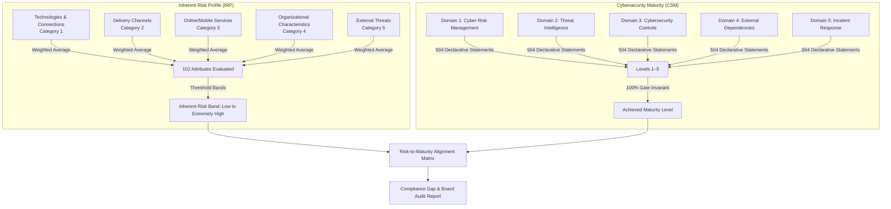

# Central Bank of Nigeria — Cybersecurity Self-Assessment Tool (CBN CSAT)

[-green.svg)](#statutory-foundation)
[](#scoring-engine-architecture)
[](#implementation-roadmap)

This directory houses the complete engineering architecture, statutory calculation models, and NestJS/Prisma migration roadmap for the **Central Bank of Nigeria (CBN) Cybersecurity Self-Assessment Tool (CSAT)** rules engine.

---

## Executive Overview

The CBN CSAT is a statutory cybersecurity assessment workbook mandated for all Deposit Money Banks (DMBs), Payment Service Providers (PSPs), and Other Financial Institutions (OFIs) in Nigeria. 

The system transitions traditional, error-prone macro spreadsheets into a deterministic, high-throughput cloud compliance platform that enforces multi-tenant institutional isolation, cryptographic audit logging, and automated score computation.

```
cbn-csat/
├── README.md                               # This documentation index & architecture overview
├── cbn-csat-implementation-plan.md         # Rules engine specification & scoring formulas
└── cbn-csat-backend-migration-tasks.md     # Production NestJS + Prisma backend migration plan
```

---

## Document Index

| Document | Category | Scope / Key Focus | Status |
| :--- | :--- | :--- | :--- |
| [cbn-csat-implementation-plan.md](./cbn-csat-implementation-plan.md) | **Rules Engine Spec** | Full mathematical formulas, 102 Inherent Risk attributes, 504 Maturity statements, risk-to-maturity alignment matrix | Production Spec |
| [cbn-csat-backend-migration-tasks.md](./cbn-csat-backend-migration-tasks.md) | **Backend Migration** | Phased NestJS & Prisma ORM migration roadmap (P0–P6), multi-tenancy scoping (`institutionId`), catalog seeding | Completed / Reference |

---

## Scoring Engine Architecture

The CBN CSAT engine evaluates risk posture using two primary mathematical models:



### 1. Inherent Risk Level Thresholds
- **Low**: Score $< 1.5$
- **Moderate**: $1.5 \le \text{Score} < 2.5$
- **Above Average**: $2.5 \le \text{Score} < 3.5$
- **High**: $3.5 \le \text{Score} < 4.5$
- **Extremely High**: $\text{Score} \ge 4.5$

### 2. Maturity Level Gate Invariant
Maturity levels are sequential: **Baseline (Level 1) $\rightarrow$ Evolving (Level 2) $\rightarrow$ Intermediate (Level 3) $\rightarrow$ Advanced (Level 4) $\rightarrow$ Innovative (Level 5)**. A financial institution can only be certified at level $N$ if and only if **100% of declarative statements for levels $1$ through $N$ are satisfied (Yes)**.

---

## Core Security & Tenancy Rules

- **Strict Multi-Tenancy**: All CSAT queries and mutations are isolated by `req.user.institutionId`. Cross-institution assessment access returns `403 Forbidden`.
- **Immutable Assessment History**: Completed assessments are versioned and cryptographically signed for regulatory inspection.
