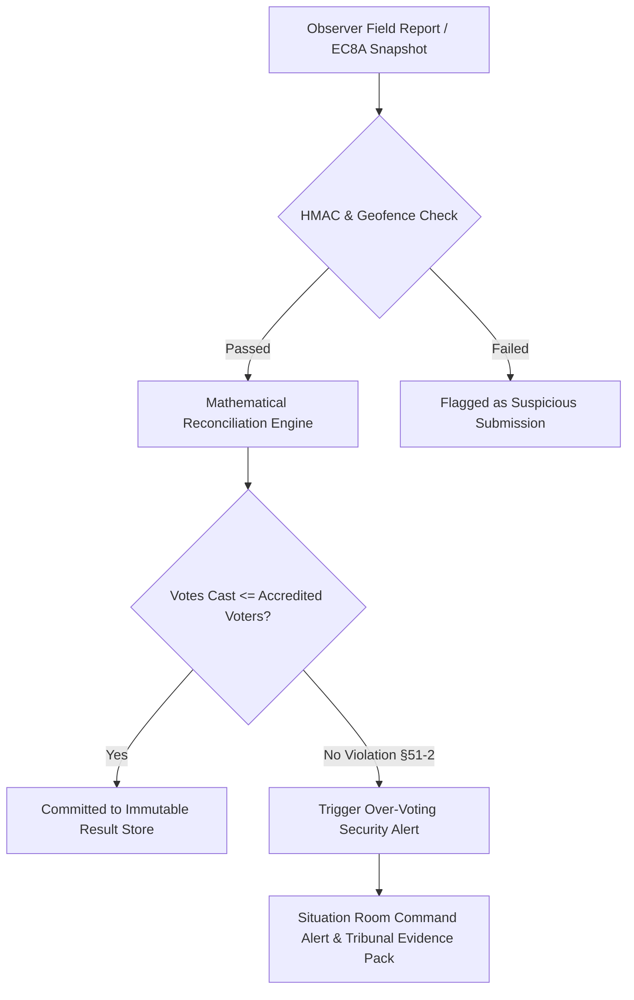

# ElectionsSentinel360 (ES360) — Security & OSINT Intelligence Platform

[](#overview)
[-purple.svg)](#statutory-foundation)
[](#security-architecture)

This directory contains the engineering specifications, domain models, distributed ingestion pipelines, threat models, and security sign-off documentation for **ElectionsSentinel360 (ES360)**.

---

## Overview

ElectionsSentinel360 is an enterprise-grade election monitoring and Open Source Intelligence (OSINT) platform engineered to guarantee election integrity, detect polling unit irregularities in real time, and monitor electoral security threats.

The system processes real-time field reports from verified election observers, ingests social media & broadcast OSINT streams, cross-validates voter turnout against statutory mathematical rules (e.g. over-voting detection under §51(2) of the Electoral Act 2026), and provides geospatial situational awareness to command centres.

```
elections-sentinel/
├── README.md                                                        # This overview and document index
├── 01-requirements-and-core-entities.md                             # Statutory foundation, core entities & RBAC
├── 02-architecture-and-data-flow.md                                 # Ingestion pipeline, streaming & data flow
├── 03-implementation-plan.md                                        # Phased development & milestone roadmap
├── 04-security-architecture-review.md                               # Threat modeling, attack surface & defenses
├── 05-security-signoff-and-pentest-readiness.md                     # Vulnerability matrix & pentest sign-off
└── elections-sentinel360-live-data-sources-and-osint-strategy.pdf   # OSINT collection strategy & NLP pipeline
```

---

## Document Index

| Document | Category | Scope / Key Focus |
| :--- | :--- | :--- |
| [01-requirements-and-core-entities.md](./01-requirements-and-core-entities.md) | **Requirements & Model** | Statutory rules (Electoral Act 2026 §51(2)), Core Entities (Polling Units, Observers, Incidents, Results), ERD, RBAC Matrix |
| [02-architecture-and-data-flow.md](./02-architecture-and-data-flow.md) | **System Architecture** | High-throughput ingestion pipeline, event streaming, geospatial indexing, state machine |
| [03-implementation-plan.md](./03-implementation-plan.md) | **Execution Roadmap** | Phased milestone delivery, situation room UI, API contracts, verification gates |
| [04-security-architecture-review.md](./04-security-architecture-review.md) | **Security Review** | STRIDE threat modeling, anti-spoofing, cryptographically signed observer submissions |
| [05-security-signoff-and-pentest-readiness.md](./05-security-signoff-and-pentest-readiness.md) | **Pentest Sign-off** | Pentest readiness checklist, CVE remediation, defensive hardening verification |
| [elections-sentinel360-live-data-sources-and-osint-strategy.pdf](./elections-sentinel360-live-data-sources-and-osint-strategy.pdf) | **OSINT Strategy** | Multilingual social listening, NLP sentiment & threat classification, disinformation counter-ops |

---

## Statutory Foundation & Mathematical Invariants

Under **§51(2) of the Electoral Act 2026 (Amended)**, if the number of votes cast at an election in any polling unit exceeds the total number of accredited voters in that polling unit, the result of the election for that polling unit must be cancelled:

$$\text{Integrity Invariant: } \sum \text{Votes Cast} \le \text{Accredited Voters}$$

ES360 enforces this invariant automatically at the ingestion boundary before tally aggregation, flagging anomalies for election tribunal review.


