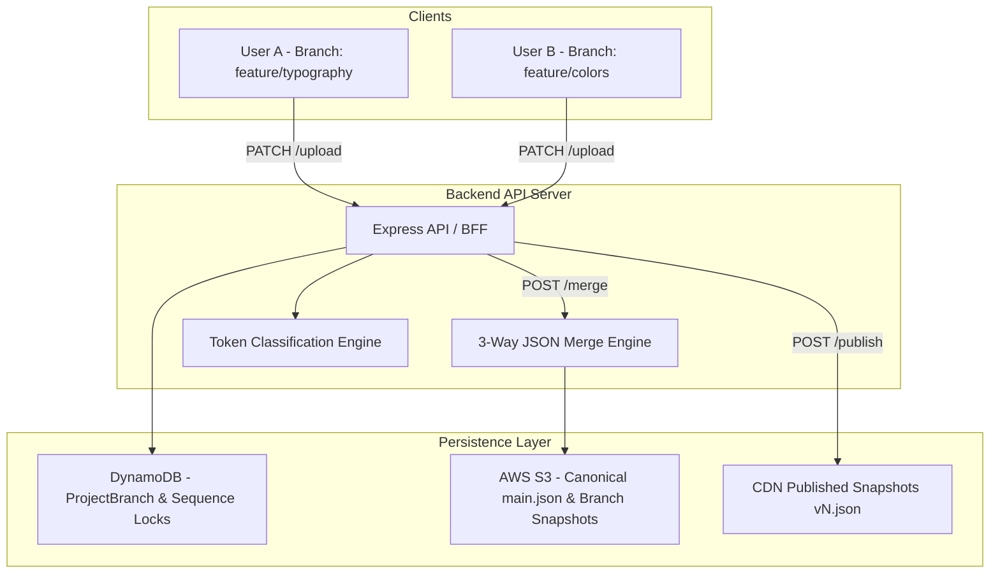

# Strata — Multi-User VCS, Design System Tokens & Prototype Engine (`/charisol`)

[](#overview)
[](#architecture-highlights)
[](#subsystem-directory-structure)

This domain houses the complete architectural specifications, 3-way JSON merge algorithms, token classification rules, Figma plugins, and live prototype generation engines for **Strata (Charisol Design System)**.

---

## Overview

Strata bridges the gap between Figma design files and production codebases. It treats design tokens as version-controlled code assets, providing:
1. **Git-Like Multi-User Branching**: Teams can branch design tokens (`feature/typography`, `feature/dark-mode`), edit in parallel, and merge with conflict resolution via a backend 3-way JSON merge engine.
2. **Deterministic Token Classification**: Automatically classifies tokens into **Brand** (raw hex/scalars), **Semantic** (contextual aliases like `--color-bg-primary`), and **Scoped** (component-bound rules like `--btn-primary-bg`).
3. **Figma Community Plugin & Ingestion**: Direct 2-way synchronization between Figma Variables and the Strata cloud token registry.
4. **Deterministic Prototype Generation**: Compiles token inventories directly into deployable responsive React prototypes with automated Vercel preview environments.

```
charisol/
├── README.md                                         # Master domain documentation & index (this file)
│
├── vcs-branching-architecture.md                     # Collaborative Branching & Multi-User VCS (DynamoDB, S3)
├── vcs-collaboration-implementation-plan.md         # Phased implementation plan for multi-user collaboration
├── collaboration-gap-analysis.md                     # Multi-user conflict resolution & sequence lock audit
├── strata-live-prototype-handoff-plan.md             # Strata live prototype developer handoff & roadmap
│
├── token-classification-architecture.md              # 3-layer token classification pyramid specification
├── token-classification-implementation.md            # Backend-authoritative classification engine tasks
│
├── figma-plugin-architecture.md                      # Manifest V3 Figma plugin architecture & event bridge
├── figma-community-rejection-findings.md             # Figma community review triage & compliance fixes
├── figma-community-resubmit-plan.md                  # Action plan for Figma store approval
├── plugin-infrastructure-config.md                   # AWS CDK / Serverless infrastructure for plugin backend
├── plugin-shared-schema-contract.md                  # Shared schema contracts between plugin and BFF
├── plugin-file-change-manifest.md                    # File modification manifest for plugin integration
│
├── font-integration-manual-ui-test-guide.md          # Dynamic font loader validation & fallback testing
├── manual-ui-test-guide.md                           # End-to-end component rendering & token verification
│
├── ai-brief-merge-bug-analysis.md                    # Deep-dive RCA: AI brief merge race conditions
├── brand-context-engine-preview-mismatch-analysis.md # Canvas vs runtime preview mismatch resolution
├── public-asset-publish-bug-analysis.md              # Asset publication race conditions & CDN caching
├── sync-publish-save-analysis.md                     # Tri-state sync, publish, and save state machine
│
├── connected-app/                                    # Downstream Application Telemetry Subsystem
│   ├── README.md                                     # Overview, heartbeat ingestion & API contracts
│   ├── architecture.md                               # Connected surface tracking architecture
│   └── implementation.md                             # Phased implementation plan
│
├── figma-asset-export/                               # Automated Figma Vector & Asset Export Pipeline
│   ├── README.md                                     # Asset pipeline architecture & incident post-mortems
│   ├── 01-gap-analysis.md                            # Asset export gap analysis
│   ├── 02-target-architecture.md                     # Target asset pipeline architecture
│   ├── 03-implementation-plan.md                     # Phased asset export implementation plan
│   └── 04-incident-hifi-landing-page.md              # Landing page rendering incident analysis
│
├── prototype-builder/                                # Interactive Prototype Construction Engine
│   ├── README.md                                     # Component tree builder & API contracts
│   ├── 01-architecture.md                            # Architecture & state synchronization
│   ├── 02-api-contracts.md                           # BFF and compiler API contracts
│   └── 03-implementation-plan.md                     # Step-by-step prototype builder roadmap
│
├── prototype-generation-engine/                      # AST Compiler & Code Synthesis Pipeline
│   ├── README.md                                     # Deterministic React generation overview
│   ├── 01-architecture-and-contracts.md              # Template compiler contracts & schema
│   └── 02-implementation-steps.md                   # Generator pipeline implementation tasks
│
├── review-feedback-architecture/                     # Foundational Architecture Blueprints
│   ├── README.md                                     # Subsystem architectural overview
│   ├── branch-publish-tab-architecture.md            # Branch release workflow & CDN snapshots
│   ├── brand-context-engine-v2-architecture.md       # Multi-modal web crawler & brand synthesizer
│   ├── figma-importation-architecture.md             # Figma node tree parser & DTCG normalization
│   └── implementation-plan.md                        # Master backend/frontend implementation plan
│
├── review-feedback-plan/                             # Phase-by-Phase Feedback Resolution Roadmap
│   ├── README.md                                     # Roadmap matrix & dependency graph
│   ├── 00-index.md                                   # Master task directory (RV-100 to RV-505)
│   ├── 01-reanalyse-fix.md                           # Phase 1: Re-analyse endpoint fix
│   ├── 02-css-import-bce.md                          # Phase 2: CSS import & font extraction in BCE
│   ├── 03-font-type.md                               # Phase 3: Multi-font support & font upload
│   ├── 04-charisol-sso.md                            # Phase 4: Charisol SSO auth migration
│   └── 05-explore-project.md                         # Phase 5: Dynamic Explore Project page
│
├── v2/                                               # Snapshot Ingestion Engine V2
│   ├── README.md                                     # V2 snapshot architecture & execution plan
│   ├── 01-architecture.md                            # Snapshot schema v2 & DynamoDB indexing
│   ├── 02-implementation-plan.md                    # Phases 0–7 implementation tasks
│   ├── snapshot-ingestion-architecture.md            # S3 snapshot ingestion pipeline
│   └── update/                                       # Problem analysis, testing & validation guides
│       ├── README.md                                 # Testing guide index (Phases 0–4)
│       ├── 01-problem-analysis.md                    # Current state problem analysis
│       ├── 02-architecture.md                        # Target update architecture
│       ├── 03-implementation-plan.md                # Update execution roadmap
│       └── 04..09-manual-testing-guides.md           # Master QA validation guides
│
└── v2-ui-upgrade/                                    # Next.js 14 App Router UI Modernization
    ├── README.md                                     # Modernization overview & SSR benefits
    ├── architecture.md                               # Component tree & micro-state scoping
    └── implementation-plan.md                        # Phased UI upgrade implementation plan
```

---

## Master Document Matrix

| Category | Document | Scope / Core Deliverables |
| :--- | :--- | :--- |
| **VCS Architecture** | [vcs-branching-architecture.md](./vcs-branching-architecture.md) | Multi-user Git-like VCS, branch isolation, sequence locking, 3-way JSON merge |
| **VCS Plan** | [vcs-collaboration-implementation-plan.md](./vcs-collaboration-implementation-plan.md) | Phased backend and frontend implementation tasks for multi-user collaboration |
| **VCS Gap Analysis** | [collaboration-gap-analysis.md](./collaboration-gap-analysis.md) | Concurrent editing edge cases, optimistic concurrency, and conflict prevention |
| **Token Architecture** | [token-classification-architecture.md](./token-classification-architecture.md) | Brand / Semantic / Scoped 3-layer pyramid classification specification |
| **Token Plan** | [token-classification-implementation.md](./token-classification-implementation.md) | Backend-authoritative classification engine tasks and API routes |
| **Live Prototype** | [strata-live-prototype-handoff-plan.md](./strata-live-prototype-handoff-plan.md) | Figma-to-code prototype generator developer handoff and validation criteria |
| **Figma Plugin** | [figma-plugin-architecture.md](./figma-plugin-architecture.md) | Manifest V3 plugin architecture, secure iframe messaging, token export |
| **Figma Store** | [figma-community-rejection-findings.md](./figma-community-rejection-findings.md) | Figma community review triage and compliance resolution |
| **Figma Store** | [figma-community-resubmit-plan.md](./figma-community-resubmit-plan.md) | Action plan and validation gates for Figma plugin resubmission |
| **Plugin Infra** | [plugin-infrastructure-config.md](./plugin-infrastructure-config.md) | AWS CDK / Lambda serverless infrastructure configuration |
| **Plugin Contract** | [plugin-shared-schema-contract.md](./plugin-shared-schema-contract.md) | TypeScript interface contracts between plugin and backend |
| **Plugin Manifest** | [plugin-file-change-manifest.md](./plugin-file-change-manifest.md) | Code change manifest for plugin repository integration |
| **QA / Testing** | [font-integration-manual-ui-test-guide.md](./font-integration-manual-ui-test-guide.md) | Font loader verification, dynamic fallback & font preview validation |
| **QA / Testing** | [manual-ui-test-guide.md](./manual-ui-test-guide.md) | End-to-end token verification, editor controls and canvas preview QA |
| **Debugging / RCA** | [ai-brief-merge-bug-analysis.md](./ai-brief-merge-bug-analysis.md) | Root cause analysis: AI brief merge race condition and state hydration fix |
| **Debugging / RCA** | [brand-context-engine-preview-mismatch-analysis.md](./brand-context-engine-preview-mismatch-analysis.md) | Canvas vs runtime preview mismatch analysis and resolution |
| **Debugging / RCA** | [public-asset-publish-bug-analysis.md](./public-asset-publish-bug-analysis.md) | Asset publication race conditions and CDN snapshot persistence fix |
| **Debugging / RCA** | [sync-publish-save-analysis.md](./sync-publish-save-analysis.md) | Tri-state sync, publish, and save state machine verification |
| **Telemetry Subsystem**| [connected-app/README.md](./connected-app/README.md) | Downstream application heartbeat tracking, token consumption metrics |
| **Asset Pipeline** | [figma-asset-export/README.md](./figma-asset-export/README.md) | High-fidelity asset extraction, SVG cleanup, S3 CDN deployment |
| **Prototype Builder** | [prototype-builder/README.md](./prototype-builder/README.md) | Visual layout builder, component tree authoring, API contracts |
| **Code Generation** | [prototype-generation-engine/README.md](./prototype-generation-engine/README.md) | Deterministic React code generator, AST template compilation |
| **Review Architecture**| [review-feedback-architecture/README.md](./review-feedback-architecture/README.md) | Core blueprints for BCE V2, Figma import, and branch publishing |
| **Review Roadmap** | [review-feedback-plan/README.md](./review-feedback-plan/README.md) | 5-phase execution plan resolving all review feedback (RV-100 to RV-505) |
| **Snapshot Ingestion** | [v2/README.md](./v2/README.md) | High-performance snapshot ingestion v2 and update test suites |
| **UI Modernization** | [v2-ui-upgrade/README.md](./v2-ui-upgrade/README.md) | Next.js 14 App Router migration and zero-latency preview rendering |

---

## 3-Way JSON Merge Architecture


