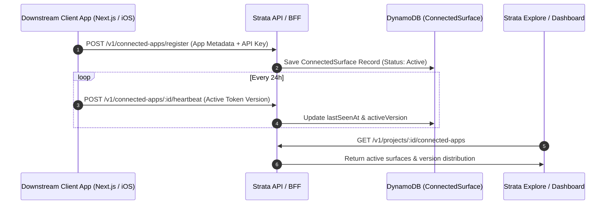

# Connected App Tracking Subsystem (`/charisol/connected-app`)

[](#overview)
[](#document-index)
[](#architecture-flow)

This directory houses the system architecture and implementation roadmap for **Connected App Tracking** within the Strata (Charisol) design system.

---

## Overview

The Connected App tracking subsystem provides design system maintainers with real-time visibility into which production codebases, design tools, and web applications are actively consuming published design tokens:
- **Surface Registration**: External applications register via API keys and report their runtime platform (e.g. Next.js web app, iOS, React Native, Figma plugin).
- **Automated Heartbeats**: Client applications send lightweight periodic telemetry reporting active token bundles and version adoption.
- **Dependency Graph**: The project dashboard renders live connection statuses, alerting teams when downstream applications are running stale token versions.

```
connected-app/
├── README.md               # This architectural overview and document index
├── architecture.md         # System design, data models, DynamoDB schema & endpoints
└── implementation.md       # Phased implementation plan and task validation criteria
```

---

## Document Index

| Document | Category | Scope / Core Deliverables |
| :--- | :--- | :--- |
| [architecture.md](./architecture.md) | **System Architecture** | `ConnectedSurface` DynamoDB entity, heartbeat ingestion worker, telemetry endpoints |
| [implementation.md](./implementation.md) | **Implementation Plan** | Backend API endpoints, authentication middleware, frontend dashboard cards |

---

## Architecture Flow


