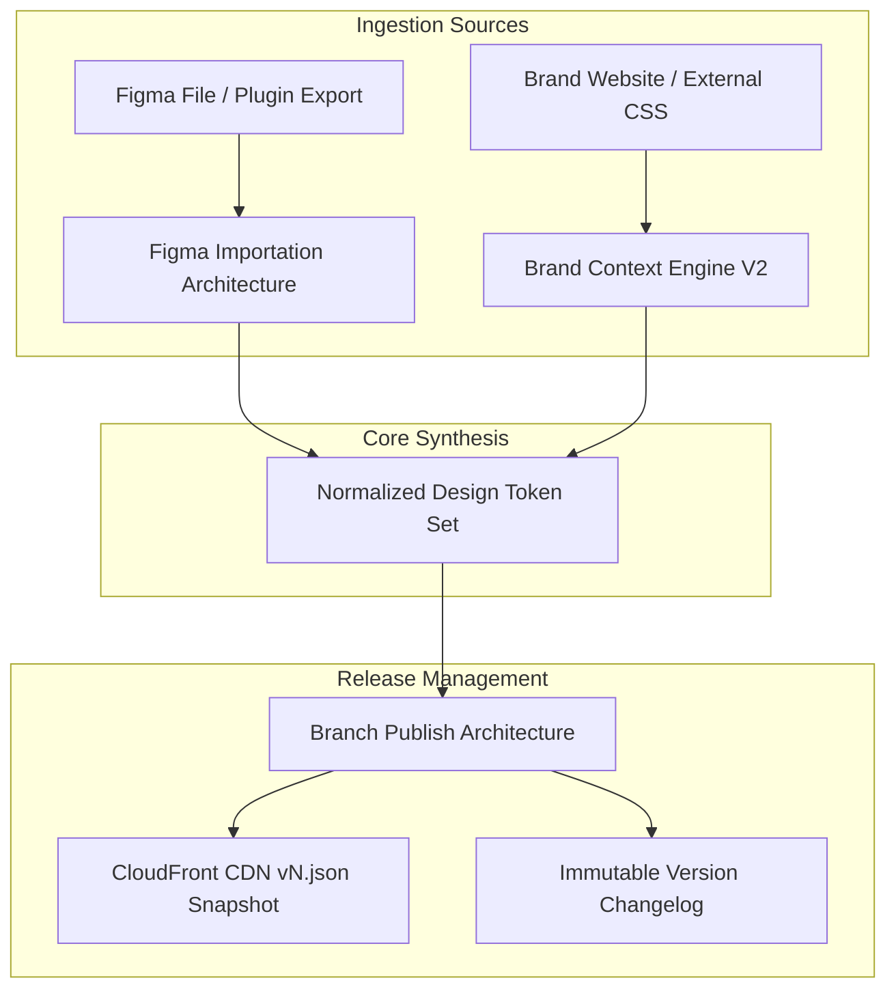

# Review Feedback Architecture Blueprints (`/charisol/review-feedback-architecture`)

[](#overview)
[](#document-index)
[](#architectural-subsystems)

This directory houses the foundational architectural design documents drafted in response to platform review feedback for the Strata (Charisol) design system.

---

## Overview

These architecture specifications define the deep technical foundations required for enterprise-grade Figma token ingestion, automated brand styling extraction, and independent branch publication workflows.

```
review-feedback-architecture/
├── README.md                                 # This architectural overview and index
├── figma-importation-architecture.md         # Figma REST API / Plugin token extraction & frame tree parser
├── brand-context-engine-v2-architecture.md   # Multi-modal web crawler, contrast analyzer & token synthesizer
├── branch-publish-tab-architecture.md        # Branch release workflow, CDN snapshots & changelog generation
└── implementation-plan.md                    # Consolidated backend and frontend technical implementation plan
```

---

## Document Index

| Document | Category | Scope / Core Architectural Focus |
| :--- | :--- | :--- |
| [figma-importation-architecture.md](./figma-importation-architecture.md) | **Ingestion Engine** | Figma node tree normalization, style dictionary mapping, variable collection parsing |
| [brand-context-engine-v2-architecture.md](./brand-context-engine-v2-architecture.md) | **AI Styling Engine** | Automated website URL scraping, brand asset extraction, color contrast validation |
| [branch-publish-tab-architecture.md](./branch-publish-tab-architecture.md) | **Release Management** | Isolated branch publishing to S3/CloudFront, semantic versioning, release diffing |
| [implementation-plan.md](./implementation-plan.md) | **Technical Plan** | Cross-subsystem development milestones, schema extensions, API route mapping |

---

## Architectural Subsystems


