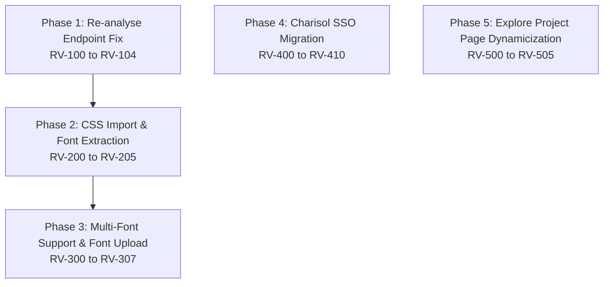

# Review Feedback Resolution Roadmap (`/charisol/review-feedback-plan`)

[](#overview)
[-orange.svg)](#phase-matrix)
[](#task-summary)

This directory contains the master phased implementation roadmap addressing all technical review feedback for the Strata (Charisol) design system platform.

---

## Overview

The review feedback plan covers five critical stabilization and expansion phases:
1. **Phase 1**: Hardening the token re-analysis and reclassification backend endpoint.
2. **Phase 2**: Adding CSS `@import` parsing and automated font extraction into the Brand Context Engine (BCE).
3. **Phase 3**: Enabling multi-font management, custom font uploading to S3, and Google Fonts API integration.
4. **Phase 4**: Migrating internal authentication to Charisol OAuth 2.0 Single Sign-On (SSO).
5. **Phase 5**: Making the public Explore Project showcase dynamically query live project tokens and metadata.

```
review-feedback-plan/
├── README.md                 # This overview and roadmap index
├── 00-index.md               # Master phase matrix, dependencies & task inventory
├── 01-reanalyse-fix.md       # Phase 1: Re-analyse endpoint fix (RV-100 to RV-104)
├── 02-css-import-bce.md      # Phase 2: CSS import & font extraction in BCE (RV-200 to RV-205)
├── 03-font-type.md           # Phase 3: Multi-font support & font upload (RV-300 to RV-307)
├── 04-charisol-sso.md        # Phase 4: Charisol SSO migration (RV-400 to RV-410)
└── 05-explore-project.md     # Phase 5: Explore project page dynamicization (RV-500 to RV-505)
```

---

## Phase Matrix

| Phase | Feature / Scope | Priority | Tasks | Document |
|:---|:---|:---|:---|:---|
| **Phase 1** | Re-analyse Endpoint Fix | 🔴 High | `RV-100` – `RV-104` | [01-reanalyse-fix.md](./01-reanalyse-fix.md) |
| **Phase 2** | CSS Import & Font Extraction in BCE | 🟡 Medium | `RV-200` – `RV-205` | [02-css-import-bce.md](./02-css-import-bce.md) |
| **Phase 3** | Multi-Font Support & Font Upload | 🟡 Medium | `RV-300` – `RV-307` | [03-font-type.md](./03-font-type.md) |
| **Phase 4** | Charisol SSO Auth Migration | 🟠 Medium-High | `RV-400` – `RV-410` | [04-charisol-sso.md](./04-charisol-sso.md) |
| **Phase 5** | Explore Project Page Dynamicization | 🔴 High | `RV-500` – `RV-505` | [05-explore-project.md](./05-explore-project.md) |
| **Master Index** | Complete Phase & Task Directory | ℹ️ Reference | All | [00-index.md](./00-index.md) |

---

## Dependency Graph


