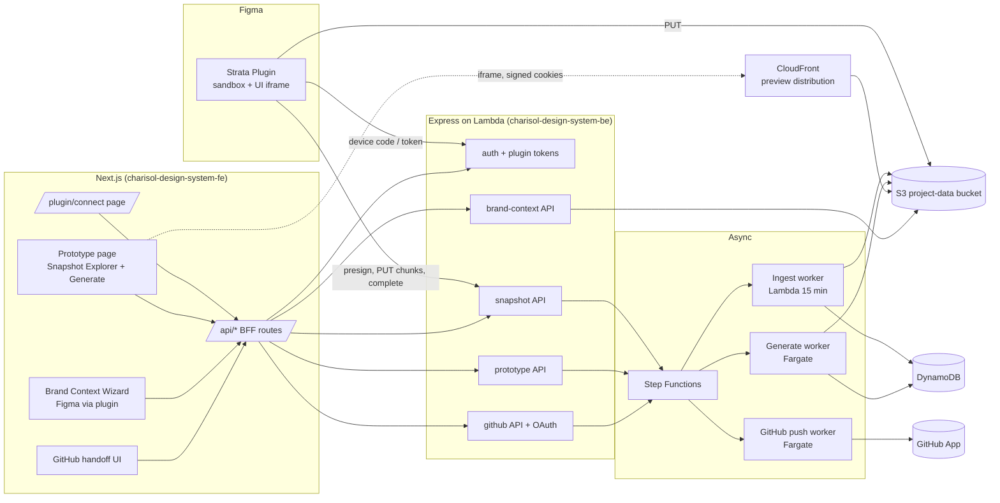
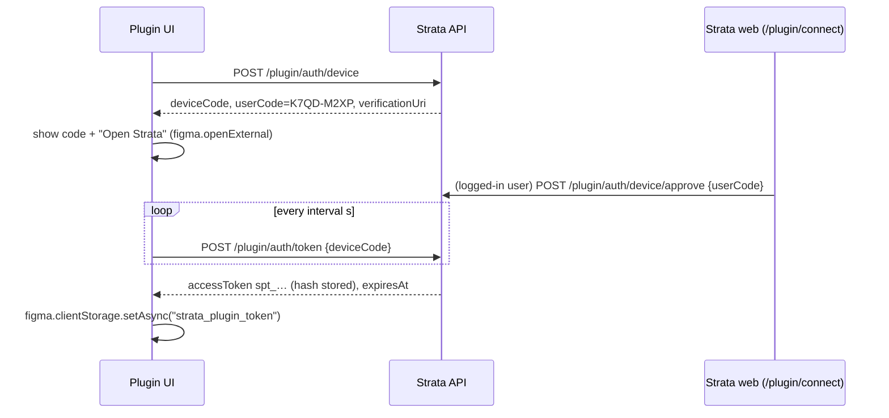
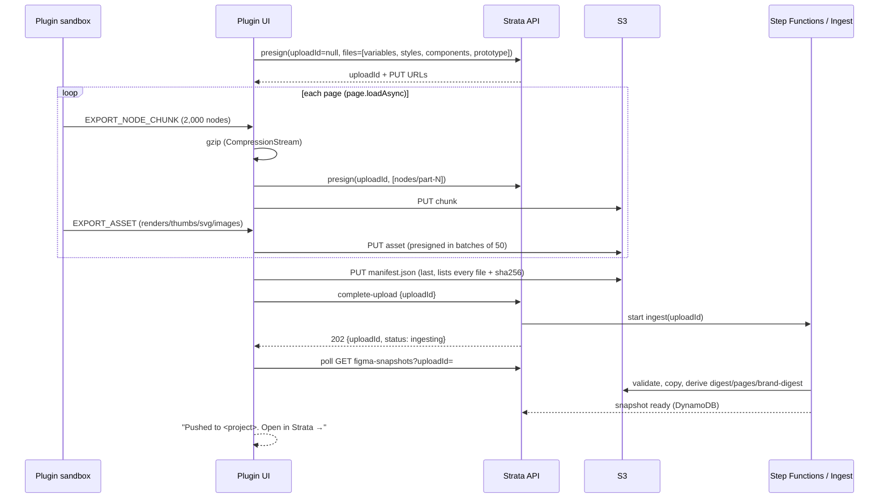
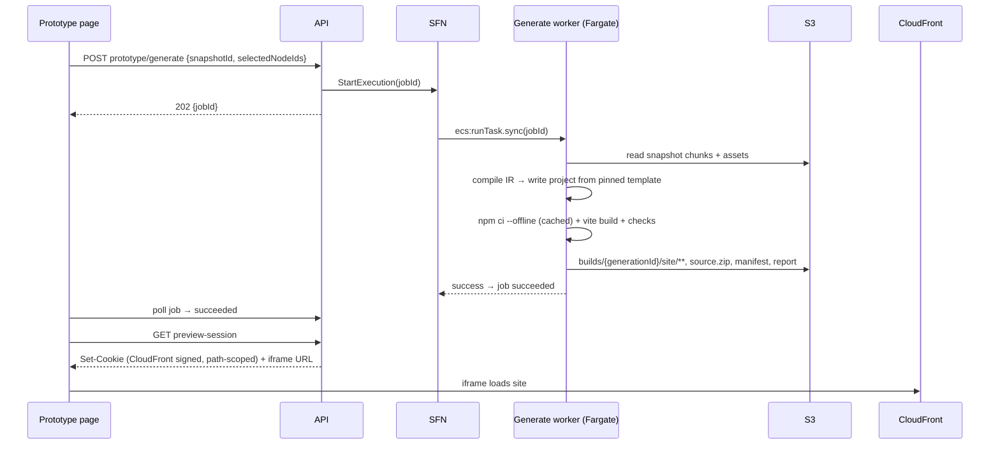

# Strata v2: Figma Plugin → Snapshot → Prototype, Brand Context, and GitHub Handoff

## Architecture

This document describes the target architecture for Strata v2. It covers the current state of the code, the decisions this plan makes, the shared data contracts, and how the components interact. The step-by-step tasks are in [`02-implementation-plan.md`](./02-implementation-plan.md).

---

## 1. Goals

1. **Pull data from Figma using the Strata Figma plugin.** The plugin is the only way Figma data gets into Strata. Users do not paste Figma URLs or personal access tokens anywhere in the web app.
2. **Store one canonical "Figma snapshot" per push.** Both the Prototype workflow and the Brand Context Engine read the same snapshot.
3. **Show everything that was pulled on the Prototype page.** That includes screens, flows, components, tokens, assets, layers, and warnings. Add a **Generate Prototype** button that builds a runnable application prototype from the snapshot.
4. **Change the Figma source in the Brand Context Engine.** The Figma card follows the steps *connect plugin → push to Strata → pick the snapshot in the Brand Context Engine → extract design data*. It no longer asks for a Figma URL or access token.
5. **Fix the GitHub handoff end to end.** That means GitHub OAuth, installing the GitHub App, picking or creating a repository, and pushing the *generated prototype* (not placeholder files) to a branch with a pull request.

### Non-goals for v2

- Production authentication, payments, or real back-end integrations inside generated prototypes. This is unchanged from the v1 plan.
- Vercel deployment and the stable-URL promotion from v1 plan Phase 4. v2 hosts review builds on Strata-owned S3 and CloudFront. Vercel stays a follow-up behind the deployment-provider interface.
- AI-driven layout. Generation is deterministic. AI is optional and limited to naming and "brand feel" hints.

### Relationship to the v1 plan

[`../strata-live-prototype-handoff-plan.md`](../strata-live-prototype-handoff-plan.md) assumed that Strata would read Figma through the REST API, using a Figma URL and a stored credential. v2 replaces that with the plugin:

| v1 section | Status in v2 |
|---|---|
| Phase 0: contracts, roles, jobs, Step Functions | **Reused.** v2 Phase 0 fixes the defects found in the existing implementation. |
| Phase 1: REST inventory worker, render worker | **Replaced** by plugin extraction (v2 Phase 1) and snapshot ingestion (v2 Phase 2). |
| Phase 1: selection UI | **Replaced** by the Snapshot Explorer (v2 Phase 3). |
| Phase 2: deterministic generation | **Kept and made concrete** in v2 Phase 4. |
| Phase 3: GitHub handoff | **Kept.** v2 Phase 6 fixes the broken OAuth and replaces the placeholder publish. |
| Phase 4: Vercel and preview tokens | **Deferred.** v2 uses S3 and CloudFront review builds. Preview tokens are reused when sharing is added. |
| Task 0.2: encrypted Figma credential storage | **Mostly obsolete.** The plugin removes the need for Figma tokens. The legacy token path is deprecated in v2 Phase 7. |

---

## 2. Current state (audit, October 2026)

These findings come from reading the code. They explain why the plugin screenshot shows `Total Nodes: 10,000`, `Variables: 0`, `Styles: 0`, and why the GitHub modal shows *"No GitHub OAuth token found for user."*

### 2.1 Figma plugin (`charisol-figma-plugin/`)

| Finding | Evidence | Impact |
|---|---|---|
| Hard 10,000-node cap | `src/walker/treeWalker.ts` L43 `const maxNodes = scope.maxNodes \|\| 10000`. The UI never passes `maxNodes` (`src/components/ExportProgressView.tsx` ~L149). | Large files are cut off silently. The screenshot shows exactly 10,000. |
| Truncation always reported as false | `src/assembler/manifestAssembler.ts` L149 `isTruncated: false` | The backend and UI treat truncated data as complete. |
| Variables return 0 | `src/walker/variableExtractor.ts` reads only `getLocalVariableCollectionsAsync`. The `catch` at L89 swallows every error. | Files that use library variables, and files where any call throws, report 0. |
| Styles return 0 | `src/walker/styleExtractor.ts` uses `getLocal*StylesAsync` only and has a silent `catch` at L89. | Same as variables. |
| Node usage of variables and styles not captured | `src/walker/nodeSerializer.ts` does not serialize `boundVariables`, `fillStyleId`, `textStyleId`, `effectStyleId`, `strokeStyleId`, or `gridStyleId`. | The generator and Brand Context Engine cannot tell which tokens a design actually uses. |
| Aliases lose their target | `variableExtractor.ts` L47 turns an alias into `var(--alias-<id>)` | The semantic → primitive chain is lost. |
| Prototype reactions use the deprecated `action` field | `src/walker/prototypeExtractor.ts` reads `r.action`. Figma now uses `reactions[].actions[]`. | Multi-action and newer interactions are dropped. |
| Renders limited to root frames | `src/exporter/assetExporter.ts` exports PNGs at scale 2 only for root FRAME, COMPONENT, and COMPONENT_SET nodes. There are no thumbnails and no SVG icons. | The Explorer has no thumbnails. 2× renders of large frames are heavy. |
| Uploads fail silently | `src/uploader/uploadOrchestrator.ts` L133–135 and L184–191 swallow errors and still report success with a fake `job_<ts>` ID. | The UI says "Export & S3 Upload Complete" even when nothing was stored. |
| Upload is one large manifest | Nodes are chunked over IPC (`src/chunking/nodeChunker.ts`), but the upload sends the full `EXPORT_MANIFEST` as one `manifest.json`. | Memory and size limits. This is the hidden reason for the 10,000 cap. |
| Auth is email and password inside the plugin | `src/services/api.ts` L26–71 tries `/auth/login` then `/auth/signin`, and has a "paste token" fallback. The token is stored in `figma.clientStorage`. | There is no "connect plugin" flow, no scoped or revocable token, and passwords are typed into a Figma iframe. |
| `networkAccess` pinned to a PR environment | `manifest.json` lists `https://api-pr-256-…aws.charisol.io` | The plugin cannot be published as is. |
| `figma.fileKey` assumed | The backend `FigmaInventory` model requires `fileKey` (`models/FigmaInventory.js` L13). `figma.fileKey` is **only available to private plugins**. | The inventory record fails to save for published plugins (see 2.2). |

### 2.2 Backend (`charisol-design-system-be/`)

| Finding | Evidence | Impact |
|---|---|---|
| Plugin upload produces a *generation* job | `controllers/pluginController.js` `completePluginUpload` L136–258 calls `createJobRecord({ workflowType: "generation" })` and jumps straight to `ready-for-review`. | The "Prototype Job ID" in the plugin is not a real job. It hides the missing snapshot concept. |
| Inventory record silently not saved | `pluginController.js` L177–191 calls `FigmaInventory.create` without `fileKey` inside a try/catch that swallows the error. | There is no durable index of pushes. |
| No list or latest endpoint for pushes or jobs | `routes/v1/index.js` L548–578 | The web app cannot discover a push unless it already has a job ID. |
| Generation is faked | `controllers/prototypeController.js` `startGeneration` L22–94 uses `setImmediate` to force `COMPLETE`. | Nothing is generated. |
| Step Functions workflow is all `Pass` states | `cdk/lib/charisol-design-system-stack.ts` L540–574. A Fargate task definition exists (L496+) but is not wired in. | There is no worker execution. |
| Prototype config held in memory | `prototypeController.js` L448–487 uses a `Map` | Config is lost on every Lambda cold start. |
| Undefined state referenced | `prototypeContracts.js` uses `JOB_STATES.PROMOTION_PENDING` in transitions, but it is not defined in `JOB_STATES`. | Creates an `undefined` key in the transition map. |
| Brand Context Figma extract needs URL and token | `controllers/brandContextEngineController.js` `extractFromFigma` L445–549. It reads plaintext `Profile.figmaTokens[].tokenValue`, calls the REST API, and stops its loop after 12 seconds (L509–515). | This is the user-facing problem in goal 4. The 12-second loop also silently truncates. |
| GitHub authorize is unauthenticated | `routes/v1/index.js` L519–522 has no `authenticateUser`. `githubOAuthController.js` L89 uses `req.user?.id \|\| req.user?.pk \|\| req.query.userId \|\| ""`. | `userId` is empty. The callback falls back to `"anonymous"` (L137) and **skips saving the token** (L148), but still shows "Connected". **This is the root cause of the screenshot error.** |
| OAuth `state` is unsigned base64 JSON | `githubOAuthController.js` L94–101 | Anyone can craft a `state` naming another user ID and attach their own GitHub account to that user's Strata account. |
| Token save failure ignored | L164–168 only logs a warning | "Connected" is shown even when nothing was saved. |
| Callback URL mismatch | CDK default `GITHUB_OAUTH_CALLBACK_URL=https://strata.charisol.io/api/github/oauth/callback` (stack L277–278) vs. the backend fallback `/v1/github/oauth/callback` (L62–74) | `redirect_uri` mismatches break the code exchange in some environments. |
| GitHub user tokens stored in plaintext | `models/GitHubUserToken.js` `accessToken` and `refreshToken` | Security risk. |
| Publish pushes placeholder content | `controllers/githubController.js` `publish` L663–693 writes hardcoded `design-system/tokens.json` (fake colors) and a README. | Even a working handoff would push nothing useful. |

### 2.3 Frontend (`charisol-design-system-fe/`)

| Finding | Evidence | Impact |
|---|---|---|
| The Prototype section exists | `components/sections/project/PrototypeSection.tsx`, plus subcomponents in `components/sections/project/prototype/` | We extend it rather than starting over. |
| Plugin pushes are invisible | The inventory loads only from a saved `jobId` in localStorage (`strata_prototype_job_*`) or a fetched artifact manifest. `prototype.service.ts` has plugin methods that nothing calls. | After a push, the Prototype page does not show the data. |
| Loads the full manifest in the browser | `PrototypeSection.tsx` L127–132 fetches the whole presigned manifest | This will not scale past the 10,000 cap. |
| Has "Continue to Generation", not "Generate Prototype" | `prototype/PrototypeActionFooter.tsx` L86, L138 | The action exists but generation is fake (2.2). |
| Brand Context Figma source asks for URL and token | `components/brand-context/BrandContextWizard.tsx` ~L732–774 with `FigmaTokenPicker` | Goal 4. |
| OAuth callback BFF proxies backend HTML | `app/api/github/oauth/callback/route.ts` returns the backend HTML and depends on it to `postMessage` | Fragile. The success message is shown even if the token was never saved. |
| Repo picker opens without checking OAuth | `prototype/RepositoryStatusCard.tsx` L227–230 (`onSuccess` opens the picker) and L412–414 (Change Repository). `RepoPickerModal.tsx` L72–76 always calls installations. | Shows "Connection Error" with only a "Try Again" button, which can never succeed. |

---

## 3. Key decisions

| # | Decision | Rationale |
|---|---|---|
| D1 | **The plugin is the only Figma ingestion path.** REST/URL ingestion is deprecated, then removed in Phase 7. | One code path. No Figma tokens to store. The plugin can read data the REST API cannot, such as variables on non-Enterprise plans and resolved instances. |
| D2 | **A push creates a `FigmaSnapshot`, not a job.** Generation jobs are created only when the user clicks **Generate Prototype**. | Separates ingestion from generation, as the v1 plan intended. One snapshot can feed many generations and brand extractions. |
| D3 | **The snapshot is immutable and versioned.** `snapshotId` is content-addressed (hash of the manifest without timestamps). Re-pushing identical content is deduplicated. | Reproducible generations, cheap re-push, and reliable caching. |
| D4 | **Chunked upload format (schema 2.0.0).** A small `manifest.json`, node chunks of 2,000 nodes each (gzipped), and separate files for variables, styles, components, and prototype data. | Removes the memory ceiling behind the 10,000 cap. The browser and workers load only what they need. |
| D5 | **Raise the node budget to 150,000 by default and never truncate silently.** Hitting the budget sets `truncation.isTruncated=true` with reasons, and the UI shows it. | Honest data. The budget is a protection, not a hidden limit. |
| D6 | **Ingest step derives read-optimized artifacts**: `digest.json`, per-page `pages/<pageId>.json`, and `brand-digest.json`. | The Prototype page and Brand Context Engine respond within the 30-second API Lambda limit without parsing 100 MB of nodes. |
| D7 | **Plugin "connect" uses a device-code flow** that issues a scoped, revocable plugin token (`spt_…`). Email and password login stays as a fallback for one release. | Matches the user's "connect plugin" step. No passwords in the plugin. Tokens can be revoked from Settings. |
| D8 | **Identify Figma files by `sourceDocumentId`.** This is a UUID the plugin writes once into `figma.root` plugin data. `figma.fileKey` is stored when available, which is only for private plugins. | Works for both published and private plugins. |
| D9 | **Build one shared renderer package**, `strata-figma-render` (TypeScript and React), that turns normalized nodes into DOM. The Explorer uses it for live preview and the generator uses it for emitted code. | What users see in the Explorer matches what the generator builds. One implementation to test. |
| D10 | **Deterministic compiler: snapshot → IR → React 19, TypeScript, and Vite project** from a pinned template. It runs in a Fargate task started by Step Functions. | Inherited from v1. It must run `npm ci` and `vite build`, which cannot run in Lambda. |
| D11 | **Review builds are hosted on S3 behind CloudFront with signed cookies**, and shown in the Prototype page in an iframe. | Strata already runs S3 and CloudFront. No Vercel dependency to ship v2. |
| D12 | **Brand Context reads `brand-digest.json`.** The mapping is deterministic. Optional AI "feel" analysis runs on a few screen thumbnails using the existing images extractor. | Fast and explainable, with per-token provenance (`figma-variable`, `figma-style`, or `observed`). |
| D13 | **GitHub OAuth uses a server-started flow with HMAC-signed, single-use state** bound to the authenticated user, the project, and `redirect_uri`. The callback page is owned by the Next.js frontend, and saving the token fails closed. | Fixes the root cause and the account-binding vulnerability. |
| D14 | **GitHub handoff pushes the generated prototype bundle**, with `ownership.json` and the existing `ownershipService` and `manualEditProtectionService`, to `strata/prototype/<generationId>`, and opens or updates one PR. | Replaces the placeholder publish. |
| D15 | **Everything ships behind per-environment and per-project feature flags**: `FF_PLUGIN_SNAPSHOTS`, `FF_PROTOTYPE_GENERATION`, `FF_BRAND_FIGMA_PLUGIN`, and `FF_GITHUB_HANDOFF_V2`. | Safe rollout and a kill switch. |

---

## 4. System overview



### 4.1 Component responsibilities

| Component | Owns | Must not |
|---|---|---|
| Plugin sandbox (`src/code.ts`, walkers) | Walking the document page by page, serializing nodes, resolving variables and styles, prototype reactions, exporting renders | Talk to the network (the sandbox has no `fetch`). Hold the full node list in memory. |
| Plugin UI (`src/ui.tsx`) | Auth (device code), project picker, chunk buffering, gzip, presign, PUT, complete, progress, and honest errors | Report success before `complete-upload` returns 2xx. |
| BFF (`app/api/**`) | Forwarding cookies, OAuth popup start and callback pages | Hold provider secrets, or do long-running work. |
| API Lambda | Auth, roles, validation, presign, creating snapshot and job records, starting Step Functions, reads | Parse full snapshots, run builds, or call GitHub for pushes. |
| Ingest worker | Validating all chunks, computing `snapshotId`, writing digests and page indexes, setting snapshot `ready` | Mutate design-system tokens. |
| Generate worker | Compiling the snapshot into IR and a project, `npm ci`, `vite build`, validation, uploading the site and source bundle | Call Figma or the network beyond the npm registry mirror. |
| GitHub push worker | Installation token, Git Data API tree, commit, and branch, PR, and ownership diff | Force-push, or push to the default branch. |

---

## 5. Data contracts

### 5.1 Snapshot upload format, schema `2.0.0`

The single source of truth is a JSON Schema at `charisol-design-system-be/contracts/figma-snapshot/v2/*.schema.json`. TypeScript types for the plugin and frontend are generated from it by `yarn contracts:sync` (Phase 0, Task 0.1).

Upload prefix: `projects/{projectId}/plugin-uploads/{uploadId}/`

```text
manifest.json               # small (< 1 MB), lists every other file and its sha256
nodes/part-00001.json.gz    # ≤ 2,000 nodes per chunk, ordered by page, then depth-first
nodes/part-00002.json.gz
variables.json              # collections, modes, variables (local + library-referenced), alias graph
styles.json                 # paint, text, effect, grid styles (local + referenced remote)
components.json             # components, component sets, variant props, instance counts
prototype.json              # flows, reactions (actions[]), resolved links
assets/renders/{nodeId}@1x.png      # every top-level frame / component / section child
assets/thumbs/{nodeId}@thumb.png    # same set, max 480 px longest side
assets/images/{imageHash}.{ext}     # unique image fills
assets/svg/{nodeId}.svg             # vector-only nodes and icon-sized instances (≤ 64 px)
```

`manifest.json` (abbreviated):

```json
{
  "schemaVersion": "2.0.0",
  "uploadId": "upl_…",
  "source": {
    "sourceDocumentId": "c5e0…uuid",
    "fileKey": null,
    "fileName": "CleanAlert",
    "pluginVersion": "2.0.0",
    "figmaEditor": "figma",
    "exportedAt": "2026-10-05T15:40:00Z",
    "scope": { "mode": "document", "pageIds": [], "nodeIds": [], "skipInvisibleInstanceChildren": true }
  },
  "counts": { "pages": 4, "nodes": 48211, "topLevelFrames": 37, "variables": 212, "styles": 41, "components": 96, "prototypeLinks": 125, "assets": 168 },
  "pages": [
    { "id": "0:1", "name": "Dashboard", "nodeCount": 15022, "topLevelNodeIds": ["12:4", "12:90"], "chunkRange": [1, 8] }
  ],
  "files": [
    { "path": "nodes/part-00001.json.gz", "kind": "nodes", "sha256": "…", "bytes": 182334, "nodeCount": 2000 },
    { "path": "variables.json", "kind": "variables", "sha256": "…", "bytes": 40211 }
  ],
  "warnings": [
    { "code": "LIBRARY_VARIABLES_UNRESOLVED", "severity": "warning", "message": "3 variables from a disabled library could not be read", "nodeIds": [] }
  ],
  "truncation": { "isTruncated": false, "nodeBudget": 150000, "reasons": [] }
}
```

Node shape changes compared with `1.0.0` (all additive, apart from the version bump):

- `boundVariables`: `{ [field]: variableId | variableId[] }`, taken from `node.boundVariables`.
- `styleRefs`: `{ fill?, stroke?, text?, effect?, grid? }`, the style IDs.
- `componentRef`: `{ componentId, componentKey, isRemote, variantProps }` for instances.
- `reactions`: `[{ trigger, actions: [...] }]`, using the current API shape.
- `renderRef`, `thumbRef`, `svgRef`: asset paths when they were exported.
- The existing fields `bounds`, `layoutProperties`, `fills`, `strokes`, `effects`, `textContent`, radii, and `children` are kept.

Variables (`variables.json`):

```json
{
  "collections": [{ "id": "VariableCollectionId:1:2", "name": "Primitives", "isRemote": false, "libraryName": null, "modes": [{ "modeId": "1:0", "name": "Light" }], "defaultModeId": "1:0" }],
  "variables": [{
    "id": "VariableID:1:5", "name": "color/brand/500", "collectionId": "VariableCollectionId:1:2",
    "resolvedType": "COLOR", "isRemote": false, "scopes": ["ALL_FILLS"],
    "valuesByMode": { "1:0": { "kind": "color", "hex": "#16A34A", "rgba": [0.086, 0.639, 0.29, 1] } },
    "aliasesByMode": {},
    "usageCount": 412
  }]
}
```

Aliases are stored as `{ "kind": "alias", "variableId": "VariableID:…" }` and resolved by the ingest worker into a `resolvedValuesByMode` field. The literal `var(--alias-…)` string is no longer used.

### 5.2 Snapshot storage after ingestion

Prefix: `projects/{projectId}/figma-snapshots/{snapshotId}/`

```text
manifest.json         # copied from the upload, plus ingest metadata
nodes/…               # copied (S3 CopyObject, not re-uploaded)
variables.json styles.json components.json prototype.json
assets/…
derived/digest.json         # what the Explorer needs on first paint (< 2 MB)
derived/pages/{pageId}.json # top-level frames of a page + their subtree node ids + chunk refs
derived/brand-digest.json   # palette, typography, spacing, radii, shadows, component catalog, provenance
derived/flows.json          # graph: nodes = top-level frames, edges = resolved navigations
derived/ingest-report.json  # validation results, warnings, timings
```

`digest.json` contains the source info, counts, pages, top-level frames (ID, name, size, `thumbRef`, `renderRef`, flow start flag), component summary, token summary, warnings, and truncation.

### 5.3 DynamoDB entities

| Entity | Keys | Notes |
|---|---|---|
| `FigmaInventory` (renamed to **Figma snapshot** in docs and UI; the model and key prefix stay) | `pk=PROJECT#{projectId}`, `sk=INVENTORY#{snapshotId}`. GSI `byProjectCreatedAt`. | Add `sourceDocumentId`, `fileName`, `uploadId`, `status` (`uploading`, `ingesting`, `ready`, `failed`), `schemaVersion`, `counts`, `truncation`, `warningsCount`, `s3Prefix`, `pushedBy`, `pushedAt`, `pluginVersion`. **`fileKey` becomes optional.** |
| `PluginDeviceCode` | `pk=PLUGINDEVICE#{deviceCodeHash}`, TTL 10 min | `userCode`, `status` (`pending`, `approved`, `denied`), `approvedByUserPk`, `interval`. |
| `PluginToken` | `pk=USER#{userPk}`, `sk=PLUGINTOKEN#{tokenId}`. GSI `byTokenHash`. | Stores only the token hash. `scopes`, `label` (for example "Figma Desktop – MacBook"), `lastUsedAt`, `expiresAt` (90 days, sliding), `revokedAt`. |
| `OAuthState` | `pk=OAUTHSTATE#{nonce}`, TTL 10 min | `userPk`, `projectId`, `redirectUri`, `usedAt`. Single use. |
| `GitHubUserToken` (existing) | unchanged | `accessToken` and `refreshToken` are **KMS-encrypted**. Add `status` (`active` or `reauth_required`). |
| `PrototypeConfig` (new, replaces the in-memory Map) | `pk=PROJECT#{projectId}`, `sk=PROTOTYPE#CONFIG` | `activeSnapshotId`, `selectedNodeIds`, `generationOptions`, `latestGenerationId`, `repo` preferences. |
| `PrototypeJob`, `PrototypeArtifact`, `GitHubConnection`, `AuditEvent` (existing) | unchanged keys | Jobs gain `snapshotId` and `workflowType ∈ {ingest, generation, github_push}`. |

### 5.4 Job state machine (fixes `prototypeContracts.js`)

```text
queued → running → succeeded
                 ↘ failed  (retryable flag) → queued (retry)
queued|running → cancelled
```

`phase` is a separate field, set per workflow type:

- `ingest`: `validating → copying → deriving → indexing`
- `generation`: `compiling → scaffolding → installing → building → validating → uploading`
- `github_push`: `preparing → diffing → committing → pull_request`

Remove `PROMOTION_PENDING` from transitions until promotion is implemented. The UI derives everything it displays from `state` and `phase`. A unit test checks that every transition target is a defined state.

### 5.5 New and changed API surface (all under `/v1`, all in `docs/openapi.js`)

| Method and path | Role | Purpose |
|---|---|---|
| `POST /plugin/auth/device` | public, rate-limited | Start device-code flow. Returns `deviceCode`, `userCode`, `verificationUri`, `interval`, and `expiresIn`. |
| `POST /plugin/auth/device/approve` | user (cookie) | Approve a `userCode` from `/plugin/connect`. |
| `POST /plugin/auth/token` | public, rate-limited | Plugin polls with `deviceCode`. Returns `pending`, `slow_down`, `denied`, or `{ accessToken, expiresAt }`. |
| `GET /plugin/tokens` / `DELETE /plugin/tokens/:tokenId` | user | List and revoke connected plugins. |
| `GET /plugin/me` | plugin token | Validate the token and return the user summary. |
| `POST /projects/:projectId/plugin/presign-upload` | editor (plugin token or cookie) | **Changed.** Can be called repeatedly with the same `uploadId` to presign more files. |
| `POST /projects/:projectId/plugin/complete-upload` | editor | **Changed.** Creates the snapshot in `ingesting` state and starts the ingest workflow. Returns `202 { snapshotId?, uploadId, status }`. Does **not** create a generation job. |
| `GET /projects/:projectId/figma-snapshots` | viewer | List snapshots, newest first, paginated. |
| `GET /projects/:projectId/figma-snapshots/latest` | viewer | Latest `ready` snapshot. Returns 404 if there is none. |
| `GET /projects/:projectId/figma-snapshots/:snapshotId` | viewer | Record plus a short-lived signed URL for `digest.json`. |
| `GET /projects/:projectId/figma-snapshots/:snapshotId/pages/:pageId` | viewer | Signed URL for the page index plus signed URLs for its chunks. |
| `GET /projects/:projectId/figma-snapshots/:snapshotId/assets?refs=` | viewer | Batch of signed asset URLs (maximum 200 per call). |
| `POST /projects/:projectId/prototype/generate` | editor | **Changed.** Body `{ snapshotId, selectedNodeIds?, options }`. Returns 202 with the job. Starts the real workflow. |
| `GET /projects/:projectId/prototype/jobs` | viewer | **New.** List jobs, filterable by `workflowType`. |
| `GET /projects/:projectId/prototype/generations/:generationId/preview-session` | viewer | Sets CloudFront signed cookies and returns the iframe URL. |
| `GET /projects/:projectId/prototype/generations/:generationId/source.zip` | editor | Signed download of the generated source. |
| `POST /projects/:projectId/brand-context/extract/figma` | editor | **Changed.** Body `{ snapshotId? }`, defaulting to latest. `figmaUrl` and `figmaToken` are accepted only while `FF_LEGACY_FIGMA_TOKEN` is on. |
| `GET /github/oauth/authorize` | user | **Changed.** Authenticated, returns `{ url }` as JSON, and stores the signed state. |
| `POST /github/oauth/exchange` | server-to-server (BFF), state-verified | **New.** Replaces the HTML callback. Verifies state, exchanges the code, saves the encrypted token, and returns JSON. |
| `GET /github/oauth/status` | user | `{ connected, githubUsername, avatarUrl, status, installUrl }` |
| `POST /projects/:projectId/github/push` | editor | **New.** Body `{ generationId, mode: "new-branch" }`. Returns 202 with the `github_push` job. Replaces placeholder `publish`, which becomes a thin alias. |

Error envelope: use the v1 plan §6.1 shape (`status`, `code`, `message`, `details.retryable`, `requestId`) for every new or changed route.

---

## 6. Key flows

### 6.1 Connect the plugin (device code)



### 6.2 Push to Strata (export)



### 6.3 Generate a prototype



### 6.4 GitHub OAuth (fixed)

```mermaid
sequenceDiagram
  participant FE as Browser (Strata tab)
  participant POP as Popup
  participant BFF as Next.js BFF
  participant API
  participant GH as GitHub
  FE->>POP: window.open(/api/github/oauth/start?projectId)
  POP->>BFF: GET /api/github/oauth/start (cookie)
  BFF->>API: GET /github/oauth/authorize?projectId&redirect_uri (cookie forwarded)
  API->>API: authenticateUser; nonce→OAuthState{userPk,projectId,redirectUri}; state=nonce.HMAC
  API-->>BFF: {url}
  BFF-->>POP: 302 GitHub authorize url
  POP->>GH: user authorizes
  GH-->>POP: 302 /api/github/oauth/callback?code&state
  POP->>BFF: GET callback (cookie)
  BFF->>API: POST /github/oauth/exchange {code,state,redirectUri} (cookie forwarded)
  API->>API: verify HMAC, nonce unused & fresh, cookie user == state user
  API->>GH: exchange code (same redirect_uri)
  API->>API: encrypt + save GitHubUserToken (fail closed)
  API-->>BFF: {ok, githubUsername} | {error}
  BFF-->>POP: HTML page (FE-owned) → postMessage(targetOrigin=FE origin) → close
  FE->>FE: verify event.origin → refetch /github/oauth/status → open picker only if connected
```

---

## 7. Shared renderer and generator design

### 7.1 `strata-figma-render` package

Location: a new top-level folder `strata-figma-render/`, a TypeScript library built with `tsup`. The frontend consumes it through a `file:` or workspace dependency. The generator template vendors it at a pinned version.

| Module | Responsibility |
|---|---|
| `normalize/` | Turns snapshot nodes into a render tree (`RNode`). It resolves `boundVariables` into CSS variable references and resolves instances against their components. |
| `layout/` | Maps auto-layout to flexbox (direction, gap, padding, align, sizing `FIXED`/`HUG`/`FILL`, wrap) and non-auto-layout to absolute positioning relative to the parent. Constraints map to left, right, center, and scale. |
| `paint/` | Maps solid, gradient, and image fills, strokes (including inside, center, and outside via box-shadow or outline), effects (drop and inner shadow, layer and background blur), radii, opacity, and blend modes. |
| `text/` | Maps text segments to spans with font family, weight, size, line height, letter spacing, case, and decoration. Includes a font-loading manifest (Google Fonts when matched, otherwise the system fallback stack). |
| `react/` | `<FigmaFrame node assets tokens />` runtime renderer, used by the Explorer. |
| `emit/` | Code emitter. Turns the same `RNode` into TSX source and CSS modules, used by the generator. |
| `fidelity/` | A list of unsupported features, each with a stable warning code (for example `UNSUPPORTED_MASK`, `UNSUPPORTED_BLEND_MODE`). |

Fidelity fallback: when a subtree uses an unsupported feature (masks, complex boolean operations, unusual blend modes), render that subtree as its exported SVG or PNG asset and emit a warning. Pages always render, just with lower editability.

### 7.2 Compiler: snapshot to IR to project

1. **Selection.** Default selection is every top-level FRAME, COMPONENT_SET, or SECTION child on every page that is a prototype flow start or the target of a navigation. Otherwise it is every top-level frame. The user can change the selection in the Explorer.
2. **Screens to routes.** Each selected top-level frame becomes a route. The slug comes from the frame name and is deduplicated deterministically with `-2`, `-3`, and so on, sorted by node ID. Flow starting points become `/` or flow index routes.
3. **Responsive grouping.** Frames with the same base name and widths in the mobile (< 600), tablet (600–1023), and desktop (≥ 1024) bands, for example `Dashboard / Mobile`, are merged into one route with breakpoints. A lone frame renders fluidly: auto-layout fill rules first, then scale-to-fit for fixed-position frames.
4. **Components.** Each local COMPONENT_SET or COMPONENT used two or more times becomes `src/components/<Name>.tsx` with variant props from `componentPropertyDefinitions`. Instances become component usages with property and text overrides. Remote components are inlined, with a warning.
5. **Tokens.** Variables become `src/design/tokens.css` (`:root` plus `[data-mode=…]` per mode). Styles become utility classes. Unbound literal values stay literal.
6. **Interactions.** `NAVIGATE` becomes `navigate(route)`. `OVERLAY` and `SWAP` become a modal or swap state. `BACK` becomes `history.back()`. `SCROLL_TO` becomes `scrollIntoView`. `URL` becomes an external link with `rel="noopener"`. `CHANGE_TO` (variant) becomes local component state. Triggers `ON_CLICK`, `ON_HOVER`, `ON_PRESS`, and `AFTER_TIMEOUT` are supported. Anything else produces a warning.
7. **Forms and mock data.** TEXT nodes inside input-like instances (named `Input`, `TextField`, and so on, or with an editable-text component property) become controlled inputs with local state. Repeated sibling structures (three or more siblings with the same structure) become a mapped array over `src/mock/<screen>.json` built from the actual Figma text.
8. **Output.** `src/routes.tsx`, `src/screens/*.tsx`, `src/components/*`, `src/design/*`, `src/mock/*`, `public/assets/*`, `strata.manifest.json` (snapshot ID, template commit, routes, and source node map), and `ownership.json`.

Determinism: sort every collection by Figma node ID, put no timestamps in source files, and keep a stable formatter (Prettier pinned in the template). Running the compiler twice on the same snapshot and template commit must produce byte-identical output.

---

## 8. Security model

- **Plugin tokens:** 32-byte random, prefixed `spt_`, SHA-256 hashed at rest. Scopes are `projects:read` and `plugin:upload`. They are accepted only on `/plugin/*`, `/project/all`, and `/projects/:id/plugin/*`. All other routes reject them. Revocable, with a 90-day sliding expiry.
- **Device codes:** `userCode` uses 8 characters from an unambiguous alphabet. Rate-limited per IP and per `deviceCode`. Approval requires a logged-in web session and shows the plugin label and request time.
- **Upload limits:** presign validates `contentType`, extension, and `sizeBytes` (25 MB per file, 2 GB per upload, 20,000 files per upload). Presigned PUT URLs expire after 15 minutes and are path-scoped to the upload prefix. Ingest re-checks sha256 against `manifest.json`.
- **Snapshots** are project-scoped. Every signed-URL endpoint checks project membership. Signed URLs live for 5 minutes and are never persisted.
- **Preview hosting:** private S3 with CloudFront OAC. Signed cookies are scoped to `/p/{projectId}/{generationId}/*` and expire after 1 hour. Generated sites have a CSP that blocks connections to anything other than self.
- **GitHub:** HMAC-SHA256 state with `GITHUB_OAUTH_STATE_SECRET` from Secrets Manager. Nonces are single use with a 10-minute TTL. The cookie user must equal the state user. User tokens are KMS-encrypted. Installation tokens are never stored. PATs are still rejected (`assertNoPAT`).
- **Logging:** use the v1 redaction rules. Add the `spt_`, `gho_`, `ghu_`, and `ghr_` prefixes to the redaction patterns.

---

## 9. Infrastructure changes (CDK)

| Resource | Purpose |
|---|---|
| `IngestWorkerFn` (Node 20 Lambda, 15 min, 3 GB) | Snapshot validation and derivation. Reads and writes only `projects/*/plugin-uploads/*` and `projects/*/figma-snapshots/*`. |
| `PrototypeWorkflow` (Step Functions Standard) | Replace the `Pass` states with: `Ingest` (Lambda invoke), `Generate` (`ecs:runTask.sync`), and `GitHubPush` (`ecs:runTask.sync`). Retries use exponential backoff. `Catch` writes the failure. |
| `GenerateTaskDef` (Fargate, 2 vCPU / 4 GB, 20 GB ephemeral) | Image includes Node 20, a pnpm/npm cache warmed with the template lockfile, and Playwright Chromium for screenshots. |
| `GitHubPushTaskDef` (Fargate, 0.5 vCPU / 1 GB) | Git Data API work only. No git binary is needed. |
| `PreviewDistribution` (CloudFront + OAC + CloudFront Function) | SPA rewrite to `index.html` per build prefix, signed-cookie key group, and security headers. |
| Secrets | `PLUGIN_TOKEN_PEPPER`, `GITHUB_OAUTH_STATE_SECRET`, `CLOUDFRONT_PREVIEW_PRIVATE_KEY`, and a KMS key `StrataUserTokensKey`. |
| Env fixes | `GITHUB_OAUTH_CALLBACK_URL` is set **per environment** to `<FRONTEND_URL>/api/github/oauth/callback`. |
| S3 lifecycle | `plugin-uploads/` expires after 7 days. Non-latest snapshots older than 90 days with no generation move to IA. Builds older than 30 days and not latest are expired. |
| Alarms | Ingest and generate failure rate, Step Functions execution timeouts, DLQ depth, and an OAuth exchange error rate above 5%. |

---

## 10. Risks and mitigations

| Risk | Mitigation |
|---|---|
| Plugin memory or time on very large files | Walk page by page with `page.loadAsync()`, stream chunks, free references after each chunk, show progress per page, support resume by `uploadId`, and record the budget in the truncation reasons. |
| Library variables not readable | Resolve every `boundVariables` ID with `getVariableByIdAsync`, which works for imported remote variables. Use the `teamlibrary` permission to list available library collections. Emit `LIBRARY_VARIABLES_UNRESOLVED` with counts. |
| Fidelity gaps erode trust | SVG or PNG fallback per subtree, a fidelity warning list in the Explorer, a side-by-side render vs. Figma PNG view, and a visual diff score in the generation report. |
| Published plugin has no `fileKey` | Use `sourceDocumentId` (D8). `fileKey` is optional. |
| Dynamic PR environments vs. GitHub App callback limits (10 URLs) | A stable callback on the staging frontend relays to PR environments from an allowlist encoded in signed state (Task 6.3). |
| Brand Context regressions for users on the URL and token flow | Keep the legacy path behind `FF_LEGACY_FIGMA_TOKEN` for one release, show an in-app migration banner, then remove it in Phase 7. |
| Unauthenticated brand-context extract endpoints (`/brand-context/extract/*`) | Out of scope here. Tracked in Phase 7 as rate-limit plus captcha or auth hardening. |
