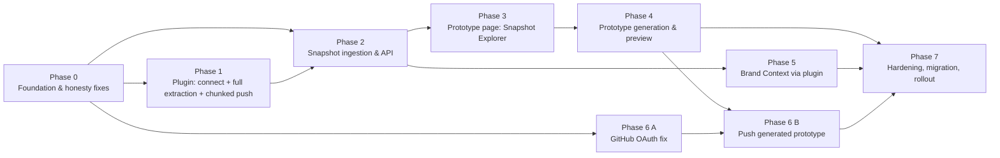

# Strata v2: Implementation Plan

This plan implements [`01-architecture.md`](./01-architecture.md). Each phase lists its goal, its tasks, and **phase exit criteria**. Each task lists its area, size, dependencies, files, steps, **task validation**, and a "done when" statement. A task is complete only when its validation has been run and has passed.

**Sizes:** S ≤ 1 day, M = 2–3 days, L = 4–6 days, XL = more than 6 days (split it before you start).
**Areas:** `PLUGIN` = `charisol-figma-plugin`, `BE` = `charisol-design-system-be`, `FE` = `charisol-design-system-fe`, `INFRA` = CDK in `charisol-design-system-be/cdk`, `RENDER` = new `strata-figma-render` package, `TPL` = generated-project template.

## Standard checks (referenced as "standard checks" below)

| Area | Command(s) |
|---|---|
| BE | `yarn lint`, `yarn typecheck`, `yarn test:unit`, `yarn test:integration`, `yarn test:functional`, `yarn build`, `yarn docs:validate`, `yarn audit:refresh-spec` (commit `audits/openapi-snapshot.json` if it changed). Every route change ships with `docs/openapi.js`. |
| FE | `yarn lint`, `yarn typecheck`, `yarn test`, `yarn build` |
| PLUGIN | `npm run typecheck`, `npm test`, `npm run build`, plus a manual run in Figma Desktop (Plugins → Development → Import from manifest) |
| INFRA | `yarn cdk synth`, then inspect IAM in `cdk.out` for least privilege |
| RENDER / TPL | `pnpm typecheck`, `pnpm test`, `pnpm build` |

## Test fixtures (create in Phase 0, use everywhere)

Keep these under `fixtures/figma/` in the BE repo. Mirror them as `.fig` files in a shared Strata Figma team project.

| Fixture | Contents |
|---|---|
| `F1-small` | 1 page, 3 frames, auto-layout, 10 local color variables, 2 modes, 4 text styles, 2 prototype links |
| `F2-cleanalert` | The CleanAlert file from the screenshots: multi-page, about 37 screens, 125 links, images |
| `F3-library` | Uses only **library** variables and styles (no local ones). This reproduces "Variables 0 / Styles 0". |
| `F4-large` | More than 60,000 nodes across 6 pages. This reproduces the 10,000 cap. |
| `F5-edge` | Masks, boolean operations, blend modes, mixed-font text, nested instances with overrides, hidden layers, a component set with variants, an overlay, `BACK`, `SCROLL_TO`, and `URL` actions |
| `F6-responsive` | `Home / Desktop`, `Home / Tablet`, and `Home / Mobile` frames |

## Phase map and parallel tracks

Three tracks can run at the same time after Phase 0:

- **Track A:** Phases 1 → 2 → 3 → 4 (plugin and prototype).
- **Track B:** Phase 6 A (GitHub OAuth). It is independent and fixes a visible bug, so ship it first.
- **Track C:** Phase 5 (Brand Context). It starts once Phase 2's `brand-digest.json` exists.

---

## Phase 0: Foundation and honesty fixes

**Goal:** Stop the system from reporting false success, and put the shared contracts, models, and flags in place that every later phase needs.

### Task 0.1: Snapshot schema v2 as a shared contract

- **Area:** BE, PLUGIN, FE · **Size:** M · **Depends on:** none
- **Goal:** Have one JSON Schema for the snapshot upload format (architecture §5.1) that the plugin, backend, and frontend all compile against.
- **Files:** new `charisol-design-system-be/contracts/figma-snapshot/v2/{manifest,node,variables,styles,components,prototype,digest,brand-digest}.schema.json`; `charisol-design-system-be/services/figmaInventorySchema.js`; new `scripts/contracts-sync.js`; generated `charisol-figma-plugin/src/types/snapshot.v2.ts` and `charisol-design-system-fe/types/figma-snapshot.ts`.
- **Steps:**
  1. Write the schemas. Mark required and optional fields, and give every warning code an `enum`.
  2. Add `yarn contracts:sync`, which uses `json-schema-to-typescript` to write the TypeScript types into the plugin and FE repos, with a "generated, do not edit" header.
  3. Replace the hand-written validator in `figmaInventorySchema.js` with Ajv (2020-12) compiled from these schemas. Keep a `1.0.0` compatibility validator so existing uploads still validate.
  4. Add a CI check (`yarn contracts:check`) that fails if the generated types are out of date.
- **Validation:** Valid fixture JSON for `F1` and `F2` passes. Ten hand-crafted invalid documents (a missing `schemaVersion`, a bad sha256, an unknown warning code, a negative count, and so on) fail with field paths. `contracts:check` fails after a schema edit without a sync.
- **Done when:** The plugin, BE, and FE import generated types, and no hand-written duplicate of the snapshot shape remains.

### Task 0.2: Snapshot model, S3 layout helpers, and job contract fixes

- **Area:** BE · **Size:** M · **Depends on:** 0.1
- **Goal:** Make pushes durable records and fix the broken job contract.
- **Files:** `models/FigmaInventory.js`, `models/PrototypeJob.js`, `services/prototypeJobService.js`, `controllers/prototypeContracts.js` (or wherever `JOB_STATES` lives), new `services/snapshotStore.js`, new `models/PrototypeConfig.js`, `controllers/prototypeController.js`.
- **Steps:**
  1. Extend `FigmaInventory` with the fields in architecture §5.3. Make `fileKey` optional and require `sourceDocumentId`. Add the GSI `byProjectCreatedAt`.
  2. `snapshotStore.js`: key builders for `plugin-uploads/` and `figma-snapshots/`, `signGet(key, ttl=300)`, `copyPrefix`, `readJson`, and `readGzipJson`.
  3. Fix `JOB_STATES` and transitions to match architecture §5.4. Add a unit test that every transition target is a defined state.
  4. Add `workflowType ∈ {ingest, generation, github_push}` and `snapshotId` to jobs.
  5. Replace the in-memory `prototypeConfigsStore` Map with the DynamoDB `PrototypeConfig` model.
  6. Remove the `setImmediate` fake completion in `startGeneration`. While `FF_PROTOTYPE_GENERATION` is off, return `409 FEATURE_DISABLED` instead.
- **Validation:** Unit tests cover the transitions, including that no transition target is `undefined`. An integration test round-trips a snapshot record and lists it newest first. A config written in one test process is read back in a fresh one, which proves it is no longer in memory. `startGeneration` with the flag off returns 409, not a fake success.
- **Done when:** The standard BE checks pass and no code path fakes job completion.

### Task 0.3: Stop the plugin and backend from reporting false success (quick fixes)

- **Area:** PLUGIN, BE · **Size:** S · **Depends on:** none (ship immediately)
- **Goal:** The current UI must never say "Complete" when data is missing or truncated.
- **Files:** `charisol-figma-plugin/src/assembler/manifestAssembler.ts` L149, `src/walker/variableExtractor.ts` L89, `src/walker/styleExtractor.ts` L89, `src/uploader/uploadOrchestrator.ts` L133–135 and L184–191, `src/components/ExportProgressView.tsx`; `charisol-design-system-be/controllers/pluginController.js` L177–191.
- **Steps:**
  1. Set `truncation.isTruncated` and `reasons` from the walker's `MAX_NODES_EXCEEDED` warning.
  2. Replace the empty `catch` blocks with warnings (`VARIABLES_READ_FAILED` and `STYLES_READ_FAILED`, with the error message) that are added to the manifest.
  3. Fail hard on presign or complete errors. Remove the `job_${Date.now()}` fallback. Show the error and a **Retry upload** button.
  4. Show warnings and truncation in the completion card in amber, for example "Truncated at 10,000 nodes".
  5. In the BE, stop swallowing `FigmaInventory.create` errors. Pass `sourceDocumentId` (falling back to `fileKey` or `uploadId`) and return 500 `SNAPSHOT_PERSIST_FAILED` on failure.
- **Validation:** Exporting `F4-large` shows "Truncated". Exporting `F3-library` shows a warning if the read fails and does not silently show 0. Blocking the API domain (offline) shows an upload error, not success. A BE integration test checks that a failing `create` returns 500.
- **Done when:** Every failure in the screenshot scenario is visible to the user.

### Task 0.4: Feature flags and fixtures

- **Area:** BE, FE, INFRA · **Size:** S · **Depends on:** none
- **Steps:** Add the flags `FF_PLUGIN_SNAPSHOTS`, `FF_PROTOTYPE_GENERATION`, `FF_BRAND_FIGMA_PLUGIN`, `FF_GITHUB_HANDOFF_V2`, and `FF_LEGACY_FIGMA_TOKEN` (default on). Read them from environment variables, with an optional per-project override in `PrototypeConfig.flags`. Expose them through `GET /projects/:id/features`, used by the FE hook `useFeatureFlags(projectId)`. Create fixtures F1–F6 (JSON exports and `.fig` files).
- **Validation:** A unit test covers the flag resolution order (project override, then env, then default). The FE hides the gated UI when a flag is off.
- **Done when:** Every later task can gate its code behind a named flag.

### Phase 0 exit criteria

- [ ] The snapshot v2 schema exists, types are generated into the plugin and FE, and `contracts:check` runs in CI.
- [ ] No code path fakes success. A test or manual check covers each of: fake job IDs, silent catches, `isTruncated:false`, swallowed `create`, and the `setImmediate` completion.
- [ ] `PrototypeConfig` persists across cold starts. The job transition map has no undefined states.
- [ ] Flags F1–F6 and fixtures exist. Standard checks pass in BE, FE, and PLUGIN.

---

## Phase 1: Plugin connect, complete extraction, and chunked push

**Goal:** A user connects the plugin once, picks a project, clicks **Push to Strata**, and every page, node (up to the honest budget), variable (local and library), style, component, prototype interaction, and asset reaches S3.

### Task 1.1: Device-code "Connect plugin" flow (backend)

- **Area:** BE · **Size:** M · **Depends on:** 0.2
- **Files:** new `models/PluginDeviceCode.js`, `models/PluginToken.js`, `controllers/pluginAuthController.js`; `middlewares/index.js` (`authenticateUser`); `routes/v1/index.js`; `docs/openapi.js`.
- **Steps:**
  1. Implement `POST /plugin/auth/device`, `POST /plugin/auth/device/approve`, `POST /plugin/auth/token`, `GET /plugin/me`, `GET /plugin/tokens`, and `DELETE /plugin/tokens/:tokenId` as specified in architecture §5.5 and §8.
  2. Token format: `spt_` plus 32 random bytes in base64url. Store `sha256(pepper + token)`. Use a 90-day sliding expiry, and update `lastUsedAt` at most once per hour.
  3. Extend `authenticateUser`: for `Bearer spt_…`, look up by hash, load the user, and set `req.auth = { kind: "plugin", scopes }`. Add a `requirePluginScope(scope)` middleware. Add a `rejectPluginTokens` guard applied globally *except* to the plugin allowlist (`/plugin/*`, `/project/all`, `/projects/:id/plugin/*`).
  4. Rate limits: `device` 10 per minute per IP, `token` polling at the `interval` (5 seconds), with `slow_down` when a client polls too fast.
  5. Write audit events for `PLUGIN_CONNECTED` and `PLUGIN_REVOKED`.
- **Validation:** Unit tests cover the code alphabet and entropy, hashing, expiry, and `slow_down`. Integration tests cover the full device flow, plus denied, expired, approved-twice, and revoked-token (401) cases. A plugin token used on `/projects/:id/tokens` returns 403. Redaction tests check that `spt_` values never appear in logs.
- **Done when:** A plugin can obtain a scoped token without a password, and an owner can revoke it.

### Task 1.2: `/plugin/connect` page and Settings "Connected plugins" (frontend)

- **Area:** FE · **Size:** M · **Depends on:** 1.1
- **Files:** new `app/plugin/connect/page.tsx`, `app/api/plugin/auth/device/approve/route.ts`, `app/api/plugin/tokens/[[...path]]/route.ts`, new `components/settings/ConnectedPlugins.tsx`, and the account settings page.
- **Steps:**
  1. The page reads `?code=`. If the user is not logged in, redirect to login and back. Show the code, a device label, and **Approve** / **Deny** buttons.
  2. On success, show "Plugin connected. Return to Figma."
  3. Settings lists tokens with their label, created date, last used date, and a **Revoke** button.
- **Validation:** Component tests for the logged-out redirect, invalid or expired code, approve, deny, and revoke. Manual: a full device flow with the plugin from Task 1.3.
- **Done when:** A user can approve and revoke plugin connections from the web app.

### Task 1.3: Plugin auth, project picker, and "Push to Strata" UX

- **Area:** PLUGIN · **Size:** M · **Depends on:** 1.1
- **Files:** `src/services/api.ts`, `src/components/LoginScreen.tsx` (renamed `ConnectScreen.tsx`), `src/ui.tsx`, `src/code.ts` (`initPluginState`), `src/components/ProjectPickerScreen.tsx`, `src/components/ExportProgressView.tsx`, `src/components/Header.tsx`, `manifest.json`, `esbuild.js`.
- **Steps:**
  1. The default screen is **Connect to Strata**. It requests a device code, shows the code, and has an **Open Strata** button (`figma.openExternal(verificationUri + "?code=")`). It polls for the token and stores it in `figma.clientStorage` as `strata_plugin_token`. Keep "Sign in with email" behind a "Use password instead" link, and remove it in Phase 7.
  2. On startup, validate the token with `GET /plugin/me`. On 401, clear it and return to Connect.
  3. Remember the project per document using `figma.root.setPluginData("strataProjectId", …)` and fall back to the last used project. Show "Linked project: X · Change".
  4. Rename the main action to **Push to Strata**. The success card shows the snapshot counts, the warnings, and an **Open in Strata** button that deep-links to `/project/{id}?section=prototype&snapshot={snapshotId}`. Remove the "Prototype Job ID" line (decision D2).
  5. Show **Re-push** (not "Re-export Inventory") and "Last pushed: <time> by <user>".
  6. Make `networkAccess` env-driven at build time: `prod` = API domain plus the S3 bucket regional domain only, `dev` = the current wildcards. Add `"permissions": ["teamlibrary"]` and `devAllowedDomains` for localhost.
  7. Write `sourceDocumentId` on first run with `figma.root.setPluginData("strataDocumentId", crypto.randomUUID())`, guarded by an existing value.
- **Validation:** Manual in Figma Desktop: connect, push, close, and reopen, and confirm the user is still connected and the project is remembered per document. Revoke in web settings, then confirm the plugin returns to Connect on its next open. Unit tests for `api.ts` cover 401 handling and polling backoff.
- **Done when:** The user steps "connect plugin" and "push to Strata" work without typing a password or a project ID.

### Task 1.4: Page-by-page streaming walker with an honest budget

- **Area:** PLUGIN · **Size:** L · **Depends on:** 0.1, 0.3
- **Files:** `src/walker/treeWalker.ts`, `src/walker/nodeSerializer.ts`, `src/chunking/nodeChunker.ts`, `src/code.ts`, `src/types/messages.ts`.
- **Steps:**
  1. Replace `figma.loadAllPagesAsync()` with a per-page `await page.loadAsync()`, iterating `figma.root.children` in order.
  2. Walk depth-first iteratively (an explicit stack, not recursion) and yield to the event loop every 500 nodes (`await new Promise(r => setTimeout(r, 0))`) so the UI stays responsive.
  3. Emit `EXPORT_NODE_CHUNK { pageId, seq, nodes[≤2000] }` as soon as a chunk is full, then drop references to it. Use acknowledgement backpressure with `EXPORT_NODE_BATCH_ACK`, so the sandbox waits until the UI has uploaded the chunk.
  4. Set the budget to `maxNodes = 150000` (from settings, range 10,000–500,000). When it is reached, finish the current page's top-level frames shallowly (frame bounds plus render), then stop. Record `truncation.reasons = [{ code: "NODE_BUDGET", pageId, nodesSkippedEstimate }]`.
  5. Set `figma.skipInvisibleInstanceChildren = true` by default (configurable) and record it in `scope`.
  6. Add a scope option: **Whole document**, **Current page**, or **Selection**, wired to the existing `ExportScope`.
- **Validation:** `F4-large` (more than 60,000 nodes) exports completely with `isTruncated:false`. With `maxNodes=10000`, it is truncated and reports reasons. Peak plugin memory (Figma's dev tools) stays below 1.5 GB on F4. The node count equals the fixture's ground-truth count, within the skipped invisible-instance children. Unit tests cover the chunker boundaries (0, 1, 2,000, and 2,001 nodes).
- **Done when:** The 10,000 cap is gone and any truncation is explicit.

### Task 1.5: Variables, styles, and bound-usage extraction (fixes "0 / 0")

- **Area:** PLUGIN · **Size:** M · **Depends on:** 1.4
- **Files:** `src/walker/variableExtractor.ts`, `src/walker/styleExtractor.ts`, `src/walker/nodeSerializer.ts`.
- **Steps:**
  1. In `serializeNode`, capture `boundVariables` (fills, strokes, effects, text fields, layout fields, and radii) and `styleRefs` (`fillStyleId`, `strokeStyleId`, `textStyleId`, `effectStyleId`, and `gridStyleId`, skipping `figma.mixed`). For mixed text, take the IDs from `getStyledTextSegments(['fillStyleId','textStyleId','boundVariables'])`.
  2. As the walk runs, collect the set of referenced variable IDs and style IDs.
  3. Variables: read the local collections, then resolve every referenced ID with `getVariableByIdAsync`, which returns remote variables that have been imported into the file. Load each collection with `getVariableCollectionByIdAsync`. Set `isRemote` and `libraryName` (from `figma.teamLibrary.getAvailableLibraryVariableCollectionsAsync()` when permitted).
  4. Store aliases as `{kind:"alias", variableId}`. Do not flatten them to CSS here.
  5. Styles: read the local styles, then resolve each referenced style ID with `getStyleByIdAsync` (which works for remote styles). Serialize paint, text (font, size, line height, letter spacing, case), effect, and grid properties. Include `usageCount`.
  6. Every failure adds a warning with a count. A partial result is never discarded.
- **Validation:** `F3-library` reports more than 0 variables and styles, with `isRemote:true`, and the counts match the variables and styles visible in Figma's "Libraries" panel for the used set. `F1` reports exactly 10 variables, 2 modes, and 4 text styles. An alias chain in F1 is preserved. Unit tests use a mocked `figma` global for `mixed` values, missing permissions, and thrown errors.
- **Done when:** The screenshot's "Variables 0 / Styles 0" cannot happen for a file that uses tokens. If extraction fails, a warning is shown.

### Task 1.6: Prototype reactions on the current API

- **Area:** PLUGIN · **Size:** S · **Depends on:** 1.4
- **Files:** `src/walker/prototypeExtractor.ts`.
- **Steps:** Read `reactions[].actions[]`, falling back to the legacy `action`. Capture the trigger (type, timeout, delay), each action (type, `destinationId`, `navigation`, `transition`, `overlayRelativePosition`, `url`, and `resetScrollPosition`), and `flowStartingPoints` per page. Emit `prototype.json` with `{ flows, reactions[{sourceNodeId, trigger, actions}], links[{from, to, kind}] }`.
- **Validation:** `F5-edge` includes overlay, `BACK`, `SCROLL_TO`, `URL`, and multi-action reactions, and all of them appear. `F2` still reports 125 links or more. Unit tests cover both API shapes.
- **Done when:** Every interaction in F5 can be traced to a `prototype.json` entry.

### Task 1.7: Asset export (renders, thumbnails, images, SVG)

- **Area:** PLUGIN · **Size:** M · **Depends on:** 1.4
- **Files:** `src/exporter/assetExporter.ts`.
- **Steps:**
  1. Renders: every top-level FRAME, COMPONENT, COMPONENT_SET, and the frames inside each top-level SECTION, at 1× PNG. Clamp so the longest side is at most 4,096 px (use `constraint: {type:"WIDTH"}` or `"HEIGHT"`).
  2. Thumbnails: the same set with the longest side at 480 px.
  3. Images: unique `imageHash` fills, with the extension detected from the magic bytes.
  4. SVG: VECTOR, BOOLEAN_OPERATION, STAR, POLYGON, and instance or component nodes of 64 px or less whose subtree contains only vector types. Use `exportAsync({format:"SVG_STRING", svgIdAttribute:true})`.
  5. Stream assets to the UI one at a time, with backpressure. Dedupe by sha256. Store the references on the nodes (`renderRef`, `thumbRef`, `svgRef`).
- **Validation:** For `F2`, every top-level frame has a render and a thumbnail (37 or more each). The total upload is under 300 MB. SVG icons in F5 open in a browser. A unit test covers asset deduplication.
- **Done when:** The Explorer has a thumbnail for every screen and the generator has assets for every image and icon.

### Task 1.8: Chunked, resumable uploader

- **Area:** PLUGIN, BE · **Size:** M · **Depends on:** 1.4, 1.7, 0.2
- **Files:** `src/uploader/uploadOrchestrator.ts`; `controllers/pluginController.js` (`presignPluginUpload`).
- **Steps:**
  1. BE: allow `presign-upload` to be called with an existing `uploadId` (it must belong to the same user and project and still be `uploading`). Validate names against the allowed path patterns from §5.1, the size limits, and the content types. Store an `uploading` snapshot record on the first call.
  2. Plugin UI: presign in batches of 50. Gzip `nodes/*.json` with `CompressionStream('gzip')` and upload it with `Content-Encoding: gzip`. Use 4 concurrent PUTs, retry 3 times with jitter, and re-presign on a 403 caused by URL expiry.
  3. Persist progress to `clientStorage` as `{uploadId, uploadedPaths[]}` so that **Resume** after closing the plugin skips files already uploaded.
  4. Upload `manifest.json` last, with the sha256 of every file, then call `complete-upload`.
- **Validation:** `F4` uploads with more than 30 node chunks. If the network is cut halfway and the plugin reopened, **Resume** finishes without re-uploading completed files (check the S3 PUT count). An expired URL is re-presigned. BE tests reject path traversal (`../`), wrong types, oversize files, and another user's `uploadId`.
- **Done when:** A large file pushes reliably and can be resumed.

### Phase 1 exit criteria

- [ ] Connect via device code works on Figma Desktop and in the browser. The token can be revoked from the web.
- [ ] `F4-large` pushes completely (more than 60,000 nodes) with no silent truncation. A forced budget shows a truncation warning.
- [ ] `F3-library` shows more than 0 variables and styles. `F1` counts exactly match the fixture.
- [ ] `F5` interactions all appear in `prototype.json`. `F2` has a render and thumbnail for every top-level frame.
- [ ] A failed upload is never shown as success. An interrupted upload can be resumed.
- [ ] The plugin builds for `prod` with a non-wildcard `networkAccess`.

---

## Phase 2: Snapshot ingestion and snapshot API

**Goal:** A completed upload becomes an immutable, validated, project-scoped snapshot with read-optimized derived files, discoverable by the web app.

### Task 2.1: Ingest workflow (infrastructure)

- **Area:** INFRA · **Size:** M · **Depends on:** 0.2
- **Files:** `cdk/lib/charisol-design-system-stack.ts` (around L496–574), new `workers/ingest/index.js`.
- **Steps:** Add `IngestWorkerFn` (Node 20, 15 minutes, 3 GB) and grant it S3 read and write only on `projects/*/plugin-uploads/*` and `projects/*/figma-snapshots/*`, plus DynamoDB access on the project table. Replace the Step Functions `Pass` state for inventory with a `LambdaInvoke` that retries (3 attempts, backoff 2×) and has a `Catch` that marks the job `failed`. Add a DLQ and alarms (§9).
- **Validation:** `cdk synth` succeeds. The IAM diff shows no `s3:*` and no `Resource: *` on the ingest role. A smoke execution with a no-op handler reaches `succeeded`.
- **Done when:** An ingest execution can run for up to 15 minutes, independent of the API Lambda.

### Task 2.2: `complete-upload` starts ingestion (replaces fake generation job)

- **Area:** BE · **Size:** S · **Depends on:** 2.1, 1.8
- **Files:** `controllers/pluginController.js` `completePluginUpload` L136–258 and `startPluginJob` L260–307; `services/stepFunctionsService.js`.
- **Steps:** Verify that the caller owns the `uploadId` and that `manifest.json` exists and is under 1 MB. Validate it against the v2 schema (v1 uploads go through a v1 adapter). Set the snapshot to `ingesting`, create an `ingest` job, start Step Functions, and return `202`. Delete `startPluginJob` and its route, after confirming no callers through FE `prototype.service.ts`. Make the endpoint idempotent on `uploadId`.
- **Validation:** An integration test covers complete, then a second complete (which returns the same job), a missing manifest (422), and an invalid schema (422 with paths). No generation job is created.
- **Done when:** A push creates exactly one snapshot record and one ingest job.

### Task 2.3: Ingest worker logic

- **Area:** BE · **Size:** L · **Depends on:** 2.2
- **Files:** `workers/ingest/*` (pure functions in `workers/ingest/lib/*` for testability).
- **Steps:**
  1. **Validating:** for each file in the manifest, `HeadObject` checks the size, then the worker streams it and checks the sha256. Validate every chunk against `node.schema.json`. Check that every `parentId` is either present or a page root. Missing or corrupt files fail the job with a list of the bad files.
  2. **Snapshot ID:** `snap_` plus the first 16 characters of `sha256(canonical manifest without exportedAt/uploadId)`. If a `ready` snapshot with the same ID exists for the project, mark this upload `duplicate`, point it at the existing snapshot, and stop.
  3. **Copying:** use `CopyObject` (parallelism 32) to copy from `plugin-uploads/{uploadId}/` to `figma-snapshots/{snapshotId}/`.
  4. **Deriving** (streaming one chunk at a time; never load all nodes at once):
     - `digest.json` per architecture §5.2.
     - `pages/{pageId}.json`: the top-level frames, the node IDs in each frame's subtree, and the chunk ranges that contain them.
     - `flows.json`: edges between top-level frames, with each reaction's source resolved to its top-level ancestor.
     - Variables: resolve alias chains into `resolvedValuesByMode`, detect cycles, and add a warning for each cycle.
     - `brand-digest.json`: see Task 5.1. It is computed here so the Brand Context Engine is fast.
  5. **Indexing:** update the snapshot record (`ready`, counts, `warningsCount`, `truncation`, `s3Prefix`), set `PrototypeConfig.activeSnapshotId` if none is set, and write the `SNAPSHOT_READY` audit event.
  6. Write `ingest-report.json` with timings per phase.
- **Validation:** Golden tests for F1, F2, and F5 compare `digest.json`, `flows.json`, and `pages/*.json` against committed snapshots. A corrupted chunk fails with that chunk named. An identical re-push is deduplicated. Ingesting F4 finishes in under 5 minutes with peak memory under 2 GB. Alias cycle detection is tested.
- **Done when:** Every `ready` snapshot has a complete, validated set of derived files.

### Task 2.4: Snapshot read API

- **Area:** BE, FE (BFF) · **Size:** M · **Depends on:** 2.3
- **Files:** new `controllers/figmaSnapshotController.js`; `routes/v1/index.js`; `docs/openapi.js`; FE `app/api/projects/[id]/figma-snapshots/[[...path]]/route.ts`; new `services/figma-snapshot.service.ts`.
- **Steps:** Implement the list, latest, get, page, and assets endpoints and the `?uploadId=` lookup for plugin polling (§5.5). Signed URLs last 5 minutes and asset batches are capped at 200. Viewer role is required. Plugin tokens are allowed only on `?uploadId=` polling.
- **Validation:** Integration tests cover role checks (viewer allowed, non-member 404), pagination, latest with nothing ready (404), signed URL expiry, a cross-project `snapshotId` (404), and more than 200 refs (400). The FE service has unit tests with mocked `fetch`.
- **Done when:** The web app can find and read the latest push without knowing any job ID.

### Phase 2 exit criteria

- [ ] Plugin push → snapshot `ready` works end to end on staging for F1–F5. The plugin's **Open in Strata** link resolves.
- [ ] No generation job is created by a push. An identical re-push is deduplicated.
- [ ] Derived files exist for every ready snapshot and match the golden tests.
- [ ] Ingest failures leave a `failed` snapshot with a readable `ingest-report.json`, and the plugin shows the reason.
- [ ] Standard BE and INFRA checks pass. The OpenAPI document covers every new route.

---

## Phase 3: Prototype page Snapshot Explorer (render everything pulled)

**Goal:** The Prototype page shows everything that came from Figma (screens, flows, components, tokens, assets, layers, and warnings) and has a clear **Generate Prototype** button.

### Task 3.1: Shared renderer package, runtime part

- **Area:** RENDER · **Size:** XL (split into 3.1a layout and paint, 3.1b text and fonts, 3.1c instances and fallbacks) · **Depends on:** 0.1
- **Files:** new `strata-figma-render/` (`src/normalize`, `src/layout`, `src/paint`, `src/text`, `src/react`, `src/fidelity`), and `package.json` with `tsup`, `vitest`, and `@testing-library/react`.
- **Steps:** Implement the modules in architecture §7.1, except `emit/`, which is Phase 4. `<FigmaFrame>` takes `{ rootId, nodesById, assets: (ref) => url, tokens, mode }`. Unsupported subtrees fall back to `svgRef` or `renderRef` and register a fidelity warning. Fonts: map the Figma font family to Google Fonts if it is available, and load it via `@font-face` from a fonts manifest.
- **Validation:** Unit tests cover the auto-layout mapping matrix (direction × sizing × alignment, 36 cases), paints (solid, linear and radial gradients, image), effects, and text segments. Visual tests use Playwright component screenshots of F1 and F5 frames compared against the Figma PNG renders, using pixelmatch. Target: under 3% differing pixels on F1, and under 10% on F5 excluding regions flagged as fallback.
- **Done when:** The F1 and F5 screens render recognizably in the browser from snapshot data alone.

### Task 3.2: Snapshot data hooks and lazy loading (frontend)

- **Area:** FE · **Size:** M · **Depends on:** 2.4
- **Files:** new `hooks/useFigmaSnapshot.ts`, `hooks/useSnapshotPage.ts`, `hooks/useSnapshotAssets.ts`; `components/sections/project/PrototypeSection.tsx`.
- **Steps:**
  1. Load `latest` (or `?snapshot=` from the URL), then `digest.json`.
  2. Load a page index and its node chunks only when that page is opened. Cache them in memory (an LRU of 8 chunks) and decompress with `DecompressionStream`.
  3. Batch asset URL requests, refresh signed URLs 30 seconds before they expire, and lazy-load images with `IntersectionObserver`.
  4. Remove the localStorage inventory and job reattachment (`strata_prototype_inventory_*` and `strata_prototype_job_*`) and the full-manifest fetch (`PrototypeSection.tsx` L127–132). Keep only the persisted selection for each snapshot.
  5. Empty state: "No Figma data yet" with the plugin guide. Poll `latest` every 5 seconds while the empty state is visible and the tab is focused, and stop after 10 minutes.
- **Validation:** Hook tests with mocked services. Opening an F4 snapshot downloads less than 3 MB before the first screen grid paints (check in the Network panel). Switching pages fetches only that page's chunks. A new push appears without a reload while the page is in the empty state.
- **Done when:** The page scales to F4 and reflects new pushes automatically.

### Task 3.3: Explorer UI with tabs

- **Area:** FE · **Size:** L · **Depends on:** 3.1, 3.2
- **Files:** new `components/sections/project/prototype/explorer/` containing `SnapshotHeader.tsx`, `ScreensTab.tsx`, `ScreenViewer.tsx`, `FlowsTab.tsx`, `ComponentsTab.tsx`, `TokensTab.tsx`, `AssetsTab.tsx`, `LayersTab.tsx`, and `WarningsTab.tsx`. Update `PrototypeSection.tsx`, `PrototypeInventoryTree.tsx`, `PrototypeRenderReview.tsx`, and `PrototypePluginGuide.tsx`.
- **Steps:**
  1. **Header:** file name, pushed by and when, plugin version, counts, a truncation badge, a snapshot switcher (the last 20), and "How to re-push".
  2. **Screens:** a grid by page with thumbnails, names, and sizes, a flow-start badge, and a selection checkbox. Clicking a screen opens **ScreenViewer** with three modes: *Figma render* (PNG), *Live render* (`<FigmaFrame>`), and *Side by side*. It also has zoom, a mode switcher (variable modes), and its outgoing links listed as clickable chips that navigate the viewer.
  3. **Flows:** a graph of top-level frames and edges from `flows.json`, using `reactflow` with a dagre layout. Clicking a node opens the ScreenViewer.
  4. **Components:** component sets with their variants, live-rendered, with the instance count and property definitions.
  5. **Tokens:** variables grouped by collection, with mode columns, color swatches, alias arrows, and an `isRemote` badge. Styles are listed by type with previews.
  6. **Assets:** images, SVGs, and renders, filterable, with download.
  7. **Layers:** a virtualized tree (`react-window`) for the selected page, with node properties in a side panel. The existing `PrototypeInventoryTree` is refactored into this.
  8. **Warnings:** grouped by code, each with an explanation and the affected nodes (clicking one jumps to Layers).
  9. Accessibility: tabs follow the ARIA tab pattern, the tree is keyboard-navigable, and status uses `aria-live`.
- **Validation:** Component tests for each tab's empty, loading, populated, and error states. Test that a 10,000-row Layers tree renders with fewer than 100 DOM rows. Manual: for F2, every screen, link, component, token, and asset seen in Figma is findable. Axe has no serious violations. Run the standard FE checks.
- **Done when:** A user can see everything that was pulled from Figma without leaving Strata.

### Task 3.4: Selection and the "Generate Prototype" action

- **Area:** FE · **Size:** S · **Depends on:** 3.3
- **Files:** `prototype/PrototypeActionFooter.tsx` (L86, L138), `prototype/PrototypeSelectionSummary.tsx`, `PrototypeSection.tsx` `handleContinueToGeneration` (L396–418).
- **Steps:** A sticky footer shows "N screens selected (default: flow screens)" and a primary **Generate Prototype** button. The confirm dialog lists the screens, the responsive groups it detected, the warnings that will affect output, and options (default variable mode, include mock data). It calls `POST prototype/generate {snapshotId, selectedNodeIds, options}`. The button is disabled with a tooltip when `FF_PROTOTYPE_GENERATION` is off, the role is viewer, or the snapshot is not `ready`. Selection persists per `snapshotId` through `PrototypeConfig.selectedNodeIds`.
- **Validation:** Component tests cover the role and flag gating, selection persistence after a reload, and the request payload.
- **Done when:** The **Generate Prototype** button exists and sends the correct request.

### Phase 3 exit criteria

- [ ] After a plugin push, the Prototype page shows the new snapshot with no manual steps.
- [ ] Every top-level frame of F2 is visible as a thumbnail and opens in Figma-render and Live-render modes.
- [ ] Flows, components, tokens (including library ones), assets, layers, and warnings are all visible and match the fixture.
- [ ] F4 is usable (first paint under 3 seconds on a 50 Mbps connection, smooth scrolling).
- [ ] **Generate Prototype** is present, gated, and sends the selection.
- [ ] Visual fidelity targets from Task 3.1 are met. Standard FE and RENDER checks pass.

---

## Phase 4: Prototype generation and in-app preview

**Goal:** Clicking **Generate Prototype** produces a runnable React 19, TypeScript, and Vite application that matches the Figma screens and flows. It is viewable inside Strata and downloadable.

### Task 4.1: Pinned project template

- **Area:** TPL · **Size:** M · **Depends on:** none
- **Files:** a new private repo `strata-prototype-template` (or `templates/prototype/` until the repo exists).
- **Steps:** Vite, React 19, TypeScript (strict), `react-router` v7, CSS Modules, a vendored `strata-figma-render` runtime pinned by version, ESLint, Prettier (pinned), and Vitest with one smoke test. Scripts: `build`, `typecheck`, `lint`, and `test`. Set a CSP meta tag (`connect-src 'self'`). Include a "Prototype – not production" banner component. Commit the lockfile. Tag `v1.0.0` and record its commit SHA in `TEMPLATE_COMMIT`.
- **Validation:** In a clean clone, `npm ci && npm run build && npm run typecheck && npm run lint && npm test` all pass. A grep finds no secrets or production URLs.
- **Done when:** The template builds reproducibly at a pinned commit.

### Task 4.2: Renderer emitter (`emit/`)

- **Area:** RENDER · **Size:** L · **Depends on:** 3.1
- **Steps:** Emit TSX and CSS Modules from the same `RNode` tree as the runtime. Use stable class names (`n_<nodeIdSanitized>`), extract repeated styles into shared classes, and emit tokens as `var(--…)` references. Emitted code must pass the template's ESLint and TypeScript checks.
- **Validation:** Golden tests: emitting F1 and F5 frames twice produces byte-identical output. A Playwright test compares the emitted page against the runtime render, with less than 1% pixel difference. The emitted code typechecks.
- **Done when:** The runtime render and the generated code look the same.

### Task 4.3: Compiler (snapshot → IR → project files)

- **Area:** BE (worker library) · **Size:** XL (split into 4.3a routes and responsive, 4.3b components and instances, 4.3c tokens, 4.3d interactions, 4.3e forms and mock data) · **Depends on:** 4.1, 4.2
- **Files:** new `workers/generate/compiler/*` as pure functions.
- **Steps:** Implement architecture §7.2, items 1–8. Write `compiler-report.json` with every warning (code, node ID, and message) and with the mapping from routes to source node IDs.
- **Validation:** Golden IR tests for F1, F2, F5, and F6. F6 produces one route with 3 breakpoints. F5 interactions map to the expected handlers, and each unsupported one produces a warning. Duplicate frame names produce deterministic slugs. Running the compiler twice gives identical output. No output file references a network URL other than local assets.
- **Done when:** The compiler turns any fixture into a complete project directory without network access.

### Task 4.4: Generate worker (Fargate) and Step Functions wiring

- **Area:** BE, INFRA · **Size:** L · **Depends on:** 4.3, 2.1
- **Files:** new `workers/generate/index.js` and `workers/generate/Dockerfile`; CDK `GenerateTaskDef` and the Step Functions `Generate` state (replacing its `Pass`); `controllers/prototypeController.js` `startGeneration`.
- **Steps:**
  1. API: validate that the snapshot is `ready` and belongs to the project and that `selectedNodeIds` is a subset of its top-level frames. The idempotency key is `hash(snapshotId, sorted selection, options, TEMPLATE_COMMIT)`. If a matching generation already exists, return it. Otherwise create the job and start the execution, then return 202.
  2. Worker phases, each one written to the job record:
     - `compiling`
     - `scaffolding`: copy the template at its pinned commit, which is baked into the image.
     - `installing`: `npm ci --offline --prefer-offline`, using the cache baked into the image.
     - `building`: `vite build --base=/p/{projectId}/{generationId}/`.
     - `validating`: typecheck, lint, route manifest check, Playwright screenshots of every route at 1440, 834, and 390 px, a click-through of every navigation edge, and a visual diff against the Figma renders.
     - `uploading`: `builds/{generationId}/site/**`, `source.zip`, `strata.manifest.json`, `ownership.json`, and `report.json`.
  3. Check for cancellation between phases. Enforce a 20-minute hard timeout. Upload partial artifacts and the report on failure.
  4. Write a `PrototypeArtifact` record and update `PrototypeConfig.latestGenerationId`.
- **Validation:** Staging runs for F1, F2, F5, and F6 all reach `succeeded`. Each report includes screenshots and a fidelity score. A compile error injected through a fixture fails with the phase and log excerpt in the report. Cancelling during `installing` stops the run within 30 seconds. A duplicate request returns the existing job. `cdk synth` and an IAM review pass. The worker has no access to Secrets Manager.
- **Done when:** **Generate Prototype** produces a real build artifact.

### Task 4.5: Preview hosting (CloudFront signed cookies)

- **Area:** INFRA, BE · **Size:** M · **Depends on:** 4.4
- **Steps:** Add `PreviewDistribution` (§9), with a CloudFront Function that rewrites extensionless paths under `/p/{p}/{g}/` to that prefix's `index.html`. Endpoint `GET …/generations/:generationId/preview-session`: check the viewer role, then set three CloudFront signed cookies (path `/p/{projectId}/{generationId}/`, `Domain` = the preview domain, `SameSite=None; Secure`, 1-hour lifetime) and return `{ url }`.
- **Validation:** A viewer can load the preview. A non-member gets 403 from CloudFront. Expired cookies give 403. A deep link to `/p/…/settings` loads the SPA. Response headers include the CSP and `X-Frame-Options` allowing only the Strata frontend origin (`frame-ancestors`).
- **Done when:** Previews are private, project-scoped, and embeddable only in Strata.

### Task 4.6: Generation progress, preview, and download UI

- **Area:** FE · **Size:** M · **Depends on:** 4.5, 3.4
- **Files:** `prototype/PrototypeJobStatus.tsx`; new `prototype/GenerationPanel.tsx`, `prototype/PreviewFrame.tsx`, and `prototype/GenerationHistory.tsx`.
- **Steps:** Show progress phase by phase (driven by `phase`), with Cancel and Retry. On success, show an embedded preview with a viewport switcher (desktop, tablet, mobile), an **Open in new tab** button, a route list, a fidelity score, the report's warnings, **Download source (.zip)**, and **Push to GitHub** (Phase 6 B). Add a history of past generations for the snapshot. Use abortable polling that stops on terminal states and on unmount, and show the duration.
- **Validation:** Component tests for every job state. Manual: generate F2, click through the flows in the iframe, switch viewports, and download the zip, then confirm `npm ci && npm run dev` works locally from it.
- **Done when:** Users can generate, watch, view, and download a prototype in the Prototype page.

### Phase 4 exit criteria

- [ ] F1, F2, F5, and F6 generate successfully on staging. Every selected screen is a route, and every supported interaction works in the preview.
- [ ] Same snapshot, selection, options, and template commit produce byte-identical `source.zip` contents, excluding `report.json` timings.
- [ ] Average fidelity is 90% or more on F1 and F2. Every gap appears as a warning.
- [ ] The generated zip builds on a clean machine with no Strata access.
- [ ] Previews are private (signed cookies), not reachable across projects, and embeddable only by Strata.
- [ ] The P95 generation time for F2 is under 6 minutes. Cancel and retry work.

---

## Phase 5: Brand Context Engine Figma via plugin

**Goal:** In the Brand Context Engine, the Figma source uses the pushed snapshot: connect the plugin, push, pick the snapshot, extract. There is no URL or token field.

### Task 5.1: `brand-digest.json` derivation

- **Area:** BE (ingest worker) · **Size:** M · **Depends on:** 2.3
- **Files:** `workers/ingest/lib/brandDigest.js`.
- **Steps:** Derive, with provenance for every entry (`figma-variable`, `figma-style`, or `observed`) and a usage count:
  - **Colors:** COLOR variables, resolved per default mode, with semantic names kept. Add paint styles. If there are fewer than 5, add observed solid fills, clustered (ΔE < 3), and keep the top 24 by area-weighted usage.
  - **Typography:** text styles, otherwise observed font family, size, and weight combinations ranked by character count. Record the detected type scale ratio.
  - **Spacing and radii:** FLOAT variables whose names or scopes match spacing, gap, or radius, otherwise observed `itemSpacing`, padding, and `cornerRadius` histograms snapped to a 4 px grid.
  - **Shadows:** effect styles, otherwise observed drop shadows.
  - **Components:** a catalog of names, variant properties, and instance counts, mapped to Strata component catalog names (`GET /brand-context/component-catalog`) by name similarity.
  - **Imagery:** the three or so most-used screen thumbnails, as references for optional analysis of the design's overall feel.
- **Validation:** Golden tests for F1 (variables only), F3 (library), and a fixture with no tokens (observed values only). Provenance and counts must be correct.
- **Done when:** Every ready snapshot has a deterministic brand digest.

### Task 5.2: Brand Context Figma extract from a snapshot (backend)

- **Area:** BE · **Size:** M · **Depends on:** 5.1
- **Files:** `controllers/brandContextEngineController.js` `extractFromFigma` (L445–549) and `transformFigmaTokensToExtractionResult` (L551+); `docs/openapi.js`.
- **Steps:**
  1. New body: `{ snapshotId?: string, includeFeelAnalysis?: boolean }`, defaulting to `PrototypeConfig.activeSnapshotId` and then to the latest ready snapshot. Return `404 NO_FIGMA_SNAPSHOT` with a `pluginGuideUrl` when none exists.
  2. Read `brand-digest.json` and map it into the existing `ExtractionResult` shape, so the downstream merge and generate steps do not change. Add `meta: { source: "figma-plugin", snapshotId, fileName, pushedAt, provenanceCounts }`.
  3. If `includeFeelAnalysis` is set, send up to 3 thumbnails to the existing images extractor (Gemini) to fill in "feel", with a 10-second timeout. Failure is non-blocking and adds a warning.
  4. Legacy `figmaUrl` and `figmaToken`/`figmaTokenId` are accepted only when `FF_LEGACY_FIGMA_TOKEN` is on, and the response includes a `deprecation` header. Remove the 12-second loop truncation from the new path, since it no longer applies.
- **Validation:** Integration tests cover the latest snapshot, an explicit snapshot ID, a cross-project snapshot ID (404), no snapshot (404 with guide), the legacy flag off (`400 LEGACY_FIGMA_DISABLED`), and feel-analysis timeout tolerance. The P95 response time is under 1.5 seconds without feel analysis. The output passes the existing `merge-preview` and `generate` endpoints unchanged.
- **Done when:** The Brand Context Engine can extract Figma brand data with no Figma URL or token.

### Task 5.3: Brand Context Wizard Figma card (frontend)

- **Area:** FE · **Size:** M · **Depends on:** 5.2, 2.4, 1.2
- **Files:** `components/brand-context/BrandContextWizard.tsx` (~L732–774), `components/brand-context/InputSourceCard.tsx`, `components/brand-context/ExtractionResultCard.tsx`, new `components/brand-context/FigmaPluginSourcePanel.tsx`, `services/brand-context.service.ts`; delete the unreachable legacy form in `BrandContextModal.tsx` (L1086–1116 and L1291–1330).
- **Steps:** Replace the URL and `FigmaTokenPicker` fields with `FigmaPluginSourcePanel`, which shows four steps with live status:
  1. **Connect plugin:** shows "Connected · last used 2h ago" from `GET /plugin/tokens`, or an install link plus **Connect** (opens `/plugin/connect` instructions).
  2. **Push to Strata:** shows "Latest push: CleanAlert · 2h ago by Ada · 212 variables, 41 styles", or "Waiting for your first push…", polling `latest` every 5 seconds while visible.
  3. **Choose snapshot:** latest by default, with a dropdown of recent snapshots and a link to view it in the Prototype Explorer.
  4. **Extract design data:** a button with an optional "Analyze visual feel" checkbox. The result appears in `ExtractionResultCard` with provenance badges.
  If the snapshot is more than 14 days old, show "This snapshot is old. Re-push from Figma for the latest". Show the legacy URL and token form only when `FF_LEGACY_FIGMA_TOKEN` is on, inside a collapsed "Legacy" disclosure with a deprecation note.
- **Validation:** Component tests for each step state (not connected, connected with no push, push in progress, ready, stale, extract error, extract success). A test checks that no URL or token input renders when the legacy flag is off. Manual end to end: push F1, then the wizard extracts the brand, then generating the design system produces tokens matching F1's colors.
- **Done when:** The Figma part of the Brand Context Engine matches the user's requested flow: connect plugin, push to Strata, pull in the Brand Context Engine, extract.

### Phase 5 exit criteria

- [ ] With the legacy flag off, the Brand Context Engine has no Figma URL or token field anywhere.
- [ ] Pushing F1 and extracting reproduces F1's palette, type styles, and spacing, with provenance badges. F3 (library) works. A file with no tokens produces sensible observed values.
- [ ] The extracted result flows through merge-preview and generate unchanged.
- [ ] Standard BE and FE checks pass. The OpenAPI document reflects the new body and the deprecation.

---

## Phase 6: GitHub handoff

**Goal:** "Connect with GitHub" reliably connects, the repo picker never shows a dead-end error, and **Push to GitHub** sends the *generated prototype* to a branch with a PR.

### Phase 6 A: OAuth and connection (start immediately, no Phase 4 dependency)

#### Task 6.1: Authenticated authorize with signed, single-use state

- **Area:** BE, FE (BFF) · **Size:** M · **Depends on:** 0.4
- **Files:** `controllers/githubOAuthController.js` `authorizeOAuth` (L81–116); new `models/OAuthState.js`; `routes/v1/index.js` (L519–522); FE `app/api/github/oauth/start/route.ts`.
- **Steps:**
  1. Add `authenticateUser` to `GET /github/oauth/authorize`. Take `userPk` **only** from `req.user.pk`. Remove the `req.user?.id` and `req.query.userId` fallbacks.
  2. Generate a 16-byte nonce and save `OAuthState{userPk, projectId, redirectUri, createdAt}` with a 10-minute TTL. Set `state = nonce + "." + HMAC_SHA256(secret, nonce|userPk|projectId|redirectUri)`.
  3. Validate `redirect_uri` against an allowlist (`ALLOWED_OAUTH_REDIRECTS`, one per environment).
  4. Always return JSON `{ url }`. Remove the redirect mode.
  5. The BFF `start` route calls the backend **server-side** with the browser cookie forwarded (`cookie` header), then answers the popup with a `302` to the returned URL. On 401, it returns a small HTML page saying "Please sign in to Strata first".
- **Validation:** Unit tests cover the HMAC sign and verify, and tampered `userPk` or `projectId` in the state. An integration test checks that an unauthenticated authorize returns 401, and that a `?userId=` parameter is ignored. A disallowed `redirect_uri` returns 400.
- **Done when:** It is impossible to start OAuth without a known, authenticated user.

#### Task 6.2: Code exchange endpoint and a frontend-owned callback page

- **Area:** BE, FE · **Size:** M · **Depends on:** 6.1
- **Files:** `githubOAuthController.js` `callbackOAuth` (L122–~280) becomes `exchangeOAuthCode`; `models/GitHubUserToken.js`; new `utils/kmsCrypto.js`; FE `app/api/github/oauth/callback/route.ts`; `components/sections/project/prototype/GitHubConnectButton.tsx`.
- **Steps:**
  1. Add `POST /github/oauth/exchange {code, state, redirectUri}`, called from the BFF with the cookie forwarded. Verify the HMAC, check that the nonce exists and has not been used, mark it used with a conditional write, and check that the cookie user's `pk` equals the state's `userPk` (otherwise return `403 OAUTH_USER_MISMATCH`). Exchange the code using the **same** `redirectUri`, then encrypt and save the token. **If the save fails, return 500 and do not report success.**
  2. Encrypt `accessToken` and `refreshToken` with KMS (envelope encryption, using a data key cached for 5 minutes). Add a lazy migration: on read, if a record is plaintext, encrypt and save it again.
  3. Keep `GET /github/oauth/callback` for one release, returning 410 with a pointer to the new flow. Update `docs/openapi.js`.
  4. The FE callback route calls `exchange` and then renders **its own** HTML. On success it runs `window.opener.postMessage({type:"GITHUB_OAUTH_RESULT", ok:true, githubUsername}, "<FRONTEND_ORIGIN>")` and calls `window.close()`. On error it shows the error and runs `postMessage({ok:false, code})`. If there is no `opener`, it redirects to `/project/{projectId}?section=prototype&github=connected`.
  5. In `GitHubConnectButton`, check `event.origin === window.location.origin` and `event.data.type`. On `ok`, call `onSuccess` **only after** `GET /github/oauth/status` confirms `connected:true`. Detect the popup closing (poll `popup.closed`) to reset the loading state.
- **Validation:** Integration tests cover a replayed state (409), an expired state, a user mismatch (403), the GitHub exchange failing, and the DynamoDB save failing (500 with no success page). A unit test checks that tokens are ciphertext at rest. Manual on staging: connect, then confirm the record exists under `USER#<pk>` and is encrypted. Messages from a foreign `postMessage` origin are ignored.
- **Done when:** A successful popup always means a usable, stored token. The error in the screenshot no longer occurs after a successful connect.

#### Task 6.3: Callback URL configuration per environment

- **Area:** INFRA, BE · **Size:** S · **Depends on:** 6.2
- **Files:** `cdk/lib/charisol-design-system-stack.ts` L277–278; the GitHub App settings; FE env (`NEXT_PUBLIC_GITHUB_OAUTH_CALLBACK_URL`).
- **Steps:**
  1. Set `GITHUB_OAUTH_CALLBACK_URL = ${FRONTEND_URL}/api/github/oauth/callback` per stack. Remove the hardcoded default.
  2. Register the prod, staging, and localhost callbacks in the GitHub App.
  3. For PR environments, use the **staging** callback as a relay. When state carries `relayTo` (allowlisted with `^https://[a-z0-9-]+\.aws\.charisol\.io$`), the staging callback 302-forwards `code` and `state` to `relayTo/api/github/oauth/callback`, which completes the exchange.
  4. Document this in `docs/runbooks/github-app.md`.
- **Validation:** OAuth connects on localhost, staging, and one PR environment. A `relayTo` that is not allowlisted is rejected.
- **Done when:** There are no `redirect_uri` mismatches in any environment.

#### Task 6.4: OAuth status endpoint and frontend gating

- **Area:** BE, FE · **Size:** M · **Depends on:** 6.2
- **Files:** BE: `getUserInstallations` (around L273) and a new `getOAuthStatus`. FE: `prototype/RepositoryStatusCard.tsx` (L197–233, L227–230, L412–414), `prototype/RepoPickerModal.tsx` (L72–76, L144–176), `services/github.service.ts`.
- **Steps:**
  1. Add `GET /github/oauth/status`, returning `{ connected, status, githubUsername, avatarUrl, installUrl }`, where `installUrl` is `https://github.com/apps/<slug>/installations/new`. If a token refresh fails, set `status: "reauth_required"` (currently `getValidUserOAuthToken` L50–52 logs the error and returns an expired token).
  2. `RepositoryStatusCard` loads the status first. It shows **Connect with GitHub** when not connected, **Reconnect GitHub** when `reauth_required`, and otherwise the repository controls. **Change Repository** checks the status before opening the picker.
  3. `RepoPickerModal` handles three cases, none of which is a dead end:
     - `GITHUB_OAUTH_REQUIRED`: inline **Connect with GitHub**. After success it reloads the installations automatically.
     - No installations: **Install the Strata GitHub App** (opens `installUrl` in a popup) and **I've installed it, refresh**.
     - Installations with no repositories granted: **Configure repository access** (a link to that installation's settings).
     Keep **Try Again** only for network or 5xx errors.
  4. Remove the dead `handleConnectGitHub` and `handleDisconnectGitHub` in `PrototypeSection.tsx` (L57–98).
- **Validation:** Component tests cover each modal state and each card state. An integration test checks that an expired token whose refresh fails returns `reauth_required` and that installations returns 401 with `GITHUB_OAUTH_REQUIRED`. Manual: revoke the app authorization on github.com, then confirm the card shows **Reconnect**.
- **Done when:** The screenshot state ("Connection Error" with only "Try Again") cannot occur. Every error has a working next action.

#### Task 6.5: GitHub App installation callback and repo selection hardening

- **Area:** BE, FE · **Size:** S · **Depends on:** 6.4
- **Steps:** Set the GitHub App "Setup URL" to `${FRONTEND_URL}/api/github/app/setup`. That route posts `{installation_id, setup_action}` to the opener with `postMessage` and closes. The FE refetches installations. Make sure `select-repo` and `connect-existing` verify, using the user's OAuth token, that the user can access that installation and repository (`GET /user/installations/:id/repositories`) before saving `GitHubConnection`. Make `createProjectRepository` default to private.
- **Validation:** Integration tests cover selecting a repository the user cannot access (403) and installing then selecting in one session. Manual: a fresh GitHub account goes from connect, to install, to select repository, without leaving the modal flow.
- **Done when:** A brand-new user can connect GitHub and pick or create a repository in one pass.

### Phase 6 B: Push the generated prototype (depends on Phase 4)

#### Task 6.6: GitHub push worker using the Git Data API

- **Area:** BE, INFRA · **Size:** L · **Depends on:** 4.4, 6.5
- **Files:** new `workers/githubPush/index.js`; `services/githubAppService.js` (`createBranchAndCommitGeneratedBundle`, `createOrUpdatePullRequest`); `services/ownershipService.js`; `services/manualEditProtectionService.js`; CDK `GitHubPushTaskDef` and Step Functions `GitHubPush` state; `controllers/githubController.js` `publish` (L627–746).
- **Steps:**
  1. Add `POST /projects/:id/github/push {generationId}` (editor role). It verifies that the generation `succeeded` and belongs to the project and that a `GitHubConnection` is active, creates a `github_push` job (idempotent on `generationId` plus the repository), and returns 202.
  2. Worker:
     - Get an installation token (in memory only).
     - Read the base branch head and the existing `ownership.json` on the target branch, if any.
     - Classify files using `ownershipService`: generated-owned, template-owned, or manual.
     - Use `manualEditProtectionService` to detect files that are generated-owned but have been edited by hand. Keep those files and record conflicts.
     - Create blobs (parallelism 8) and one tree, then a commit (message `feat(strata): prototype <generationId> from <fileName>`), on branch `strata/prototype/<generationId>`.
     - Open the PR, or update the existing open Strata PR for the same snapshot lineage. The PR body includes the snapshot info, the screens, the fidelity score, the warnings, conflicts, and a preview link.
  3. Never push to the default branch and never force-push. Write the `patch.json` artifact.
  4. Change `publish` to require a `generationId` and delegate to `push`. **Delete the placeholder `tokens.json`/README bundle (L663–693).** Include the project's real design tokens (`design-system/tokens.json` from the project's current tokens) only when `includeDesignTokens:true`.
- **Validation:** Integration tests with a mocked GitHub cover a new repository, an existing repository with manual edits (kept and listed as conflicts in the PR body), a repeat push (the same PR is updated, not duplicated), a protected default branch, a revoked installation (clear error), and a rate limit with retry. Staging end to end: generate F2, push, then confirm the PR in a test repository contains the project and that `npm ci && npm run build` succeeds in GitHub Actions (the template ships a CI workflow).
- **Done when:** **Push to GitHub** delivers the generated prototype as a reviewable PR.

#### Task 6.7: Handoff status UI

- **Area:** FE · **Size:** M · **Depends on:** 6.6
- **Files:** `prototype/RepositoryStatusCard.tsx`, `prototype/PublishButton.tsx`, `prototype/GenerationPanel.tsx`.
- **Steps:** Add **Push to GitHub** on a successful generation. Show progress through `phase` (preparing, diffing, committing, pull_request). The result shows the repository, the branch, a PR link, the commit SHA, any conflicts with file lists, and the last push time. Owner-only controls are change repository, disconnect, and repository visibility. Editors can push. Viewers see the status only.
- **Validation:** Component tests for each state and role. Manual end to end on staging, as in 6.6.
- **Done when:** The full handoff is visible and actionable from the Prototype page.

### Phase 6 exit criteria

- [ ] **6 A:** On localhost, staging, a PR environment, and prod, "Connect with GitHub" stores an encrypted token for the correct user. A crafted or replayed state is rejected. The repo picker never shows a dead end.
- [ ] **6 A:** Revoking on GitHub leads to **Reconnect** in Strata. A new user can go from connect, to install, to pick a repository, in one flow.
- [ ] **6 B:** **Push to GitHub** creates a `strata/prototype/<generationId>` branch and a PR containing the generated project. Its CI build passes. Repeat pushes update the same PR. Manual edits are never overwritten.
- [ ] No placeholder bundle code remains. No plaintext GitHub tokens remain after the lazy migration window (verified by a scan).
- [ ] Standard BE, FE, and INFRA checks pass. The OpenAPI document covers `status`, `exchange`, and `push`, and marks `callback` as deprecated.

---

## Phase 7: Hardening, migration, and rollout

**Goal:** Ship safely, retire the legacy Figma URL and token paths, and document how to operate the system.

### Task 7.1: End-to-end test suite

- **Area:** FE, BE, PLUGIN · **Size:** L
- **Steps:** A Playwright suite on staging uses an automated plugin harness. It uses the existing `npm run sim` to replay the F1 and F2 serialized exports through the real upload code, so no Figma UI is needed. The scenarios are: connect the plugin (device flow approved through the UI), push, the snapshot reaches ready, the Explorer shows the screens, Generate, the preview loads and a navigation works, the Brand Context extract succeeds, GitHub push (against a test org) creates a PR.
- **Validation:** The suite runs nightly and on release branches. Each scenario passes 3 times in a row with no flaky retries.
- **Done when:** The full v2 workflow is regression-tested automatically.

### Task 7.2: Legacy deprecation and migration

- **Area:** BE, FE · **Size:** M
- **Steps:** Show a banner to users with saved `Profile.figmaTokens` explaining the move to the plugin. After one release, turn off `FF_LEGACY_FIGMA_TOKEN`, then remove the REST Figma paths that only fed the prototype and brand context: the `extractFromFigma` legacy branch and `FigmaTokenPicker` usage in brand context. Keep the design-system token import in `figmaController.js` until a separate decision is made, and record that explicitly. Offer **Delete my stored Figma tokens** in settings. Remove plugin password login, delete `startPluginJob`, and delete the 1.0.0 manifest adapter once no 1.0.0 uploads have arrived for 30 days (tracked by a metric).
- **Validation:** Regression tests confirm that the design-system Figma import still works. With the flag off, no UI asks for a Figma token in prototype or brand context (checked by grep and a UI test).
- **Done when:** The plugin is the only Figma path for the prototype and brand context.

### Task 7.3: Observability, limits, and cost guards

- **Area:** BE, INFRA · **Size:** M
- **Steps:** Add metrics for push count, size, and duration, ingest duration and failures, generation duration, failures, and fidelity, OAuth exchange outcomes, and push outcomes. Add a CloudWatch dashboard. Add per-project quotas: 50 pushes per day and 20 generations per day, returning `429 QUOTA_EXCEEDED` with the reset time. Add the S3 lifecycle rules from §9. Add a kill switch per flag. Rate-limit and add captcha to the unauthenticated `/brand-context/extract/*` endpoints.
- **Validation:** Synthetic failure jobs fire the alarms. Quota tests. Logs contain no secrets (an automated grep over staging logs for `spt_`, `gh[oupr]_`, and `X-Amz-Signature`).
- **Done when:** Operators can see, limit, and stop each workflow.

### Task 7.4: Plugin publishing and documentation

- **Area:** PLUGIN, docs · **Size:** M
- **Steps:** Use the prod build with a restricted `networkAccess`. Prepare the Figma Community listing (icon, cover, description, privacy and data-use statement). Rewrite `docs/user-guide-figma-plugin.md`, which is currently wrong about "paste Project ID" and scope toggles, to cover connect, push, re-push, resume, and truncation. Add runbooks in `docs/runbooks/` for a stuck ingest or generation, revoking plugin tokens, rotating the GitHub App, OAuth state, and CloudFront keys, and re-running a push. Update `docsplan/figma-plugin-architecture.md` and `plugin-shared-schema-contract.md` to point to v2.
- **Validation:** A developer who did not build the feature follows the user guide and one runbook without help. The plugin passes Figma's review checklist.
- **Done when:** The plugin can be published, and the system can be operated from the documentation.

### Task 7.5: Staged rollout

- **Steps:**
  1. Internal projects only, with all flags on. Run F1–F6 and three real customer files (with permission).
  2. Enable for 10% of projects through per-project flags. Watch the dashboards for one week.
  3. General availability. Turn the legacy flag off one release later.
  Rollback means turning off the flags. Snapshots, generations, repositories, and PRs stay readable, and nothing is deleted.
- **Validation:** Each step has a sign-off checklist: error rate under 2%, P95 times within the phase targets, no security findings, and no open regressions.
- **Done when:** v2 is generally available and the legacy flag is off.

### Phase 7 exit criteria

- [ ] The end-to-end suite is green nightly for 7 days.
- [ ] The legacy Figma URL and token flow is removed from the prototype and brand context. The design-system import is unaffected.
- [ ] Dashboards, alarms, quotas, and kill switches are verified on staging.
- [ ] The plugin is submitted to or published on Figma Community. The user guide and runbooks are complete and have been tested.
- [ ] Rollout reached general availability with sign-offs recorded.

---

## Appendix A: Requirement traceability

| User requirement | Phases and tasks |
|---|---|
| 1. Pull data from Figma (plugin) | 0.3, 1.1–1.8, 2.1–2.4 |
| 2a. Use the data for prototype generation | 4.1–4.6 |
| 2b. Use the data in the Brand Context Engine | 5.1–5.3 |
| 2c. The Prototype page renders everything pulled | 3.1–3.3 |
| 2d. A "Generate Prototype" button | 3.4, 4.6 |
| 3. Brand Context Figma: no URL or token; connect plugin, push, pull, extract | 1.1–1.3, 5.1–5.3, 7.2 |
| 4. Fix the GitHub handoff | 6.1–6.7 |
| Screenshot: Total Nodes = 10,000 | 0.3, 1.4, 1.8 |
| Screenshot: Variables 0 / Styles 0 | 0.3, 1.5 |
| Screenshot: "No GitHub OAuth token found" | 6.1, 6.2, 6.4 |

## Appendix B: Definition of done (whole program)

- Every phase's exit criteria are checked off, with links to evidence (CI runs, staging job IDs, screenshots).
- Every new or changed route is in `docs/openapi.js`. `yarn docs:validate` passes and the snapshot is refreshed.
- No secret (plugin token, GitHub token, OAuth state secret, CloudFront key) appears in logs, job input, DynamoDB metadata, S3 metadata, or fixtures.
- The existing design-system token import, branches, publish snapshots, and connected surfaces pass their regression suites.
