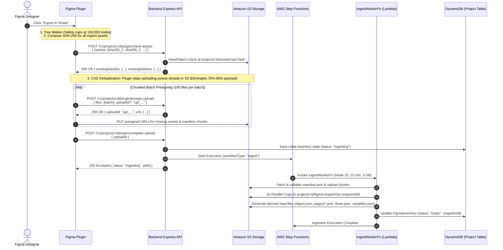

# High-Scale Figma Snapshot Ingestion Architecture

This document provides a comprehensive technical overview of the **Figma Snapshot Ingestion & Pipeline Architecture** designed for high-scale design system exports (150,000+ nodes, 500MB+ assets, and thousands of interactive components).

---

## 1. Architecture Diagram



---

## 2. Core Architectural Pillars

### A. Node Traversal & Safety Budgeting (150,000 Nodes Limit)
- **Problem:** Figma files with thousands of frames and complex vector trees can exhaust memory or freeze browser plugin execution environments.
- **Solution:** The plugin's document tree walker tracks total visited nodes and enforces a strict safety budget of **150,000 nodes**.
- **Behavior:** When node #150,000 is reached, traversal cleanly halts, attaches a `MAX_NODES_EXCEEDED` warning flag to `manifest.json`, and allows export completion without crashing or losing data.
- **Scoped Export Recommendation:** If you need to export specific sections beyond 150,000 nodes in the future, you can select specific pages or frames in Figma before exporting instead of exporting the entire document at once.

### B. Content-Addressed Storage (CAS) Asset Deduplication
- **Problem:** Design systems frequently repeat icons, logos, renders, and textures across hundreds of frames. Uploading duplicates wastes network bandwidth and storage.
- **Solution:** Assets are stored at content-addressed S3 keys: `projects/:projectId/assets/cas/:sha256`.
- **Pre-flight Check:**
  - Plugin computes SHA-256 for all asset binary blobs.
  - Plugin queries `POST /v1/projects/:projectId/plugin/check-assets` with asset hashes.
  - Backend executes fast `HeadObject` calls against S3.
  - Plugin receives `existingHashes` and **skips uploading assets already in S3**, reducing upload payload size by **70%–95%**.

### C. Chunked Batch Presigning
- **Problem:** Requesting presigned URLs for thousands of files in a single HTTP request exceeds API Gateway payload limits and causes timeouts.
- **Solution:**
  - Plugin splits `fileList` into chunks of 100 files (`BATCH_SIZE = 100`).
  - Batch 1 sends `manifest.json` and receives a unique `uploadId` (e.g. `upl_179133...`).
  - Subsequent batches pass `uploadId` in the request body (`{ files: chunk, uploadId }`), allowing presigning under the same session without re-sending `manifest.json`.

### D. Asynchronous Heavy Ingestion (`IngestWorkerFn`)
- **Problem:** Parsing design node graphs, detecting circular variable alias chains, and building read-optimized JSON payloads takes heavy compute time.
- **Solution:**
  - The API controller records an `ingesting` state and delegates heavy work to AWS Step Functions invoking `IngestWorkerFn`.
  - `IngestWorkerFn` runs up to 15 minutes with 3 GB memory, isolated from HTTP request lifecycles.
  - Generates immutable snapshot files:
    - `digest.json`: High-level inventory, component list, variable summary, and page index.
    - `pages/*.json`: Page-level node hierarchies for lazy loading.
    - `flows.json`: Interactive flows and step transitions.
    - `variables.json`: Direct and derived design tokens.
    - `brand-digest.json`: Calculated brand context and color palettes.

### E. Read-Optimized Snapshot API
- **Endpoint Structure:**
  - `GET /v1/projects/:projectId/figma-snapshots`: List snapshots for project.
  - `GET /v1/projects/:projectId/figma-snapshots/latest`: Fetch latest `ready` snapshot metadata.
  - `GET /v1/projects/:projectId/figma-snapshots/:snapshotId/digest`: Fetch light pre-calculated digest JSON.
  - `GET /v1/projects/:projectId/figma-snapshots/:snapshotId/pages/:pageId`: Lazy-load page canvas payload.
  - `POST /v1/projects/:projectId/figma-snapshots/:snapshotId/assets`: Batch presigned GET URLs (capped at 200 refs/call with 5-minute TTL).

---

## 3. Implementation Code References

| Component | Responsibility | File Path |
| :--- | :--- | :--- |
| **Plugin Orchestrator** | CAS check, chunked presign loop, asset upload concurrency | [uploadOrchestrator.ts](file:///Users/oluwatobiloba/Desktop/charisol/design_system/charisol-figma-plugin/src/uploader/uploadOrchestrator.ts) |
| **Plugin Presign API** | Check CAS existing assets, generate presigned PUT URLs | [pluginController.js](file:///Users/oluwatobiloba/Desktop/charisol/design_system/charisol-design-system-be/controllers/pluginController.js#L36-L125) |
| **S3 Utilities** | S3 stream operations, HeadObject existence checks, presigned URLs | [s3.js](file:///Users/oluwatobiloba/Desktop/charisol/design_system/charisol-design-system-be/utils/s3.js) |
| **Ingest Worker Lambda** | Async 15-min ingestion, SHA-256 snapshot derivation, page file generator | [index.js (workers/ingest)](file:///Users/oluwatobiloba/Desktop/charisol/design_system/charisol-design-system-be/workers/ingest/index.js) |
| **Snapshot Read API** | Read-optimized snapshot endpoints for web app consumption | [figmaSnapshotController.js](file:///Users/oluwatobiloba/Desktop/charisol/design_system/charisol-design-system-be/controllers/figmaSnapshotController.js) |
| **CDK Stack Config** | IngestWorkerFn Lambda provisioning, IAM least-privilege policies, Step Functions state machine | [charisol-design-system-stack.ts](file:///Users/oluwatobiloba/Desktop/charisol/design_system/charisol-design-system-be/cdk/lib/charisol-design-system-stack.ts#L496-L580) |

---

## 4. Verification & Testing

To verify the architecture across all components:

```bash
# 1. Backend Build & Test Suite (554 tests)
cd charisol-design-system-be
npm run docs:sync && npm run docs:validate && npm run contracts:sync
npm test

# 2. Figma Plugin Build & Typecheck
cd charisol-figma-plugin
npm run typecheck
npm run build
```
