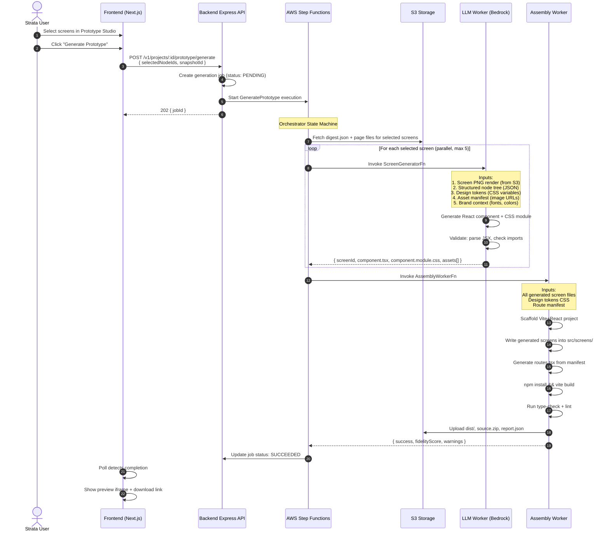
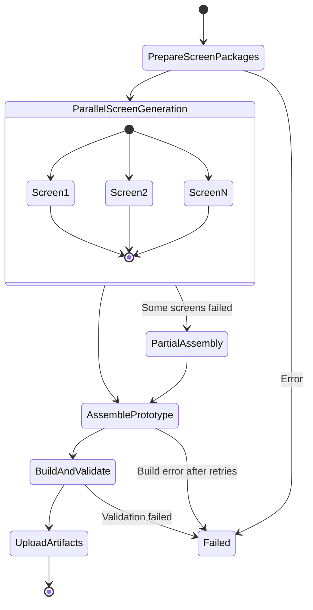

# Architecture: LLM-Powered Screen-by-Screen Prototype Generation

## Overview

This architecture replaces the broken deterministic compiler with an **LLM-powered, screen-by-screen generation pipeline**. Each Figma screen is independently converted to production-quality React code by an LLM that receives both the visual snapshot (PNG) and structured design data (JSON). Generated screens are then assembled into a complete, runnable Vite + React application.

---

## 1. Architecture Diagram



---

## 2. System Components

### 2.1 Screen Extraction Layer (Enhanced Snapshot)

**Purpose**: Prepare rich per-screen input for the LLM.

For each selected screen, the system assembles a **Screen Package** containing:

```
┌─────────────────────────────────────────┐
│ Screen Package (per screen)             │
├─────────────────────────────────────────┤
│ 1. screen-render.png                    │  ← Full-resolution PNG of the frame
│ 2. screen-nodes.json                    │  ← Complete node tree with ALL properties
│ 3. design-tokens.css                    │  ← CSS custom properties from variables
│ 4. asset-manifest.json                  │  ← Map of nodeId → image URL (presigned)
│ 5. brand-context.json                   │  ← Fonts, color palette, brand name
│ 6. interactions.json                    │  ← Click/hover actions and destinations
│ 7. component-definitions.json           │  ← Reusable component specs
└─────────────────────────────────────────┘
```

**Key change from current system**: The node data is **not stripped down**. The full Figma properties are preserved:
- Typography: fontFamily, fontSize, fontWeight, letterSpacing, lineHeight, textAlign, textDecoration
- Visual: fills (solid, gradient, image), strokes, effects (shadow, blur), opacity, cornerRadius
- Layout: layoutMode, layoutAlign, layoutGrow, primaryAxisAlignItems, counterAxisAlignItems, constraints
- Images: imageRef mapped to asset URLs

### 2.2 LLM Screen Generator (ScreenGeneratorFn)

**Purpose**: Convert one screen package into a high-quality React component.

**Runtime**: AWS Lambda (or ECS task), 5-minute timeout, 2GB memory

**LLM Provider**: Amazon Bedrock (Claude 3.5 Sonnet or Anthropic Claude 4)

**Input**: Screen package (above)

**Output**:
```typescript
{
  screenId: string;
  componentName: string;        // PascalCase, e.g., "HeroSection"
  files: {
    "ScreenName.tsx": string;    // React component source
    "ScreenName.module.css": string; // CSS module
  };
  assets: string[];              // Referenced asset keys
  imports: string[];             // External dependencies needed
  warnings: Warning[];
}
```

**Prompt Engineering Strategy**:

The LLM receives a structured system prompt that instructs it to:

1. **Analyze the PNG** to understand the visual layout, sections, and hierarchy
2. **Cross-reference with the node tree JSON** to extract exact values (colors, fonts, dimensions)
3. **Generate semantic HTML** — use `<nav>`, `<header>`, `<section>`, `<main>`, `<footer>`, `<button>`, ``, `<a>` instead of all `<div>`
4. **Use CSS Modules** with modern layout (flexbox, grid, clamp())
5. **Reference images** via the asset manifest — ``
6. **Apply design tokens** via CSS custom properties: `var(--primary-color)`
7. **Wire interactions** from the interactions.json (click → navigate, hover → state change)
8. **Output ONLY valid TypeScript + CSS** — no explanations, no markdown fences

**Retry & Validation**:
- Parse the generated TSX with a fast parser (e.g., `@swc/core` or `typescript` compiler API)
- If parse fails, retry once with error feedback appended to the prompt
- Maximum 2 LLM calls per screen (original + 1 retry)

### 2.3 Assembly Worker (AssemblyWorkerFn)

**Purpose**: Combine individually generated screens into a complete, runnable application.

**Runtime**: Lambda/ECS, 10-minute timeout, 3GB memory (same as current generate worker)

**Process**:

```
1. Scaffold from template (existing templates/prototype/)
2. Write generated screen files into src/screens/
3. Write shared components into src/components/
4. Generate src/routes.tsx from screen manifest
5. Write design tokens to src/design/tokens.css
6. Copy referenced assets to public/assets/
7. npm ci --offline --include=dev
8. npx vite build --base=/p/{projectId}/{generationId}/
9. Run type-check (tsc --noEmit)
10. Run lint (eslint)
11. If build fails: attempt auto-fix (add missing imports, fix obvious errors)
12. Generate source.zip
13. Upload dist/ and artifacts to S3
14. Capture screenshots with Playwright
```

**Key difference from current**: The assembly worker does NOT generate any code. It only:
- Combines pre-generated screen files
- Runs the build toolchain
- Handles build error recovery
- Uploads artifacts

### 2.4 Step Functions Orchestrator

**Purpose**: Coordinate the multi-step generation with parallel screen processing, error handling, and job state updates.



**Parallel execution**: Up to 5 screens are generated concurrently via Step Functions Map state. This means a 27-screen project takes ~6 rounds × ~30 seconds = ~3 minutes for generation (vs. 27 × 30s = 13.5 minutes sequential).

**Partial failure handling**: If some screens fail to generate, the assembly proceeds with successful screens. Failed screens get a placeholder component with an error message. The report includes which screens succeeded and which failed.

---

## 3. Data Flow & Contracts

### 3.1 Enhanced Node Schema

The plugin must export richer node data. The current `NODE_FIELDS` list is expanded:

```typescript
interface EnhancedFigmaNode {
  // Identity
  id: string;
  name: string;
  type: FigmaNodeType;
  visible: boolean;
  
  // Bounds (absolute, for PNG correlation)
  absoluteBounds: { x: number; y: number; width: number; height: number };
  // Bounds (relative to parent, for layout)
  relativeBounds: { x: number; y: number; width: number; height: number };
  
  // Layout
  layoutProperties: {
    layoutMode: "NONE" | "HORIZONTAL" | "VERTICAL";
    layoutWrap: "NO_WRAP" | "WRAP";
    primaryAxisAlignItems: "MIN" | "CENTER" | "MAX" | "SPACE_BETWEEN";
    counterAxisAlignItems: "MIN" | "CENTER" | "MAX" | "BASELINE";
    layoutGrow: number;
    layoutAlign: "INHERIT" | "STRETCH" | "MIN" | "CENTER" | "MAX";
    itemSpacing: number;
    paddingTop: number;
    paddingRight: number;
    paddingBottom: number;
    paddingLeft: number;
  };
  
  // Typography (TEXT nodes only)
  textStyle: {
    fontFamily: string;
    fontWeight: number;
    fontSize: number;
    lineHeight: { value: number; unit: "PIXELS" | "PERCENT" | "AUTO" };
    letterSpacing: { value: number; unit: "PIXELS" | "PERCENT" };
    textAlign: "LEFT" | "CENTER" | "RIGHT" | "JUSTIFIED";
    textDecoration: "NONE" | "UNDERLINE" | "STRIKETHROUGH";
    textTransform: "NONE" | "UPPERCASE" | "LOWERCASE" | "CAPITALIZE";
  };
  textContent: { characters: string };
  
  // Visual Properties
  fills: FigmaFill[];        // Solid, gradient, image fills
  strokes: FigmaStroke[];
  effects: FigmaEffect[];    // Drop shadow, inner shadow, layer blur, background blur
  opacity: number;
  cornerRadius: number | { topLeft: number; topRight: number; bottomRight: number; bottomLeft: number };
  clipsContent: boolean;
  
  // Variable Bindings
  boundVariables: Record<string, string>;  // property → variableId
  
  // Component Reference
  componentRef?: {
    componentId: string;
    isRemote: boolean;
    variantProps: Record<string, string>;
  };
  
  // Image Reference
  imageRef?: string;  // Maps to asset manifest
  
  // Children
  children: string[];
  
  // Interactions
  reactions: FigmaReaction[];
}
```

### 3.2 Asset Manifest

```typescript
interface AssetManifest {
  images: {
    [nodeId: string]: {
      hash: string;          // SHA-256 content hash
      s3Key: string;         // Path in S3
      originalName: string;  // "hero-image.png"
      width: number;
      height: number;
      format: "png" | "jpg" | "svg";
    };
  };
  fonts: {
    [fontFamily: string]: {
      variants: { weight: number; style: "normal" | "italic" }[];
      source: "google" | "local" | "custom";
      url?: string;          // Google Fonts URL if applicable
    };
  };
}
```

### 3.3 Generation Job Record (Enhanced)

```typescript
interface GenerationJob {
  pk: string;         // PROJECT#{projectId}
  sk: string;         // JOB#{jobId}
  jobId: string;
  projectId: string;
  snapshotId: string;
  
  // Screen-level tracking
  screens: {
    [screenId: string]: {
      name: string;
      status: "pending" | "generating" | "succeeded" | "failed" | "skipped";
      llmLatencyMs?: number;
      retryCount: number;
      error?: string;
    };
  };
  
  // Overall job state
  state: "PENDING" | "RUNNING" | "SUCCEEDED" | "FAILED" | "CANCELLED";
  phase: "PREPARING" | "GENERATING_SCREENS" | "ASSEMBLING" | "BUILDING" | "UPLOADING";
  progress: number;  // 0-100
  
  // Results
  generationId: string;
  fidelityScore: number;
  warnings: Warning[];
  
  // Metadata
  llmModel: string;          // e.g., "anthropic.claude-3-5-sonnet-20241022-v2:0"
  totalLlmTokens: number;
  totalLlmCostUsd: number;
  createdAt: string;
  updatedAt: string;
}
```

---

## 4. LLM Integration: Amazon Bedrock

### 4.1 Why Bedrock

| Factor | Decision |
|---|---|
| **AWS-native** | Already on AWS (S3, Lambda, Step Functions, DynamoDB, CloudFront). Bedrock integrates with IAM, VPC, CloudWatch. |
| **Model choice** | Claude 3.5 Sonnet for code generation — strong at React, TypeScript, CSS. Can upgrade to Claude 4 when available. |
| **Vision support** | Claude supports image input — can send the screen PNG alongside structured data. |
| **No API key management** | Uses IAM roles, not stored API keys. |
| **Cost predictability** | Pay-per-token with AWS billing. |

### 4.2 Prompt Structure

```
┌──────────────────────────────────────────────────┐
│ SYSTEM PROMPT                                    │
│                                                  │
│ You are a React UI developer. Generate a single  │
│ React component that recreates the provided       │
│ Figma screen design.                             │
│                                                  │
│ Rules:                                           │
│ - Output ONLY valid TypeScript (.tsx) and CSS     │
│   Module (.module.css) content                   │
│ - Use semantic HTML elements                     │
│ - Use CSS Modules for styling                    │
│ - Reference images as /assets/{hash}.{ext}       │
│ - Use CSS custom properties from tokens.css       │
│ - Use modern CSS (flexbox, grid, clamp)          │
│ - Make the component responsive if multiple       │
│   breakpoint variants are provided               │
│ - Wire click handlers from interactions.json      │
│ - Export as default function component            │
│                                                  │
│ Output format:                                   │
│ ---TSX---                                        │
│ <component code>                                 │
│ ---CSS---                                        │
│ <css module code>                                │
│ ---END---                                        │
└──────────────────────────────────────────────────┘

┌──────────────────────────────────────────────────┐
│ USER MESSAGE                                     │
│                                                  │
│ [Image: screen-render.png]                       │
│                                                  │
│ Screen name: "Hero Section"                      │
│ Dimensions: 1440 × 900px                         │
│                                                  │
│ Node tree:                                       │
│ <screen-nodes.json content>                      │
│                                                  │
│ Design tokens:                                   │
│ <design-tokens.css content>                      │
│                                                  │
│ Asset manifest:                                  │
│ <asset-manifest.json content>                    │
│                                                  │
│ Brand context:                                   │
│ { fonts: [...], colors: [...] }                  │
│                                                  │
│ Interactions:                                    │
│ <interactions.json content>                      │
│                                                  │
│ Component name: HeroSection                      │
└──────────────────────────────────────────────────┘
```

### 4.3 Token Budget & Cost Estimate

| Item | Estimate |
|---|---|
| System prompt | ~800 tokens |
| Screen PNG (via vision) | ~1,500 tokens (typical screen) |
| Node tree JSON (pruned) | ~2,000–5,000 tokens per screen |
| Design tokens CSS | ~500 tokens |
| Asset manifest | ~200 tokens |
| **Total input per screen** | **~5,000–8,000 tokens** |
| **Output per screen** | **~2,000–4,000 tokens** (component + CSS) |
| **Cost per screen** (Sonnet) | **~$0.02–$0.04** |
| **27-screen project** | **~$0.54–$1.08** |

This is well within acceptable cost for a B2B SaaS feature.

### 4.4 Node Tree Pruning

To stay within token limits, the node tree sent to the LLM is **pruned**:

1. **Depth limit**: Max 8 levels of nesting
2. **Invisible nodes removed**: `visible: false` nodes are stripped
3. **Duplicate children collapsed**: Repeated identical children (e.g., list items) are collapsed to 2 examples + `"...N more items"`
4. **Vector paths removed**: SVG path data is replaced with `"[vector shape]"`
5. **Precision reduced**: Float values rounded to 1 decimal place
6. **Empty properties stripped**: `effects: []`, `strokes: []` are removed

Target: **≤5,000 tokens** per screen's node tree.

---

## 5. What Stays, What Changes

### 5.1 Preserved (Reused From Current System)

| Component | Reason |
|---|---|
| Figma plugin (export flow) | Already works for CAS upload, chunking, presigning. Extended, not replaced. |
| Snapshot ingestion (IngestWorkerFn) | Already works for generating digest.json, pages/*.json. Extended with richer node data. |
| Vite + React template (`templates/prototype/`) | Still the scaffold for the final app. |
| Job state machine (`prototypeContracts.js`) | Phase tracking, state transitions. Extended with new phases. |
| S3 upload utilities (`utils/s3.js`) | Reused for artifact upload. |
| Preview session (CloudFront + signed URLs) | Reused for preview iframe. |
| Frontend job polling + preview | Extended, not replaced. |

### 5.2 Replaced

| Component | Current | New |
|---|---|---|
| `workers/generate/compiler/` | Deterministic div translator (compile.js, emit.js, style.js, routes.js, components.js) | LLM Screen Generator (ScreenGeneratorFn) |
| `workers/generate/index.js` compiling phase | `compile(source)` — single-pass mechanical | Per-screen LLM invocation via Step Functions |
| `workers/generate/index.js` scaffolding phase | `writeProjectFiles(compiled.files)` | Assembly worker combines LLM outputs |
| `snapshotLoader.js` NODE_FIELDS whitelist | 7 fields | Full node schema |

### 5.3 New Components

| Component | Purpose |
|---|---|
| **ScreenPackageBuilder** (backend service) | Assembles the screen package (PNG + JSON + tokens + assets) for each selected screen |
| **ScreenGeneratorFn** (Lambda) | Calls Bedrock LLM with screen package, validates output, retries on failure |
| **AssemblyWorkerFn** (Lambda/ECS) | Combines generated screens into runnable app, builds, validates, uploads |
| **LLM Prompt Templates** (config files) | Versioned system/user prompt templates for screen generation |
| **Step Functions state machine** (CDK) | Orchestrates parallel screen generation + assembly |
| **Screen Generation Status API** | Per-screen progress updates for the frontend |
| **Frontend: Per-screen progress UI** | Shows which screens are generated, in progress, or failed |

---

## 6. Deployment Architecture

```
┌─────────────────────────────────────────────────────────┐
│ AWS Account                                             │
│                                                         │
│  ┌──────────────┐   ┌──────────────────────────────┐    │
│  │ API Gateway   │──▶│ Express API (Lambda / ECS)   │    │
│  │ + CloudFront  │   │ - POST /generate             │    │
│  └──────────────┘   │ - GET /job/:id                │    │
│                     │ - GET /job/:id/screens         │    │
│                     └──────┬───────────────────────┘    │
│                            │ Start Execution            │
│                     ┌──────▼───────────────────────┐    │
│                     │ Step Functions                │    │
│                     │ GeneratePrototype StateMachine│    │
│                     └──────┬───────────────────────┘    │
│                            │                            │
│              ┌─────────────┼─────────────┐              │
│              │             │             │              │
│       ┌──────▼──┐   ┌──────▼──┐   ┌──────▼──┐          │
│       │ Screen  │   │ Screen  │   │ Screen  │          │
│       │ Gen λ   │   │ Gen λ   │   │ Gen λ   │          │
│       │ (5 min) │   │ (5 min) │   │ (5 min) │          │
│       └────┬────┘   └────┬────┘   └────┬────┘          │
│            │             │             │                │
│            └─────────────┼─────────────┘                │
│                          │                              │
│                   ┌──────▼───────────────────────┐      │
│                   │ Assembly Worker (10 min)       │      │
│                   │ npm install, vite build, lint  │      │
│                   └──────┬───────────────────────┘      │
│                          │                              │
│                   ┌──────▼──────┐                        │
│                   │ S3 Bucket   │                        │
│                   │ - dist/     │                        │
│                   │ - source.zip│                        │
│                   │ - assets/   │                        │
│                   └──────┬──────┘                        │
│                          │                              │
│                   ┌──────▼──────┐                        │
│                   │ CloudFront  │                        │
│                   │ Preview     │                        │
│                   └─────────────┘                        │
│                                                         │
│  ┌──────────────────────────────────────────────────┐   │
│  │ Amazon Bedrock                                    │   │
│  │ Model: anthropic.claude-3-5-sonnet-v2            │   │
│  │ Region: us-east-1 (or same as stack)             │   │
│  │ IAM: ScreenGeneratorFn role has bedrock:Invoke   │   │
│  └──────────────────────────────────────────────────┘   │
└─────────────────────────────────────────────────────────┘
```

---

## 7. Fallback & Quality Assurance

### 7.1 Deterministic Fallback

The existing compiler is **not deleted**. It becomes a fallback:
- If the LLM is unavailable (Bedrock outage, throttled)
- If the user explicitly requests "fast generation" (no LLM)
- If cost controls are exceeded

The generation job record includes a `mode` field: `"llm"` or `"deterministic"`.

### 7.2 Visual Comparison

After generation, Playwright captures screenshots of each generated screen. These are compared with the original Figma renders:
- **Structural similarity** (SSIM) score per screen
- **Fidelity score** = average SSIM across all screens × 100
- Scores below threshold trigger a warning in the report

### 7.3 Build Verification

The assembly worker runs a full build pipeline:
1. `tsc --noEmit` — type checking
2. `eslint` — lint
3. `vite build` — production build
4. If any step fails, attempt auto-fix (add missing imports, fix type errors) and retry once

---

## 8. Cost Controls

| Control | Mechanism |
|---|---|
| **Per-project daily limit** | Max 10 generations per project per day |
| **Per-screen retry limit** | Max 2 LLM calls per screen (1 original + 1 retry) |
| **Token budget per screen** | Max 15,000 input + 5,000 output tokens |
| **Concurrent generation limit** | Max 5 screens in parallel (Step Functions Map maxConcurrency) |
| **Monthly budget alert** | CloudWatch alarm on Bedrock spend > $X |
| **Fallback to deterministic** | If Bedrock returns 429 (throttled), fall back to deterministic compiler |
