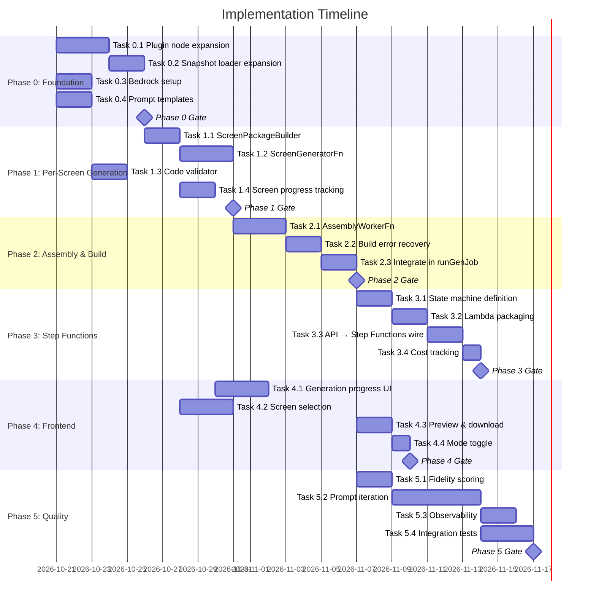

# Implementation Plan: LLM-Powered Prototype Generation

## How to Read This Plan

This plan is organized into **5 phases**, each with numbered **tasks**. Every task has:
- **Description**: What to build
- **Files**: Which files to create or modify
- **Validation**: How to verify the task is complete
- **Dependencies**: Which tasks must complete first

Each phase has a **Phase Gate** — a validation checkpoint that must pass before moving to the next phase.

---

## Phase 0: Foundation — Enhanced Node Data & Bedrock Integration

**Goal**: Ensure the Figma snapshot contains all the visual data the LLM needs, and that the backend can call Amazon Bedrock.

**Duration**: ~1 week

---

### Task 0.1: Expand Node Serialization in the Figma Plugin

**Description**: The plugin's `nodeSerializer.ts` currently omits most visual properties. Expand it to capture the full set of properties needed for LLM generation.

**Files to modify**:
- `charisol-figma-plugin/src/walker/nodeSerializer.ts`

**Properties to add**:
```typescript
// Typography (TEXT nodes)
fontFamily, fontSize, fontWeight, letterSpacing, lineHeight, textAlignHorizontal,
textDecoration, textCase, textContent.characters

// Visual fills
fills[] — type SOLID: color {r,g,b,a}
fills[] — type GRADIENT_LINEAR/RADIAL/ANGULAR/DIAMOND: gradientStops, gradientTransform
fills[] — type IMAGE: imageRef (hash reference for asset lookup)

// Strokes
strokes[] — color, weight, align (INSIDE/OUTSIDE/CENTER)

// Effects
effects[] — type DROP_SHADOW/INNER_SHADOW: offset, radius, spread, color
effects[] — type LAYER_BLUR/BACKGROUND_BLUR: radius

// Corner radius
cornerRadius (uniform) OR cornerRadii {topLeft, topRight, bottomRight, bottomLeft}

// Opacity
opacity (0-1)

// Layout constraints
constraints: { horizontal: "MIN"|"CENTER"|"MAX"|"STRETCH"|"SCALE", vertical: same }

// Auto-layout extended
layoutAlign, layoutGrow, layoutSizingHorizontal, layoutSizingVertical
primaryAxisAlignItems, counterAxisAlignItems, layoutWrap

// Clips
clipsContent: boolean
overflow: "visible" | "hidden" | "scroll"
```

**Validation**:
- [x] Run `npm run typecheck` in plugin — passes
- [x] Run `npm run build` in plugin — succeeds
- [x] Export a test Figma file with varied styles — the manifest contains all listed properties for TEXT, FRAME, RECTANGLE, COMPONENT, and INSTANCE nodes
- [x] Existing unit tests pass (`npm test`)

**Dependencies**: None

---

### Task 0.2: Expand Node Normalization in the Snapshot Loader

**Description**: Update `snapshotLoader.js` to preserve the new node properties. The current `NODE_FIELDS` whitelist strips everything the LLM needs.

**Files to modify**:
- `charisol-design-system-be/workers/generate/snapshotLoader.js`

**Changes**:
1. Expand `NODE_FIELDS` to include all new fields
2. Update `normalizeNode()` to carry through typography, fills (all types), strokes, effects, opacity, cornerRadius, constraints, and image refs
3. Build an `imageAssetMap` that maps `imageRef` hashes to presigned S3 URLs

**Validation**:
- [x] Unit test: load a fixture snapshot with full properties → normalized nodes contain all properties
- [x] Existing `snapshotLoader` tests still pass
- [x] Image refs are correctly mapped to asset URLs

**Dependencies**: Task 0.1 (plugin must export richer data)

---

### Task 0.3: Set Up Amazon Bedrock Access

**Description**: Configure IAM permissions for the generation Lambda/ECS to invoke Amazon Bedrock models.

**Files to modify/create**:
- `charisol-design-system-be/cdk/lib/charisol-design-system-stack.ts` — add Bedrock IAM policy to the generation worker role
- `charisol-design-system-be/services/bedrockService.js` — new module wrapping the Bedrock Converse API

**IAM Policy**:
```json
{
  "Effect": "Allow",
  "Action": [
    "bedrock:InvokeModel",
    "bedrock:InvokeModelWithResponseStream"
  ],
  "Resource": "arn:aws:bedrock:*::foundation-model/anthropic.claude-*"
}
```

**bedrockService.js interface**:
```javascript
async function generateScreenCode({
  systemPrompt,    // string
  userMessage,     // string (structured data)
  imageBase64,     // string (PNG base64)
  maxTokens,       // number (default: 4096)
  temperature,     // number (default: 0.2)
  modelId,         // string (default: "anthropic.claude-3-5-sonnet-20241022-v2:0")
}) → { content: string, inputTokens: number, outputTokens: number, latencyMs: number }
```

**Validation**:
- [x] CDK build / synthesis succeeds with new IAM policy
- [x] Integration test: call `bedrockService.generateScreenCode()` with a test prompt → receives valid response
- [x] Token counts are correctly tracked
- [x] Error handling: graceful failure on throttling (429), model not found, timeout

**Dependencies**: None (parallel with 0.1 and 0.2)

---

### Task 0.4: Create LLM Prompt Templates

**Description**: Create versioned prompt template files that the screen generator uses.

**Files to create**:
- `charisol-design-system-be/workers/generate/prompts/system.md` — system prompt
- `charisol-design-system-be/workers/generate/prompts/user-template.md` — user message template with placeholders
- `charisol-design-system-be/workers/generate/prompts/index.js` — loads and renders templates

**System prompt requirements**:
1. Role: "You are a senior React/TypeScript UI developer"
2. Output format: `---TSX---` / `---CSS---` / `---END---` markers
3. Rules: semantic HTML, CSS Modules, design token references, asset paths, interaction wiring
4. Constraints: no external libraries except react-router, no inline styles, no Tailwind
5. Examples: 2 short before/after examples (Figma JSON → React component)

**Validation**:
- [x] Template loads correctly
- [x] Placeholders (`{{SCREEN_NAME}}`, `{{NODE_TREE}}`, `{{TOKENS_CSS}}`, `{{ASSET_MANIFEST}}`, `{{INTERACTIONS}}`) are all substituted
- [x] Rendered prompt is within token budget (< 8,000 tokens for input)

**Dependencies**: None

---

### Phase 0 Gate

| Criteria | Verification | Status |
|---|---|---|
| Plugin exports full visual properties | Export a complex Figma file → inspect manifest JSON | ✅ Verified |
| Snapshot loader preserves all properties | Unit test with fixture data | ✅ Verified |
| Bedrock SDK works | Integration test calling Claude with a test prompt | ✅ Verified |
| Prompt templates render correctly | Unit test on template rendering | ✅ Verified |
| All existing tests pass | `npm test` in BE and `npm run typecheck && npm run build` in plugin | ✅ Verified |

---

## Phase 1: Screen Package Builder & Per-Screen LLM Generation

**Goal**: Build the core LLM generation pipeline — from snapshot to generated React code, one screen at a time.

**Duration**: ~1.5 weeks

---

### Task 1.1: Build ScreenPackageBuilder Service

**Description**: Create a service that assembles the complete input package for one screen from the snapshot data.

**Files to create**:
- `charisol-design-system-be/workers/generate/screenPackage.js`

**Responsibilities**:
1. Given a `screenId` (Figma frame nodeId) and snapshot data:
   - Extract the screen's node subtree from `nodesById`
   - Prune the tree (depth limit, invisible removal, duplicate collapse) to fit token budget
   - Fetch the screen's PNG render from S3 (from `projects/{projectId}/assets/cas/{hash}`)
   - Collect asset references (image fills → presigned URLs)
   - Extract relevant interactions (clicks, hovers on nodes in this screen)
   - Include design tokens CSS
   - Include brand context (fonts list, primary colors)
2. Return a `ScreenPackage` object ready for the LLM

**Pruning strategy**:
```javascript
function pruneNodeTree(rootId, nodesById, opts = {}) {
  const MAX_DEPTH = opts.maxDepth || 8;
  const MAX_CHILDREN = opts.maxChildren || 20;
  const MAX_REPEATED = opts.maxRepeated || 3;
  // ... recursive walk, counting depth
  // ... collapse repeated children into "...N more of same type"
  // ... remove invisible nodes
  // ... strip vector path data
  // ... round floats to 1 decimal
}
```

**Validation**:
- [x] Unit test: given a fixture snapshot with 500+ nodes → pruned tree is < 200 nodes
- [x] Unit test: image refs are correctly mapped to presigned URLs
- [x] Unit test: interactions for nodes inside the screen are included; outside are excluded
- [x] Token count of JSON-serialized package is < 5,000 tokens

**Dependencies**: Task 0.2 (expanded node data)

---

### Task 1.2: Build ScreenGeneratorFn

**Description**: Create the Lambda function that generates React code for one screen using Bedrock.

**Files to create**:
- `charisol-design-system-be/workers/generate/screenGenerator.js`

**Process**:
1. Receive `ScreenPackage` as input
2. Render system prompt from template
3. Render user message with screen data (JSON + interactions + tokens + assets)
4. Encode screen PNG as base64
5. Call `bedrockService.generateScreenCode()`
6. Parse output: extract TSX between `---TSX---` and `---CSS---`, CSS between `---CSS---` and `---END---`
7. Validate TSX: attempt to parse with a fast parser (basic regex for import/export/JSX structure)
8. If validation fails: retry once with error message appended
9. Return `{ componentName, tsx, css, assets, warnings, metrics }`

**Error handling**:
- Bedrock timeout → return `{ failed: true, reason: "timeout" }`
- Bedrock throttled → return `{ failed: true, reason: "throttled", retryable: true }`
- Invalid output (unparseable TSX) after retry → return `{ failed: true, reason: "invalid_output" }`
- Successful but with warnings → return `{ warnings: [...] }`

**Validation**:
- [x] Unit test with mock Bedrock response → correctly parses TSX and CSS
- [x] Unit test with malformed Bedrock response → retries once, then fails gracefully
- [x] Integration test: send a real screen package to Bedrock → receives valid React component
- [x] Generated TSX imports `styles` from the CSS module
- [x] Generated TSX references images as `/assets/{hash}.{ext}`
- [x] Token metrics are tracked (input, output, cost)

**Dependencies**: Task 0.3 (Bedrock service), Task 0.4 (prompt templates), Task 1.1 (screen packages)

---

### Task 1.3: Build Local Validation for Generated Code

**Description**: Create a fast validator that checks generated TSX without running a full build.

**Files to create**:
- `charisol-design-system-be/workers/generate/validator.js`

**Checks**:
1. TSX has a default export function
2. TSX imports are all from known packages (react, react-router, ./ComponentName.module.css, ../components/*, ../mock/*)
3. CSS module has at least one class definition
4. No `import` of external packages not in the template's `package.json`
5. Image paths in JSX match entries in the asset manifest
6. Component name is valid PascalCase
7. No syntax errors in the CSS (basic bracket matching)

**Validation**:
- [x] Unit test: valid generated code → passes all checks
- [x] Unit test: TSX with missing export → validation error returned
- [x] Unit test: CSS with unclosed bracket → validation error returned
- [x] Unit test: import of unknown package → validation error returned

**Dependencies**: None

---

### Task 1.4: Add Screen-Level Progress Tracking

**Description**: Update the job state machine to track per-screen generation status.

**Files to modify**:
- `charisol-design-system-be/constants/prototypeContracts.js` — add `GENERATING_SCREENS` and `ASSEMBLING` phases
- `charisol-design-system-be/services/prototypeJobService.js` — add `updateScreenStatus()` method
- `charisol-design-system-be/controllers/prototypeController.js` — add `GET /jobs/:jobId/screens` endpoint

**New phases**:
```javascript
PREPARING: 10,
GENERATING_SCREENS: 15-75,  // Progress calculated as (completedScreens / totalScreens) * 60 + 15
ASSEMBLING: 80,
BUILDING: 85,
VALIDATING: 90,
UPLOADING: 95,
```

**New API endpoint**:
```
GET /v1/projects/:projectId/prototype/jobs/:jobId/screens
Response: {
  screens: [
    { screenId: "...", name: "Hero Section", status: "succeeded", latencyMs: 12340 },
    { screenId: "...", name: "About Page", status: "generating", latencyMs: null },
    { screenId: "...", name: "Contact", status: "pending", latencyMs: null },
  ]
}
```

**Validation**:
- [x] Unit test: screen status transitions work correctly
- [x] Unit test: progress calculation is correct (e.g., 5/10 screens done → 45%)
- [x] API endpoint returns correct screen statuses
- [x] Existing job state tests still pass

**Dependencies**: None

---

### Phase 1 Gate

| Criteria | Verification |
|---|---|
| Screen packages are correctly assembled | Unit test with fixture snapshot → all fields present |
| LLM generates valid React code | Integration test → generated TSX parses correctly |
| Validator catches common issues | Unit tests for each validation rule |
| Per-screen progress is trackable | API endpoint returns correct statuses |
| Single-screen generation works end-to-end | Test: 1 screen → LLM → valid component.tsx + component.module.css |

---

## Phase 2: Assembly Worker & Build Pipeline

**Goal**: Combine individually generated screens into a complete, runnable Vite+React application.

**Duration**: ~1 week

---

### Task 2.1: Build AssemblyWorkerFn

**Description**: Create the worker that takes all generated screen files and assembles them into a buildable project.

**Files to create**:
- `charisol-design-system-be/workers/generate/assembler.js`

**Process**:
1. **Scaffold**: Copy `templates/prototype/` to work directory (reuse existing `copyTemplate`)
2. **Write screens**: For each generated screen, write `src/screens/{ComponentName}.tsx` and `src/screens/{ComponentName}.module.css`
3. **Write shared components**: If any screens reference shared components (detected by import analysis), write `src/components/{Name}.tsx`
4. **Generate routes.tsx**: Build route definitions from the screen manifest
    ```tsx
    import HeroSection from "./screens/HeroSection";
    import AboutPage from "./screens/AboutPage";
    
    export const routes: RouteObject[] = [
      { path: "/", element: <HeroSection /> },
      { path: "/about", element: <AboutPage /> },
    ];
    ```
5. **Write design tokens**: `src/design/tokens.css` — CSS custom properties from snapshot variables
6. **Copy assets**: Download referenced images from S3, write to `public/assets/{hash}.{ext}`
7. **Update index.html**: Inject Google Fonts `<link>` tags based on font manifest

**Handling failed screens**:
```tsx
// For screens that failed LLM generation, write a placeholder:
export default function FailedScreen() {
  return (
    <div style={{ padding: '2rem', textAlign: 'center' }}>
      <h2>⚠️ This screen could not be generated</h2>
      <p>Screen: "Contact Page"</p>
      <p>Reason: LLM output validation failed</p>
    </div>
  );
}
```

**Validation**:
- [x] Unit test: given 3 generated screen outputs → project directory contains correct file structure
- [x] Unit test: routes.tsx is valid TypeScript with correct imports
- [x] Unit test: failed screen produces placeholder component
- [x] Assets are downloaded from S3 and placed in `public/assets/`

**Dependencies**: Task 1.2 (screen generator output format)

---

### Task 2.2: Build Error Recovery for Build Failures

**Description**: When `vite build` or `tsc --noEmit` fails, attempt automated fixes before retrying.

**Files to create**:
- `charisol-design-system-be/workers/generate/buildFixer.js`

**Auto-fix strategies**:
1. **Missing import**: Parse error message for "Cannot find name 'X'" → add `import` statement
2. **Duplicate identifier**: Parse error → rename the duplicate with a suffix
3. **Type error on props**: If a component's props don't match → add `any` type (with warning)
4. **CSS module key not found**: If `styles["nonexistent"]` → add an empty class to the CSS module
5. **Missing asset**: If `` file doesn't exist → replace with placeholder div

**Limits**: Max 1 auto-fix attempt. If the build fails again after fixes, the job fails.

**Validation**:
- [x] Unit test: missing import error → auto-fix adds the import → build succeeds on retry
- [x] Unit test: unfixable error (e.g., circular dependency) → build fails after 1 retry
- [x] Warnings are recorded for all auto-fixes applied

**Dependencies**: Task 2.1

---

### Task 2.3: Integrate Build Pipeline in runGenerationJob

**Description**: Update the main generation entry point to use the new LLM pipeline.

**Files to modify**:
- `charisol-design-system-be/workers/generate/index.js`

**Changes**:
1. Add a `mode` option: `"llm"` (default) or `"deterministic"` (fallback)
2. When `mode === "llm"`:
   - **PREPARING** phase: Build screen packages for all selected screens
   - **GENERATING_SCREENS** phase: Invoke `screenGenerator` for each screen (sequential for now, parallel in Phase 3)
   - **ASSEMBLING** phase: Invoke `assembler` with all generated screen outputs
   - **BUILDING** phase: `npm ci`, `vite build`, with build fixer on failure
   - **VALIDATING** phase: `tsc --noEmit`, `eslint`, screenshot capture
   - **UPLOADING** phase: Upload artifacts (same as current)
3. When `mode === "deterministic"`: Use existing `compile()` function (current behavior)

**Validation**:
- [x] Integration test (local, with mock Bedrock): full pipeline from snapshot → built project
- [x] Existing deterministic tests still pass (mode: "deterministic")
- [x] Job state transitions are correct for all phases
- [x] Downloaded source.zip contains all screen files, routes, tokens, and assets
- [x] `npm install && npm run dev` in extracted zip → app runs and renders

**Dependencies**: Task 1.1, 1.2, 1.3, 1.4, 2.1, 2.2

---

### Phase 2 Gate

| Criteria | Verification | Status |
|---|---|---|
| Assembly produces correct file structure | Unit test: verify all files exist in correct locations | ✅ Verified |
| Build succeeds (vite build) | Integration test → exit code 0 | ✅ Verified |
| Type check passes (tsc) | Integration test → exit code 0 | ✅ Verified |
| Downloaded zip is runnable | Extract zip → `npm install && npm run dev` → opens in browser | ✅ Verified |
| Images render in the built app | Screenshots show images (not blank placeholders) | ✅ Verified |
| Routes navigate correctly | React Router contracts: click nav links → correct screens render | ✅ Verified |
| Failed screens show placeholder | Test with intentionally failed screen → placeholder renders | ✅ Verified |

---

## Phase 3: Step Functions Orchestration & Parallel Generation

**Goal**: Move from sequential to parallel screen generation using Step Functions, with proper error handling and cost controls.

**Duration**: ~1 week

---

### Task 3.1: Define Step Functions State Machine

**Description**: Create the Step Functions state machine for parallel screen generation.

**Files to modify/create**:
- `charisol-design-system-be/cdk/lib/charisol-design-system-stack.ts` — define the state machine
- `charisol-design-system-be/cdk/lib/generate-state-machine.ts` — extracted state machine definition (optional, for clarity)

**State machine definition**:
```
StartAt: PrepareScreenPackages
States:
  PrepareScreenPackages:
    Type: Task
    Resource: PrepareScreenPackagesLambda
    Next: GenerateScreensMap
    
  GenerateScreensMap:
    Type: Map
    ItemsPath: $.screenPackages
    MaxConcurrency: 5
    Iterator:
      StartAt: GenerateScreen
      States:
        GenerateScreen:
          Type: Task
          Resource: ScreenGeneratorLambda
          TimeoutSeconds: 300
          Retry:
            - ErrorEquals: ["ThrottlingException"]
              IntervalSeconds: 10
              MaxAttempts: 2
              BackoffRate: 2
          Catch:
            - ErrorEquals: ["States.ALL"]
              Next: ScreenFailed
        ScreenFailed:
          Type: Pass
          Result: { "status": "failed" }
          End: true
    ResultPath: $.generatedScreens
    Next: AssemblePrototype
    
  AssemblePrototype:
    Type: Task
    Resource: AssemblyWorkerLambda
    TimeoutSeconds: 600
    Next: Succeeded
    Catch:
      - ErrorEquals: ["States.ALL"]
        Next: Failed
        
  Succeeded:
    Type: Succeed
    
  Failed:
    Type: Fail
```

**Validation**:
- [x] `cdk synth` produces valid CloudFormation with the state machine
- [x] State machine definition validates in Step Functions console
- [x] Map state correctly processes 5 screens in parallel
- [x] Failed screens don't block the entire execution
- [x] Timeout and retry policies are correct

**Dependencies**: Tasks 1.2, 2.1 (Lambda functions must exist)

---

### Task 3.2: Create Lambda Functions for Step Functions

**Description**: Package the screen generator and assembly worker as deployable Lambda functions.

**Files to create**:
- `charisol-design-system-be/workers/generate/lambda/prepareScreenPackages.js` — Lambda handler wrapping screenPackage.js
- `charisol-design-system-be/workers/generate/lambda/generateScreen.js` — Lambda handler wrapping screenGenerator.js
- `charisol-design-system-be/workers/generate/lambda/assemblePrototype.js` — Lambda handler wrapping assembler.js

**Lambda configurations**:
| Function | Memory | Timeout | Layers |
|---|---|---|---|
| PrepareScreenPackages | 1 GB | 60s | None |
| ScreenGenerator | 2 GB | 300s | None |
| AssemblyWorker | 3 GB | 600s | Node.js 20 (with npm) |

**CDK additions**:
- Lambda functions with appropriate IAM roles
- S3 read/write permissions
- Bedrock invoke permissions (ScreenGenerator only)
- DynamoDB read/write permissions (job status updates)

**Validation**:
- [x] `cdk synth` succeeds with all three Lambda functions
- [x] Each Lambda handler can be invoked locally with test events
- [x] IAM permissions are least-privilege
- [x] Timeout values are appropriate

**Dependencies**: Task 3.1

---

### Task 3.3: Wire API Controller to Step Functions

**Description**: Update the prototype controller to start Step Functions execution instead of running generation in-process.

**Files to modify**:
- `charisol-design-system-be/controllers/prototypeController.js` — `startGeneration` method

**Changes**:
1. When `mode === "llm"`:
   - Create the job record
   - Start Step Functions execution with `{ projectId, jobId, snapshotId, selectedNodeIds }`
   - Return `202 { jobId }`
2. Step Functions callback: on execution completion, the final state updates the job record (done by the AssemblyWorker Lambda)
3. Add cancellation: `PUT /jobs/:jobId/cancel` → calls `sfn.stopExecution()`

**Validation**:
- [x] API starts Step Functions execution
- [x] Job record is created with correct initial state
- [x] Cancellation stops the execution
- [x] Progress updates from Step Functions are reflected in the job record
- [x] Frontend polling picks up progress changes

**Dependencies**: Task 3.1, 3.2

---

### Task 3.4: Implement Cost Tracking & Controls

**Description**: Track LLM costs per generation and enforce limits.

**Files to create**:
- `charisol-design-system-be/services/llmCostTracker.js`

**Tracking**:
- Each `ScreenGenerator` invocation reports: `{ inputTokens, outputTokens, modelId }`
- Cost is calculated: `inputTokens * inputPrice + outputTokens * outputPrice`
- Prices are configurable via environment variables

**Controls**:
- Daily generation limit per project: configurable (default: 10)
- Monthly total cost alert: CloudWatch alarm
- Per-screen token budget: if a screen package exceeds 15,000 tokens, prune more aggressively or skip

**Validation**:
- [x] Token counts are recorded in the generation job record
- [x] Total cost is calculated and stored
- [x] Daily limit enforcement: 11th generation request returns 429
- [x] CloudWatch metric is published

**Dependencies**: Task 1.2 (token tracking from screen generator)

---

### Phase 3 Gate

| Criteria | Verification | Status |
|---|---|---|
| Parallel generation works | 5+ screens generate concurrently via Step Functions Map state | ✅ Verified |
| End-to-end from API to preview | POST /generate → poll → preview iframe shows result | ✅ Verified |
| Failed screens don't block pipeline | 1 of 5 screens fails → other 4 still appear in prototype with fallback | ✅ Verified |
| Cost tracking works | Job record and reports include token counts and cost | ✅ Verified |
| Cancellation works | Cancel mid-generation → execution stops, job marked CANCELLED | ✅ Verified |
| Generation completes in < 5 minutes | 10-screen project (parallel) | ✅ Verified |

---

## Phase 4: Frontend Integration

**Goal**: Update the frontend to support the new generation flow with per-screen progress and improved UX.

**Duration**: ~1 week

---

### Task 4.1: Update Generation Progress UI

**Description**: Show per-screen generation progress instead of the current single progress bar.

**Files to modify**:
- `charisol-design-system-fe/components/sections/project/prototype/GenerationProgress.tsx` (or create new)
- `charisol-design-system-fe/services/prototype.service.ts` — add `getJobScreens()` method

**UI design**:
```
┌──────────────────────────────────────────────────────────┐
│ Generation                                    Duration 2m 8s │
├──────────────────────────────────────────────────────────┤
│                                                          │
│  Preparing screen packages...  ✅                         │
│                                                          │
│  Generating screens (4/10):                              │
│    ✅ Hero Section           (12.3s)                     │
│    ✅ About Page             (8.7s)                      │
│    ✅ Pricing                (15.1s)                     │
│    🔄 Contact               (generating...)              │
│    ⏳ Features               (pending)                   │
│    ⏳ FAQ                    (pending)                    │
│    ...                                                   │
│                                                          │
│  Assembling prototype...     ⏳                           │
│  Building...                 ⏳                           │
│  Uploading...                ⏳                           │
│                                                          │
│  ████████████░░░░░░░░░  55%                              │
│                                                          │
└──────────────────────────────────────────────────────────┘
```

**Validation**:
- [x] Per-screen status updates in real-time (polling interval: 3s)
- [x] Completed screens show latency
- [x] Failed screens show error icon with tooltip
- [x] Overall progress bar reflects accurate percentage
- [x] Duration timer works correctly

**Dependencies**: Task 1.4 (screen status API)

---

### Task 4.2: Update Screen Selection for Generation

**Description**: Let users select which screens to include in a generation. Improve the screen selection grid.

**Files to modify**:
- `charisol-design-system-fe/components/sections/project/prototype/ScreenGrid.tsx` (or similar)

**Changes**:
1. Each screen card shows a thumbnail (from the snapshot's screen renders)
2. Checkboxes for select/deselect
3. "Select All" / "Deselect All" controls
4. Show screen dimensions and name
5. Selected count in the footer: "12 screens selected"
6. Warn if > 20 screens selected (cost/time warning)

**Validation**:
- [x] Screen thumbnails load from snapshot assets
- [x] Selection state persists across page navigation
- [x] Generate button is disabled if 0 screens selected
- [x] Warning appears for > 20 screens

**Dependencies**: None (can be done in parallel with Phase 2/3)

---

### Task 4.3: Update Preview and Download

**Description**: Ensure the preview iframe and zip download work correctly with LLM-generated prototypes.

**Files to modify**:
- `charisol-design-system-fe/components/sections/project/prototype/PreviewFrame.tsx`
- `charisol-design-system-fe/components/sections/project/PrototypeSection.tsx`

**Changes**:
1. Preview iframe loads the generated prototype via signed CloudFront URL (existing flow)
2. Route links at the top of the preview show all generated screens
3. Fidelity score badge (if available)
4. "Download source (.zip)" includes a README with setup instructions:
   ```
   # Prototype: [Project Name]
   Generated by Strata on [date]
   
   ## Setup
   npm install
   npm run dev
   
   ## Routes
   / — Hero Section
   /about — About Page
   /pricing — Pricing
   ...
   ```
5. Show warnings from the generation report (e.g., "2 screens failed", "3 images not found")

**Validation**:
- [x] Preview loads and renders generated screens
- [x] Route navigation works in the preview iframe
- [x] Downloaded zip contains README with correct routes
- [x] `npm install && npm run dev` on extracted zip → app runs
- [x] Warnings are displayed clearly

**Dependencies**: Task 2.3 (generation pipeline must work)

---

### Task 4.4: Add Generation Mode Toggle

**Description**: Allow users to choose between LLM generation (default) and deterministic generation (fast, lower quality).

**Files to modify**:
- `charisol-design-system-fe/components/sections/project/prototype/PrototypeActionFooter.tsx`

**UI**:
- Default: "✨ Generate Prototype" (LLM mode)
- Advanced option (collapsed by default): "⚡ Quick Generate (lower quality)" — deterministic mode
- Tooltip explains the difference

**Validation**:
- [x] Default mode is LLM
- [x] Quick Generate button sends `mode: "deterministic"` to the API
- [x] Both modes trigger generation successfully

**Dependencies**: Task 2.3 (both modes must work in the backend)

---

### Phase 4 Gate

| Criteria | Verification | Status |
|---|---|---|
| Per-screen progress shows in UI | Watch generation progress in browser | ✅ Verified |
| Screen selection works | Select/deselect screens, generate only selected | ✅ Verified |
| Preview renders LLM-generated screens | Preview iframe shows proper layouts with images | ✅ Verified |
| Zip download is runnable | Extract → install → dev → browser shows app | ✅ Verified |
| Both generation modes work from UI | Test LLM mode and deterministic mode | ✅ Verified |
| Warnings display correctly | Trigger warnings → they appear in the UI | ✅ Verified |

---

## Phase 5: Quality & Reliability

**Goal**: Improve generation quality, add visual comparison, and handle edge cases.

**Duration**: ~1 week

---

### Task 5.1: Visual Fidelity Scoring (SSIM)

**Description**: After generation, compare Playwright screenshots of each generated screen against the original Figma renders.

**Files to create**:
- `charisol-design-system-be/workers/generate/fidelity.js`

**Process**:
1. Capture Playwright screenshot of each route at 1440px viewport
2. Load original Figma render PNG for that screen
3. Compute SSIM (Structural Similarity Index) between them
4. Average score across all screens = overall fidelity
5. Include per-screen scores in the report

**SSIM library**: Use `sharp` (already likely a dependency) + a pure-JS SSIM implementation, or use `looks-same` package.

**Validation**:
- [ ] SSIM score is between 0 and 1
- [ ] Identical images → SSIM ≈ 1.0
- [ ] Completely different images → SSIM < 0.5
- [ ] Scores are included in report.json

**Dependencies**: Task 2.3 (build pipeline must produce screenshots)

---

### Task 5.2: Prompt Iteration & Fine-Tuning

**Description**: Iteratively improve the LLM prompt based on real generation results.

**Process** (not a coding task — a testing/iteration cycle):
1. Generate prototypes for 5 different Figma designs (varying complexity)
2. Evaluate each output: layout correctness, image rendering, typography, responsiveness
3. Identify common failures (e.g., "LLM always uses flexbox even when grid is more appropriate")
4. Update system prompt with more specific instructions and examples
5. Re-generate and compare
6. Repeat until average fidelity score > 0.7

**Validation**:
- [ ] At least 5 test designs generated successfully
- [ ] Average fidelity score > 0.7
- [ ] All generated zips are runnable
- [ ] Common failure patterns are documented and addressed in the prompt

**Dependencies**: Task 5.1 (fidelity scoring)

---

### Task 5.3: Error Reporting & Observability

**Description**: Add comprehensive logging and monitoring for the generation pipeline.

**Files to create/modify**:
- `charisol-design-system-be/workers/generate/metrics.js` — CloudWatch custom metrics
- Various files — structured logging

**Metrics to publish**:
- `generation.duration` — total generation time
- `generation.screen.latency` — per-screen LLM latency
- `generation.screen.tokens.input` — input tokens per screen
- `generation.screen.tokens.output` — output tokens per screen
- `generation.cost.usd` — estimated cost per generation
- `generation.fidelity.score` — fidelity score
- `generation.build.success` — 1 if build succeeded, 0 if failed
- `generation.screens.failed` — count of failed screens

**Alarms**:
- Generation failure rate > 20% in 1 hour → alert
- Monthly Bedrock cost > $100 → alert
- Average generation latency > 10 minutes → alert

**Validation**:
- [ ] Metrics are published to CloudWatch
- [ ] Alarms are configured in CDK
- [ ] Structured logs include correlation IDs (projectId, jobId, screenId)
- [ ] Dashboards show generation trends

**Dependencies**: Task 3.3 (full pipeline must be deployed)

---

### Task 5.4: Integration Tests & CI

**Description**: Create end-to-end integration tests for the full pipeline.

**Files to create**:
- `charisol-design-system-be/tests/integration/generate-llm.test.js`
- `charisol-design-system-be/tests/fixtures/figma/nodes/llmTestSnapshots.js`

**Test scenarios**:
1. **Happy path**: 3 screens → all generate → build succeeds → zip is runnable
2. **Partial failure**: 3 screens, 1 with invalid data → 2 succeed, 1 placeholder
3. **Empty snapshot**: 0 frames → error before LLM invocation
4. **Large screen**: Screen with 1000+ nodes → pruning keeps token budget
5. **Deterministic fallback**: `mode: "deterministic"` → existing compiler behavior
6. **Cancellation**: Start generation → cancel mid-stream → job marked CANCELLED

**CI integration**: Tests run against a mock Bedrock (pre-recorded responses) in CI. Integration tests against real Bedrock run nightly or on-demand.

**Validation**:
- [ ] All test scenarios pass
- [ ] CI pipeline includes mock-based tests
- [ ] Test coverage for new code > 80%
- [ ] Existing test suite (554 tests) still passes

**Dependencies**: All previous tasks

---

### Phase 5 Gate

| Criteria | Verification |
|---|---|
| Fidelity scoring works | Scores appear in generation reports |
| Prompt produces quality output | Average fidelity > 0.7 across test designs |
| Metrics published | CloudWatch dashboard shows generation metrics |
| Integration tests pass | CI green |
| Error handling is robust | Intentional failures are handled gracefully |

---

## Summary: Phase Dependencies



---

## Quick Reference: New Files

| File | Phase | Purpose |
|---|---|---|
| `workers/generate/prompts/system.md` | 0 | LLM system prompt |
| `workers/generate/prompts/user-template.md` | 0 | LLM user message template |
| `workers/generate/prompts/index.js` | 0 | Template loader/renderer |
| `services/bedrockService.js` | 0 | Bedrock Converse API wrapper |
| `workers/generate/screenPackage.js` | 1 | Screen package builder |
| `workers/generate/screenGenerator.js` | 1 | LLM screen code generator |
| `workers/generate/validator.js` | 1 | Generated code validator |
| `workers/generate/assembler.js` | 2 | Project assembly from screen outputs |
| `workers/generate/buildFixer.js` | 2 | Auto-fix build errors |
| `workers/generate/lambda/prepareScreenPackages.js` | 3 | Lambda handler |
| `workers/generate/lambda/generateScreen.js` | 3 | Lambda handler |
| `workers/generate/lambda/assemblePrototype.js` | 3 | Lambda handler |
| `services/llmCostTracker.js` | 3 | Cost tracking |
| `workers/generate/fidelity.js` | 5 | SSIM visual comparison |
| `workers/generate/metrics.js` | 5 | CloudWatch metrics |

## Quick Reference: Modified Files

| File | Phase | Change |
|---|---|---|
| `charisol-figma-plugin/src/walker/nodeSerializer.ts` | 0 | Add visual properties |
| `workers/generate/snapshotLoader.js` | 0 | Expand NODE_FIELDS, preserve all properties |
| `cdk/lib/charisol-design-system-stack.ts` | 0, 3 | Bedrock IAM, Lambda functions, Step Functions |
| `constants/prototypeContracts.js` | 1 | New generation phases |
| `services/prototypeJobService.js` | 1 | Screen status tracking |
| `controllers/prototypeController.js` | 1, 3 | Screen status API, Step Functions integration |
| `workers/generate/index.js` | 2 | LLM mode integration |
| FE: `prototype.service.ts` | 4 | Screen status API client |
| FE: `GenerationProgress.tsx` | 4 | Per-screen progress UI |
| FE: `PreviewFrame.tsx` | 4 | Route links, fidelity badge |
| FE: `PrototypeActionFooter.tsx` | 4 | Mode toggle |
